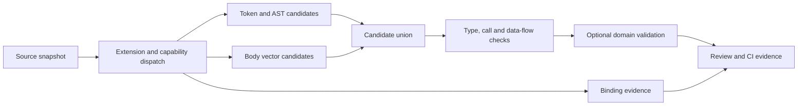

# Graph similarity: parity assessment and implementation direction

**Assessment date:** 2026-11-01. **Implementation assessed:**
`feature/codegraph-deduplication`, rebased onto `develop` (recorded checkpoint `61d25a056`).
The publication candidate and independent review are recorded below; the PR owns
subsequent CI and merge status. **Comparator:** installed jscpd **5.4.2**.
The [earlier audit](code-similarity-audit-2026-11-01.md) records the ProximaDB
measurements and their scope; this document owns the current capability assessment
and proposed next increments.

## Finding

Victor is **below overall jscpd product parity** as a clone detector. Its strongest
current additions are compiler symbol context, explicit evidence/coverage reporting
a separate JNI/FFI relationship view, body-source vectors and independent source channels. The exact Jaccard join reaches algorithmic
parity for a particular normalized representation; it does not establish parity
of extraction coverage, normalization quality, precision, recall or workflow.

`graph similar` now offers indexed **symbol-summary** vectors, normalized source
syntax, optional portable operations, **function-body** vectors and an optional
pinned jscpd token-fragment backend. `--mode hybrid` retains those source
channels independently. It does **not** compare the stored
CFG, CDG or DDG topology. The graph's existence is an opportunity, not evidence
that the current command performs program-graph equivalence detection.

## Below, at and above parity

| Capability | Position of the local Victor implementation | Evidence / qualification |
| --- | --- | --- |
| Type-1 copies and partial token blocks | **Available through pinned backend** | `--mode tokens` delegates to an explicitly installed jscpd 5.4.2, on bounded snapshots with isolated configuration. A partial-block regression passes. This is reuse of jscpd, not an independent Victor token algorithm; structural `exact` still means normalized whole-body equality. |
| Consistent renaming | **Partial parity** | Rust closure/match-arm renames now reach normalized exact 1.0, matching jscpd on those probes. Captures, nested shadowing, Python compiler scopes and common JS scopes have positive/negative tests. Other frontends retain partial binding support. |
| Type-3 function structure | **Parity in join mechanics; below in breadth** | Both can use subtree fingerprints and an exact Jaccard threshold join. Normalization, unit selection and score calibration differ. Victor's default shingle/LSH mode is a separate approximate candidate search. |
| Supported languages and embedded code | **Below** | Kotlin now reaches normalized exact 1.0; source routing uses the shared extension map with optional SCIP enrichment. C#, Scala, PHP, Swift, Lua and Bash frontends are enabled. Vue/Svelte/Astro scripts, Astro frontmatter and explicitly selected Markdown fences now have host-line mapping and conservative coverage. Template expressions and other embedded formats remain outside scope. |
| Recovery from partially invalid files | **Below in recall; stronger explicit coverage status** | Both tools now retain the valid Rust pair. Victor marks recovered members and keeps incomplete coverage/nonzero status; malformed functions and partial-file SCIP/FFI evidence are rejected. Python now recovers clean fragments through its optional grammar, preserving partial status and excluding unresolved nonlocal context. |
| Semantic body similarity / ports | **Body capability implemented; quality unmeasured** | `--mode body` uses complete function-source token windows, an immutable local model profile, separate cache and same/cross-language edge filtering. A real local BGE run covers all 234 eligible bodies in the retained subset. The default is a general text baseline with uncalibrated code accuracy. No jscpd semantic model was run; there is no precision/recall winner claim. |
| Portable operation matching | **Experimental additional evidence** | Common translated examples work. The staged implementation increases complete portable projections from 3 to 167 of 234 eligible bodies; 67 still reject unsupported constructs, principally macros. It cannot establish general polyglot parity. Comparing it only with jscpd's same-language AST pass would exclude jscpd's relevant semantic capability. |
| Compiler identity context | **Above for this specific evidence** | Same-spelling `store.get` calls to different SCIP targets split Victor's normalized exact tier. jscpd's lexical AST pair scores 1.0. Victor still offers a template candidate; that candidate is not an equivalence claim. |
| Native binding context | **Above for this specific evidence** | Victor exposes JNI declaration/export links and fresh indexed FFI references separately from clones. Automatic N-API, dynamic JNI registration and ABI verification are absent. |
| Families and explanation | **Partial parity / different presentation** | Victor explicitly returns component members and link-score metadata. jscpd also groups internally and can expose candidate relationships through EDN. “jscpd is pairwise only” is not a sound advantage claim. Components do not imply all-pairs equivalence. |
| CI and developer workflow | **Below** | jscpd exposes baselines, changed-code/new-clone gates and multiple report formats including SARIF. Victor's analysis JSON and nonzero incomplete-coverage status are useful but do not provide that workflow. |
| Scalability and incremental work | **Not established under matched conditions** | Victor rescans syntax; body-input/profile caching avoids repeated model inference. Exact vector joins remain quadratic despite bounded score tiles and function/neighbor budgets. Earlier Rust timings used different scopes, filters and SCIP work; they cannot establish a speed ratio. |

jscpd's current [documented detector/reporting interfaces](https://github.com/kucherenko/jscpd/blob/master/docs/rust.md)
and [CLI overview](https://github.com/kucherenko/jscpd) agree with the installed
binary's help. Its semantic feature remains experimental. Its thresholds are
model-specific and cannot be transferred to Victor's BGE summary vectors.

## Experiments executed

The retained experiment artifacts are [the pre-hardening probes](evidence/code-similarity-parity-before-2026-11-01.json)
and [the parameter/snapshot checkpoint](evidence/code-similarity-parity-2026-11-01.json).
The [earlier frontend/binding checkpoint](evidence/code-similarity-frontends-2026-11-01.json)
reruns the same 21 inputs after the binding increment. The [pre-review channel checkpoint](evidence/code-similarity-channels-2026-11-01.json)
adds region extraction and v2 lowering on those inputs; Markdown now explicitly
sets `include_docs`. [Current channel observations](evidence/code-similarity-channel-observations-2026-11-01.json)
retain real local model execution, cache reuse and native source manifests.
They are **controlled capability probes, not a statistical accuracy benchmark**.
The current artifact records implementation hashes, corpus hashes, invocation
settings, EDN candidate scores and source locations. No semantic model was
downloaded, no code was sent to an external model, and no user repository was
reindexed or modified.

For AST probes, both tools examine the same generated source files. jscpd uses
`--min-tokens 1 --min-lines 0 --min-nodes 5 --similarity 0.3 --kind ast`;
Victor uses minimum 5 tokens and subtree threshold 0.3. The zero line-span minimum
allows one-line functions, whose end-minus-start span is zero. The separate token
probe uses weak mode, 20 tokens and one line. EDN matters: jscpd can suppress an
AST report already covered by token matches while retaining its AST candidate.
The numeric score scales and node counts are **not interchangeable**.

| Probe | Observation | Consequence |
| --- | --- | --- |
| Python copy / consistent rename | Both normalized AST paths match at 1.0 | Basic positive control, not proof of production precision |
| Parameter reversal, Python and Rust | Before this pass Victor incorrectly returned normalized `exact`; after correction it returns near scores 0.9200 / 0.9259. jscpd scores 0.9444 / 0.9512 | Parameter positions must anchor names; related syntax still does not imply equal behavior |
| Different literal bounds | Both normalized AST paths can score 1.0 | Typed-literal normalization deliberately removes behavior-relevant information |
| Changed operators | Victor 0.7143, jscpd 0.7949 | Thresholds need calibration for their representations; neither score is a probability |
| Changed callees | Victor distinguishes exact identity and offers a template; both raw AST similarities fall | Keep abstraction opportunities separate from equivalent implementations |
| Partial copied block | jscpd token pass finds a fragment; whole-function AST scores are about 0.34 / 0.32 | A complete copy detector needs a token/block channel |
| Rust closure / match-arm rename | Before lexical binding recovery Victor scored about 0.52 / 0.38; both tools now match at 1.0 | Reuse a proper binding environment instead of treating unrecognized binders as globals |
| Kotlin / Vue / Markdown Rust | Both tools now reach normalized AST 1.0 for all three; Markdown is an explicit Victor opt-in | Syntax/region routing is independent of SCIP; virtual compiler coordinates remain unverified |
| Valid Rust function plus broken function | Both now report the valid pair at 1.0; Victor retains partial coverage and recovered-member provenance | Recover valid, error-free units while retaining partial-file provenance |
| Same file copies | Victor default omits them; its explicit same-file option finds them | This is an option/scope difference, not an algorithmic failure |
| Different SCIP receiver targets | jscpd AST 1.0; Victor exact tier splits and template remains | Compiler context adds a useful distinction; a template is not a safe extraction |
| JNI with deliberately incompatible declared return/argument types | A static name link still exists | Binding identity and ABI compatibility are separate; links now state `abi_verified: false` |
| Concurrent index update between FFI hash and edge reads | Before the fix, old hashes could accompany a new target; after it, both reads retain the original snapshot | Freshness must include a consistent index generation |

### Executed semantic counterexamples

Two functions with the same name, signature and documentation but bodies
`return x+1` and `return x-1` receive **the same summary input**. A deterministic
encoder cannot distinguish bodies it is never given. This establishes an input
contract limitation without needing to benchmark or download another model.

The portable Python/JavaScript pair for `(x+1)*2` scores **1.0**, but actual
execution at `x=9007199254740992` gives:

| Runtime | Observed result |
| --- | --- |
| Python integers | 18014398509481986 |
| JavaScript Number | 18014398509481984 |

This was executed with the installed Node runtime. Equal operation shapes lack
numeric-domain and overflow/precision contracts. Similar future controls should
include integer division, NaN, signed zero, encoding, error behavior, aliasing and
side effects. A JNI name link likewise does not verify native calling convention,
return type, parameter types, lifetime or ownership.

### Real-code coverage

The retained 40-file accelerator subset now has **167 complete portable
projections / 234 eligible bodies**, versus 3 at the earlier checkpoint. The
measured stages were 17, 89 and 167. Final `portable-operations-v2` syntax/portable
analysis took **0.819 s wall / 0.694 s CPU / 64,503,808 bytes peak process RSS**.
The 67 rejected bodies remain visible by first unsupported reason; 53 first hit
macros. The remaining cases include nested function items, unsupported numeric
suffixes/patterns, interpolation/attributes and advanced type/assembly constructs.
These counts describe representation coverage, not precision, recall or safe
consolidation. Adding one construct can expose the next blocker.

The independent body channel captured **234/234 bodies**, with **233 unique
inputs and 274 source windows**. The final cached local BGE run took **33.639 s
wall / 43.770 s CPU / 1,052,114,944 bytes peak process RSS** cold. Reusing the
same input/profile cache took **0.532 s wall / 0.469 s CPU / 64,684,032 bytes RSS**,
with 233 cache hits, zero inferred windows and no model loading. Both produced
15 body-similarity families at cosine 0.9; these families are unreviewed candidates.

These are single local ARM64 observations with concurrent tests, no SCIP artifacts
in the copied corpus, and no full-project or cross-platform speed claim. The
[retained evidence](evidence/code-similarity-channel-observations-2026-11-01.json)
contains all 40 source hashes, profiles, dependency versions, token windows,
engine hashes and controlled hybrid sources. Code hashes were sampled before
execution and verified unchanged afterward. The installed codegraph distribution
metadata reports 0.8.1 while imports resolve to this worktree's source package;
these are source-checkout observations, not wheel-installation acceptance.

The controlled `x+1`/`x-1` body negative has distinct input hashes but still shares
a BGE component. Adding body input fixes omitted-body evidence; it does not make
a general embedding model a verified behavior classifier. Code-trained models,
held-out calibration and hard negatives remain necessary. The original portable
numeric-domain counterexample also remains valid. No models were downloaded and
no project code was sent to an external service or executed.

## Recommended design

The proposed flow keeps retrieval channels independent and bindings distinct:



The source-channel union is implemented. Program-graph comparison, domain validation
and general semantic equivalence remain proposed work.

### 1. Make evidence and intent the public contract

Return distinct relations for literal/renamed copies, parameterized patterns,
semantic candidates, alternative backends, bindings and validated behavior.
Each result carries source spans/hashes, frontend and normalization versions,
model/input contract, compiler generation, coverage, score basis and unverified
contracts. Preserve caller-visible distinctions between syntax, summary vectors,
body vectors, graph features and executed validation.

Keep the existing summary mode compatible while naming its evidence accurately.
Add a separate body-embedding contract/store profile; do not silently reinterpret
`symbol-summary-v1` or overwrite those vectors. Similarity relationships belong
in analysis results or a separate derived store, not in the compiler's `CALLS`
graph. Source candidates never enter graph-row deduplication automatically.

### 2. Use capability-driven extension dispatch

Use a shared entry for each extension with optional syntax frontend, embedded
region extractor, SCIP provider, portable lowering capabilities and binding
adapter. A missing SCIP provider should not disable a valid syntax frontend.
Report unsupported formats, ignored regions, syntax errors, rejected units,
truncated model inputs and unavailable evidence separately.

Reuse `victor-codegraph` language/binding infrastructure rather than adding another
set of grammar and scope rules. Parameter fixes are only the first part: closures,
match patterns, shadowing, captures and destructuring need lexical scope or
compiler-local identities. Preserve source-coordinate mapping for embedded code.
Any new shared public contract needs the repository's applicable design/release
review rather than becoming an unversioned runtime dependency.

### 3. Retrieve candidates through complementary channels

Combine token fragments, normalized AST, body-code embeddings and optional
context/graph candidates. A pair can enter through **any** channel; requiring AST
similarity before semantic retrieval would miss the structurally different ports
that semantic detection is intended to find.

Use the existing vector infrastructure for bounded top-k/ANN retrieval, then
rerank a smaller union using body evidence, resolved callees, types/effects and
context. Measure ANN recall against an exact small-corpus oracle. Use function
windows for long bodies and expose truncation. Calibrate per model, language
pair, size and intended relation. Compare mutual-neighbor/background calibration
with fixed cosine thresholds; do not transplant jscpd's numbers.

For Type-1/2/fragment parity, evaluate an optional **pinned jscpd evidence backend**
before building another token engine. Keep it a versioned local tool contract with
explicit installation, scope and partial-failure reporting. A new mandatory native
build dependency is not justified by this comparison.

### 4. Make graph context earn its cost

The current command does not consume CFG/CDG/DDG structure. Before adding graph
kernels, validate those structures and their backend provenance. In particular,
the built-in CCG helper called `_find_dominated_nodes` currently computes simple
reachability; it is not a sufficient control-dependence/postdominator oracle.
Native/plugin graph shapes also differ, as recorded in the native strategy.

Start with an ablation of resolved call targets and def/use features. Then test
bounded graph fingerprints or typed operation/data-flow neighborhoods. Preserve
order, control predicates, memory effects and unknown calls. Cross-language
intrinsic aliases require type/domain guards: equal method spellings are not
shared identities. Compare ranking gain against end-to-end cost before retaining
the graph feature or considering a native implementation.

### 5. Treat native bindings as contracts

Add explicit adapters for PyO3, N-API, JNI registration, C ABI and generated IDL
where evidence exists. Resolve module/export aliases and library identity as well
as names. Check overloads, calling convention, implicit JNI arguments, declared
native types, ownership/lifetimes and exception translation; keep unknowns visible.
Use generated declarations/build metadata where possible. A runtime library that
is not resolved remains unverified.

Wrappers and implementations are related roles, not duplicated bodies. Python
reference and Rust accelerator implementations often intentionally coexist.
The useful action may be sharing contract/differential tests, not deleting either
backend or routing every call through FFI.

### 6. Cache and group with explicit semantics

Cache per-function features using source hash, parser/lowering version, compiler
manifest and evidence profile. Update changed files and affected resolved
dependencies, with atomic generation publication and durable vector refresh state.
Keep file moves, graph rebuilds, model upgrades and source mutations in the test
matrix. Source mtime/range plausibility alone is not a compiler freshness proof.

Connected components are useful for discovery but can join A~B and B~C where A is
unlike C. Offer a deterministic representative/cohesion view and explicit weak
links; do not label the best edge as whole-family similarity. A CI ratchet should
track stable new source-copy evidence, not just family count: a bridge can merge
two families and reduce the count while increasing duplication.

## Next experiments and acceptance gates

| Priority | Experiment / implementation increment | Evidence needed before general availability |
| --- | --- | --- |
| P0 | Maintain the probe harness and relation/coverage schema; audit normalization and snapshots | Positive and negative controls per supported frontend; no false clean result when no supported input was analyzed; explicit unverified ABI/equivalence |
| P1 | Extend binding and embedded-format coverage; script/fence recovery increment implemented locally | Rust closure/match renames and language/region fixtures reach their intended tier; source locations stay exact; malformed portions remain reported |
| P1 | Continue portable lowering beyond the implemented 167/234 coverage | Per-language real-code coverage and subsequent blockers after each stage; no dropped effects; hand-labeled positives and hard negatives, not only translated arithmetic |
| P1 | Calibrate implemented body-vector/token channels on held-out projects | Reproducible source manifests, pinned profiles, project-held-out labels, precision/recall and review precision@k; report code/model inference separately |
| P2 | Graph/context ablation and typed binding adapters | Gain over syntax/body-only baselines; correct graph semantics; aliases and ABI/lifetime/error counterexamples; unresolved cases remain unresolved |
| P2 | Incremental feature cache and bounded retrieval | Unchanged-file reuse, correct dependency invalidation, same answers as cold rebuilds, concurrent publication tests, measured cold/warm CPU/RSS/latency |
| P2 | Baseline/SARIF/changed-file workflow and family cohesion | Stable versioned fingerprints under moves/line shifts; new-copy gates survive component merges; machine-readable partial/error status |

Build a representative review set from ProximaDB and Victor plus labeled public
tasks. [BigCloneBench/BigCloneEval](https://github.com/clonebench/BigCloneBench)
provides clone-recall infrastructure; [CodeXGLUE clone tasks](https://github.com/microsoft/CodeXGLUE/blob/main/Code-Code/Clone-detection-BigCloneBench/README.md)
provide a pair-classification evaluation reference. They do not by themselves
validate Rust/TypeScript ports or FFI contracts. Include real aliases, intentional
backends, test doubles, generated code and negatives with identical names.
Hold out repositories/families to avoid copy leakage into calibration.

Mutation/injection testing and indexed candidate filtering are useful lessons
from [SourcererCC](https://arxiv.org/abs/1512.06448). Apply those as measured
experiments, not as inherited accuracy claims. Track pair retrieval, relation
classification, family coherence, frontend coverage and behavioral validation as
separate outcomes. Measure p50/p95 cold/warm latency, CPU, peak RSS and failure
behavior on the same input manifest and comparable enabled features.

## Earlier continuation: lexical binding and frontend recovery

At the pre-review checkpoint, implemented locally on the same branch:

- Syntax dispatch shares `victor-codegraph`'s extension map; a missing SCIP
  provider no longer disables a grammar. Optional dependency absence preserves
  the base installation's Python analysis and previous source inventory.
- Added offline Kotlin, Scala, C#, PHP, Swift, Lua and Bash grammar entry points.
  Renamed-parameter/local fixtures exercise the first six; Bash has copy and
  interpolation controls. Expression bodies and full binding semantics for
  these frontends are not claimed. Swift's installed grammar can treat an
  unspaced expression as an opaque identifier; lexical fallback remains
  conservative, and the rename fixture uses spaced operators.
- Python uses stdlib compiler symbol tables with closure/nonlocal classification
  and a separate lexical overlay for PEP 709 inlined comprehensions. Unknown
  compiler scope forms and ambiguous same-line lambdas produce
  `binding_error_files` and incomplete coverage rather than guessed identities.
  Free captures whose declarations are outside an analyzed unit retain their
  names/compiler identities, since that unit has no declaration anchor for them.
  Nested declarations and import targets now preserve call-target distinctions.
- Rust closure/match bindings, nested block shadowing and initializer ordering;
  common JavaScript closure/catch scopes and function-level `var` hoisting;
  grouped Go parameters/short declarations and repeated Ruby assignments have
  explicit regression controls. `binding_support` distinguishes compiler-backed
  Python from lexical/declaration subsets. This is not a full compiler resolver.
- Error-free tree-sitter callables survive malformed sibling code. Recovered
  members carry provenance, the file keeps its error status, and compiler/binding
  evidence from the partial file is disabled. Python still requires valid files.
- String interpolation preserves variable uses; it is not reduced to a constant
  string that would hide changed parameter/capture roles.

That checkpoint's embedded-region next step is implemented in the source-channel increment below. Continue portable
lowering only after measuring each stage against the retained 234-body corpus;
body vectors, token fragments, ABI validation and CI ratchets remain separate work.

## Changes made during the earlier assessment

- Fixed ordinary Python/tree-sitter parameter anchoring and grouped Go parameter
  discovery. Both exact hashes and subtree fingerprints now retain parameter
  positions/binding counts; the normalization schema is versioned in the report.
- Added source-file count and coverage scope. Empty supported scopes now return
  incomplete coverage and a nonzero CLI exit rather than a clean result.
- Added `abi_verified: false` to binding evidence.
- Pinned FFI hash/edge reads to one SQLite read transaction. A WAL writer regression
  test demonstrates the old mixed-generation result and the corrected snapshot.
- Added a reproducible local-only capability harness and retained raw before/after
  evidence. These are diagnostics, not a semantic-model leaderboard.

Continuation uses the same feature worktree. Independent review and publication
gates remain pending. The reproducible probe command, with a protobuf-capable
development environment activated, is:

```bash
export PYTHONPATH="$PWD:$PWD/victor-codegraph"
python scripts/audit_graph_similarity_parity.py \
  --jscpd /path/to/pinned/jscpd \
  --output /tmp/code-similarity-parity.json
```

Earlier checkpoint validation: **221 focused tests passed** after all hardening, Black /
Ruff / whitespace checks passed, MyPy passed **17** changed production/diagnostic
files, and **37,514 tests collected**. The wider affected/architecture run passed
**1,257 tests**, with 43 skips and one unchanged Mermaid browser integration test
deselected for the cache-isolation reason recorded in the earlier audit. That run
preceded the last snapshot hardening; the final focused gate includes its WAL
writer regression. This is not execution of the entire repository test suite.
Current probe implementation hashes were checked against the final code.


## Continuation validation and handoff

Final focused gate: **229 passed** in the protobuf-capable Python 3.12 environment.
The wider affected/architecture gate passed **1,170 tests**, with 40 skips and one
explicitly deselected unchanged `test_render_with_mmdc_produces_svg` browser test.
An initial run hit that known browser/cache failure; it was not a source-analysis
failure and no browser or production visualization code was changed. The wider
run preceded the final outside-unit capture and ambiguous-scope controls; the
229-test focused run includes both final changes.

Black and Ruff pass all **31** changed Python files; MyPy passes all **18** changed
production/diagnostic files; **37,552 tests collect**. This is not a full-suite
execution. The 21 retained probes record grammar/dependency versions and final
implementation hashes. The 40-file observation retains source hashes so it can
be reconstructed from matching branch sources, without relying on temporary
files. No native acceleration, model download, user-project reindex or graph-row
mutation occurred during this increment.

At that checkpoint all work remained local and uncommitted on `feature/codegraph-deduplication`, based
on `095e981bf`, in `.worktrees/codegraph-deduplication`. Independent adversarial
review, commit/publication and CI remain pending; local checks do not establish
merge or release. The earlier next task was embedded regions; the executable diagnostic entry points remain
`scripts/audit_graph_similarity_parity.py` and `scripts/benchmark_graph_similarity.py`.


## Current source-channel implementation and handoff

Implemented locally in the existing feature worktree:

- Vue/Svelte/Astro scripts, Astro frontmatter (including CRLF) and opt-in CommonMark
  fences preserve host lines and region kinds. External/unknown/malformed script
  regions, ambiguous attributes, selection limits and empty filtered scopes remain
  incomplete. Documentation/virtual regions cannot supply runtime JNI facts or
  inherit unverified host SCIP offsets.
- Valid Python sibling functions survive malformed files through clean fragment
  recovery. Missing enclosing nonlocal context stays rejected. Qualified C++
  out-of-class methods and Python exception binders have additional regressions.
- Portable v2 covers lexical captures, match/conditional patterns, contexts,
  containers, casts, borrows, error propagation, field order, ranges and tuple
  discard positions. Value-producing and discarded Rust conditional expressions
  remain distinct. Unknown constructs never become silently empty operations.
- Body vectors use `function-source-token-windows-v1`, a pinned local model,
  verified source-offset windows, explicit pooling and separate checksummed
  input/profile cache entries. Complete declaration/body text is captured;
  preceding decorators, enclosing module context and macro expansion are outside
  this input contract. Zero/invalid inference and corrupt cache entries fail;
  failed batches cannot publish partial inputs. Cache revisions remain isolated.
- Token mode reuses local jscpd 5.4.2 on bounded scratch snapshots. It ignores
  project configuration and validates report paths/spans/kinds/counts. Runtime,
  input, report and process limits are explicit; restricted OS environments expose
  direct-process rather than full-descendant RSS monitoring. No npx/install path
  is invoked. Same-file and identifier-pattern options are explicit.
- Hybrid mode runs source channels independently, reports per-channel failures,
  checks added/removed/modified file manifests and never expands components into
  unsupported pairwise claims. AST pair-budget exhaustion leaves other channels
  available. Body-only collection avoids unused SCIP and subtree work.

Operational commands and profile/cache/budget details are in the
[scanner documentation](structural-clone-detection.md). Current diagnostic entry
points are `scripts/audit_graph_similarity_parity.py`,
`scripts/benchmark_graph_similarity.py` and
`scripts/benchmark_graph_similarity_channels.py`.

Remaining acceptance work is code-model calibration, unsupported macro/type/effect
lowering, representative whole-project/ANN scaling, typed native-binding/ABI
validation, graph-context ablation and baseline/SARIF/changed-code workflows.
The optional token backend does not make those Victor workflows implemented.
The default model is intentionally marked uncalibrated. No result certifies
functional equivalence, safe extraction or safe backend deletion.

Final local checks: **302 focused tests passed** in the protobuf-capable
Python 3.12.6 environment; **1,245 wider affected/architecture tests passed** with
40 skips and one unchanged browser test explicitly deselected in Python 3.12.16.
**37,625 tests collect**. This is not execution of the entire test suite. The
standalone system Python 3.14 probe could not import the application because
`cachetools` is absent; no Python 3.14, other-OS or wheel-install acceptance is
claimed. Black and Ruff pass all **41** changed Python files; MyPy passes
all **23** changed production/diagnostic files. Final engine hashes match both
retained channel artifacts. No new native toolchain, model download, project reindex or graph-row
mutation occurred.

At this pre-review checkpoint, changes were **uncommitted and unpublished**, based on `095e981bf` in
`.worktrees/codegraph-deduplication`. Independent review and publication/CI/release
gates were pending at that checkpoint. Local source acceptance must not be reported as merged or
released. Next executable research increment: build the held-out review set and
run fixed-model pair/port precision and hard-negative calibration; retain the
current bounded exact implementation as its oracle before evaluating ANN.


## Publication candidate and adversarial review

The implementation was committed, then reconciled onto `origin/develop`
`b3f09333aef5524a38a55fd9aee6f33973b82fa8`. The TUI conflict preserves the incoming
compact code renderer and adds responsive tables through its isolated registry.
A later fetch/rebase incorporates `61d25a056366f94eeff96f4a0cefe946ca1d9a88`;
the additional upstream changes affect only the agent-service tracker. Later
documentation-only rebases and the final publication base are recorded in the PR.
The earlier uncommitted/095e981bf sections are historical measurement checkpoints.

Independent review of candidate `23f7c3a0b7b16e5f7ebf761134c891eca1dda135` was clean
for graph-row repair/storage, and initially found eight source-channel/normalization issues. A rereview found
two further acquisition/monitoring issues.
The [review disposition](codegraph-deduplication-review-2026-11-01.md) records each
finding and its regression. The revised Python normalization is
`normalized-body-v4-field-roles`; [reviewed probes](evidence/code-similarity-reviewed-2026-11-01.json)
record current engine hashes and recalculated scores. Previous artifacts retain
their original version/hash attribution and must not be called final-code checks.

Publication remains gated on a clean independent rereview of the exact final
commit, its local commit-bound attestation, and green required CI. The PR records
that commit, CI results and merge state; this dated checkpoint is not release
acceptance. Source scanning now explicitly requires secure descriptor-relative
opens; unsupported platforms fail incomplete instead of following a weak path
fallback. Full Windows source support requires a separately validated adapter.
