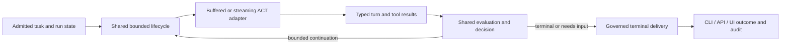

# Victor shared agent-service implementation plan and tracker

**Canonical task-status ledger.** Browser UI, VS Code and external API consumers
will converge on one Victor service and contract family. The user authorized this
plan after the [API audit](../development/victor-agent-service-audit.md).
[FEP-0039](https://github.com/anvai-labs/victor/blob/develop/feps/fep-0039-unified-agent-service-api.md)
owns the proposed architecture and is in Review, not Accepted. This file owns execution status;
the [formation ledger](multiagent-formation-coverage-handoff.md) owns historical
formation results and G-numbered gaps. Do not duplicate status in another roadmap.

This is a dated checkpoint. On every resume, reconcile its rows with GitHub PR
state and fetched source before choosing work. Completed historical work stays
completed unless new evidence invalidates it. A missing `/tmp` directory is not
permission to redo a merged task.

## Outcome and constraints

A user can start a permitted single-agent, team or workflow run from web or VS Code,
observe the same recorded progress, approve the exact action, disconnect/restart,
and recover the true outcome through the same API. Unknown writes are reconciled
before continuation; stop controls distinguish requested from completed cancellation.

- Victor owns reusable OSS building blocks; AnvaiOps owns commercial product
  integration, managed operations, billing/entitlements and packaging. Keep OSS
  auth/security, authoring components and standalone use independent of AnvaiOps.
- One canonical server composition root, service/dispatch owner and identifier
  derivation; structured contracts and explicit errors. Preserve unchanged legacy
  defaults through opt-in/versioned surfaces and adapters.
- Reuse typed web session storage, existing wire events, framework client/services,
  paused-run/action journal and team/member owners. Preserve existing auth repairs.
- Required Sandhi Python binding, optional separately deployed proxy. The embedded
  library connects directly to InferFlux, ZAI and OpenAI/Codex subscription routes;
  the network gateway is a separately selected deployment mode, not a prerequisite.
  No failure-driven bypass, second transport or credential transfer. InferFlux
  owns inference/GPU placement; account/model entitlement is qualified separately.
- TDD in existing test owners; remove duplicate tests only with invariant/coverage
  evidence. Smoke tests use a real server/packaged client, not only mocks.
- Linked worktrees from `origin/develop`, conventional prefixes, no force-push.
  Squash feature PRs only after independent review and every applicable CI gate,
  including Vertical Py3.12. Main promotion/release is a separate gated milestone.

## Status semantics

| State | Meaning / required evidence |
| --- | --- |
| TODO | No implementation/evidence accepted yet |
| ACTIVE | Named owner, branch, baseline SHA and exact next action recorded |
| RED | Relevant regression demonstrably fails for the intended reason; expected failed evidence retained |
| LOCAL_PASS | Final local diff passes cited tests/smokes; independent review/CI/merge may remain |
| MERGED | Exact PR, merge SHA and applicable green checks verified; not release/runtime acceptance |
| ACCEPTED | All row-specific acceptance gates passed, including release/live gates when required |
| BLOCKED | Concrete external prerequisite, owner, evidence and unblock condition recorded |
| SUPERSEDED | Replacement ID/PR and preserved invariant identified; never use for an unexplained omission |

Mark ✅ only for MERGED/ACCEPTED implementation rows or completed evidence-only
rows. Preserve the distinction between source, release and live acceptance. A
failed/timeout/interrupted run never becomes passed through a later documentation
edit. A mock test is not live provider or C5 evidence.

## Current checkpoint

- **UX-01 self-audit failure recovery — MERGED, [#1347](https://github.com/anvai-labs/victor/pull/1347)** — owner: Victor co-design session;
  branch `fix/self-audit-ux-recovery`, baseline `0839c34d3c17c43c1828b48555d8e25fca85b8e0`.
  The user's 2026-10-13 21:36–21:40 `homelab-openai-subscription` run failed its
  first inventory step with a retryable OpenAI transport 502 (`cec7bdad`). Its
  required dependent nevertheless ran because `planning_runtime` removed failed
  edges using description/type heuristics. The log records 21 compactions and
  21 failed compaction-audit inserts (SQLite foreign-key violations); the startup
  embedding spinner remained visible during execution. Sanitized evidence is
  preserved locally in `var/codegraph-victor-20261012/ux-self-audit-incident.json`.
  Merged repair: preserve required dependency edges and block dependents;
  retain independent branches and blocked status through evidence validation;
  register the member session before identity publication; persist sessions before
  publishing them in the store cache; compact actual provider history through a
  typed history port; preserve genuine user intent and complete/pending tool-call
  batches in simple and scored compaction; stop startup status before execution.
  Normal console errors retain the error/request ID, with full tracebacks in file
  logs and debug mode. Existing test owners cover these contracts; unsafe heuristic
  expectations were replaced rather than retained alongside conflicting tests.
  Broad validation: 2,654 pass, seven skip, one sandbox keychain permission failure;
  that exact test passes outside the sandbox. The final controller/lifecycle matrix
  passes 61 cases. Independent review passed 88 cases and both original retention
  reproducers; its pending-call fixture correction is applied and passes.
  Final selected validation passes 894 tests (seven skips). A redundant mock-only
  session failure test was then folded into the stronger SQLite test: nine final
  session tests pass, with identical executed lines in SessionRuntime (51) and
  store_session (80). MyPy passes 2,003 files; 34,963 tests collect. Black/Ruff,
  repository hygiene, documentation drift and diff checks pass. CI selection now
  maps the extracted controller/store and CLI logging owner to their existing suites.
  The gateway journal did not explain the original upstream 502; its root cause
  remains unverified. A new bounded CLI read smoke passed on the selected profile;
  this is not a replay of the failed eight-step audit or C5 acceptance.
  Prompt wording about “plan mode” is not evidence that CLI `--mode plan` was set;
  preserve configured approval policy while clarifying preview versus execution.
  Source `dda1d9a619a9e7828500baae56c5f8354b7a599f` passed independent review;
  merge `b27a4e6a4fd068c0531105e090a54e800743aef4` is on develop. All applicable
  CI gates passed (40 successful checks, two intentional skips and one neutral
  historical Trivy comparison); the current blocking security checks passed.
  The merged worktree was archived locally and removed. Next: qualify the full
  audit and browser recovery without whole-member replay.

- **UX-02 real web-chat qualification — ACTIVE** — owner: Victor co-design session;
  branch `fix/web-chat-controls`, baseline `b27a4e6a4fd068c0531105e090a54e800743aef4`. `victor ui` launches the existing
  Chainlit web chat using `VictorClient`; `victor serve` is the HTTP API, and its
  `--mode` selects agent behavior rather than a browser frontend. The workflow
  visualizer remains distinct from both chat and the planned authoring editor.
  Launched loopback `http://127.0.0.1:8767` with
  `--profile homelab-openai-subscription`, using `gpt-6-sol` through the configured
  Sandhi endpoint. AgentBrowser 1.17.0 ran headed on a separate explicitly approved
  loopback-enabled instance; the original browser service was preserved.
  New actual UI evidence: `read(pyproject.toml)` returned the correct project name
  and Python floor with lines 20/28; a second `read(CLAUDE.md)` produced a grounded
  architecture explanation. No source files were modified by either agent task.
  Runtime session: `39df2e77-2890-40d7-9e3b-338b49bf6fa0`.
  UI repairs merged in [#1348](https://github.com/anvai-labs/victor/pull/1348),
  `51bd89eb89541667679c6c6d1c3869af17325678`: display the launch profile with Chainlit's actual
  `initial_value` contract; keep provider/model overrides explicit; confirming
  unchanged settings preserves the client/history. Changed settings validate the
  configuration, stop the active turn and close the prior client before publication;
  they explicitly start a new conversation. Constructor validation is not provider
  readiness; a failed close preserves stored identity, not restored availability.
  One session lock serializes replacement, resume, close and turn admission. A
  disconnect latch rejects queued work before lock acquisition. Use Chainlit's
  native Stop, remove the disabled duplicate action and close the UI-owned client
  iterator in its task, including cancellation during rendering. Register one
  approval handler for startup and replacement; include canonical `write`/`edit`
  names in the existing ASK policy. Existing control/settings tests own coverage;
  regressions cover queue ordering, malformed approval input and close failure.
  Validation: 413 affected UI/rendering/client/config tests passed; MyPy passes
  2,003 files and 34,980 tests collect. Black/Ruff, hygiene and docs drift pass. Independent
  adversarial review passed the final 25 control/settings cases with no scoped
  blockers. Installed headed UI shows the launch profile and inherited overrides;
  a real read returned the correct project name/Python floor with line references.
  The exact user-requested browser audit **failed**, not accepted: plan
  `plan_96101cca`, root session `session_fd0e0a21ef7c`, 699.9 seconds,
  one of seven steps completed. Step 2 failed after upstream 502s
  (`10d62958`, `bfaa984e`); steps 3–7 were correctly blocked. A subsequent
  summary call failed with 400 (`bc52b0c7`), obscuring the recorded plan status.
  No foreign-key compaction errors appeared in this new run. Plan progress reached
  the server console while the browser stayed at “Thinking…”. Repeated inspected
  repository-read shell approvals interrupted execution and their displayed command
  disappeared after selection. Preserve the failed run, plan and artifacts under
  `var/codegraph-victor-20261012/ux-full-audit-*`; these are new evidence, not a
  successful reproduction or C5 acceptance. All applicable #1348 CI gates passed
  (39 success, two intentional skips, one neutral historical comparison).
  Remaining: generic Assistant branding and unnamed icon buttons; explicit mode
  controls; plan/progress event delivery; failed terminal-outcome rendering;
  approval/recovery and usage/request joins. Review reproduced a separate downstream
  iterator ownership gap in `VictorClient.stream`/`message_execution`: closing the
  outer client iterator can clear active-stream accounting before a retained inner
  generator closes. UI-owned iterator closure is not full runtime/provider drain.
  A post-audit continuity probe retained the marker JADE after unchanged settings,
  but repeated it three times and stopped with “3 turns without tool calls”. This
  is a separate no-tool completion defect, not a passing UX smoke. Preserve
  `ux-marker-followup.json` and qualify answer-only completion before acceptance.
  Earlier native Stop evidence showed “Turn stopped”/“Task manually stopped” and
  runtime `success=False`; it proves local cancellation, not origin cancellation.
  Preserve evidence under `var/codegraph-victor-20261012/ux-web-*` and
  `ux-full-audit-*`; do not claim OIDC, workflow authoring, gateway accounting or C5
  from chat turns. Credentials stay server-side. The local UI has no configured
  user authentication and must remain loopback-only for this test.

- **UX-03 effect-aware shell approvals — PLANNED** — requested during the actual
  browser audit. Ordinary verified repository reads should not prompt; the current
  `AskOnToolsPolicy` matches only tool names, so read-only shell inventories repeatedly
  block on ASK. Keep typed read tools friction-free. Reuse one authoritative command
  classifier; a model-provided `readonly` hint is not authorization. The existing
  legacy shell allowlist permits test/build commands and cannot by itself prove a
  harmless read. Preserve DENY precedence, protected-path policy and exact payload
  binding. Add explicit once/session approval choices with visible, revocable,
  expiring grants bound to session, workspace, policy and execution authority;
  invalidate them on configuration/identity changes. Similar-command grants require
  parsed command/argument scope and negative tests for substitutions, redirections,
  interpreters, wrappers and scope changes. Broad all-shell approval is a separate
  deliberate choice, never a default or bypass of policy denial. Qualify across
  actual member requests and simultaneous browser sessions before acceptance.

- **UX-04 authoritative plan outcomes — MERGED, [#1349](https://github.com/anvai-labs/victor/pull/1349)** — owner: Victor co-design;
  branch `fix/planning-stream-outcome`, baseline `51bd89eb89541667679c6c6d1c3869af17325678`.
  Validate the executed plan's boolean verdict before further model dispatch, carry
  it through streamed and buffered responses and finalize task reports once.
  Reject malformed/duplicate explicit verdicts; trailing metadata-free chunks cannot
  upgrade failure. Failed plans return recorded completed/failed/blocked status and
  artifact links without a new summary-provider dependency. The deterministic failed-plan
  branch makes no summary call and leaves summary usage absent; this says nothing
  about member consumption. This repairs shared
  service semantics for all clients; UI plan-progress delivery remains separate.
  Existing chat/planning suites own the regression matrix: 278 affected tests
  passed, 35,018 tests collected, MyPy passed 2,114 source files, and independent adversarial review
  passed after fixing malformed/duplicate verdict finalization and absent usage. All
  applicable CI gates passed; merged as `7ec09531ea1d9bbf5885e4045ddd73617c026c82`.
  No whole-member replay, origin retry or cancellation acceptance is implied.

- **UX-05 shared progress and professional presentation — MERGED (presentation, [#1350](https://github.com/anvai-labs/victor/pull/1350)), PLANNED (progress)** — first expose
  structured per-request/plan/step/member/tool progress and terminal outcomes to CLI,
  TUI and web UI, using common event semantics with snapshot reconciliation. Keep
  turn history grouped and make nested activity independently inspectable; distinguish
  waiting on provider, running tools, awaiting approval, failed and blocked. Do not
  manufacture progress from a spinner or parse console prose. Close the known
  downstream iterator ownership gap before claiming cancellation drain.
  Align Victor's OSS presentation with AnvaiOps' teal/slate token palette, compact
  IDE spacing, readable code typography, accessible focus/contrast, responsive wide
  layouts and dark/light/system preferences. Reference sibling
  `apps/control-plane/src/tokens.css` (fetched origin/develop) without copying
  commercial product behavior.
  Use headed AgentBrowser snapshots for reading, code blocks, tool activity,
  approvals, failures and mobile/wide layouts; preserve server-side credentials.
  Presentation increment: branch `feat/chat-workspace-theme`, baseline
  `7ec09531ea1d9bbf5885e4045ddd73617c026c82`. Packaged CSS/SVG assets and a narrow
  static mount provide Victor branding, teal/slate light/dark palettes, native
  system selection, wider chat, code typography, visible focus and reduced motion.
  Default-valued Chainlit name/layout become Victor/wide; explicit nondefault
  name, CSS, logo and avatar settings remain. No repository assets are overwritten.
  Browser qualification: headed 1440×1000 real repository read produced the correct
  project name/Python floor with line references, a code block and expandable tool
  activity; light/dark switches and profile settings were exercised. A separate
  390×844 headed session checks wrapping/composer fit. The browser exposed and
  fixed default-stylesheet precedence before acceptance. Evidence stays in
  `var/codegraph-victor-20261012/chat-theme-*`. Package assets passed an isolated
  built-wheel install and HTTP/MIME/content smoke. 99 UI/packaging tests passed;
  MyPy passed 2,116 files. Independent review found no scoped blocker. This is
  presentation qualification, not full editor, plan-event or C5 acceptance.
  Presentation merged as `af12c984e2f6de66b41f9b9f0f0d68518cf1cc9b` with all
  applicable CI gates green; the local UI runs that merged baseline.

- **UX-06 unattended policy behavior — PLANNED** — auto mode evaluates the same
  authoritative ALLOW/DENY/ASK policy as interactive use. Verified allowed work
  proceeds; policy denial stops; ASK durably pauses with exact action binding and
  resumes only after authorization. Missing approvers must not imply permission.
  Share scoped grant semantics across CLI/TUI/UI and workflow workers. Extend
  existing policy and approval owners, avoiding a second dispatcher or UI-only
  authorization rules. This depends on UX-03, durable approval storage and the
  accepted public-contract process where applicable.

- **UX-07 answer-only completion — MERGED, [#1351](https://github.com/anvai-labs/victor/pull/1351)** — the post-audit marker
  request was classified `edit`/`action`; its valid four-character answer was retried
  three times before the spin guard failed. The streamed duplicates were already
  visible despite a later “suppressing repeated visible output” log. Logs at
  `chat-controls-live-final.log:1007` onward preserve the sequence. Investigate
  current-turn intent ownership and typed completion through both delivery modes;
  do not simply lower the character threshold or declare every nonempty response
  successful. Negative cases must retain rejection of promises, unfulfilled tool
  actions and blocked/failed execution. Reproduce in the existing classification,
  evaluation and stream owners, then qualify a concise answer following a failed
  plan without whole-member replay.
  Owner: Victor co-design session; branch `fix/answer-only-completion`, baseline
  `af12c984e2f6de66b41f9b9f0f0d68518cf1cc9b`. The immediate cause was lexical:
  the shared direct-response classifier treated “do not use tools” as tool context,
  and a trailing answer-format clause obscured the short question. This is not
  embedding similarity or proof that all task classifiers understand negation.
  Ignore only complete, delimited trailing no-tools/answer-format constraints for
  classification; retain the original provider prompt and all execution-policy
  checks. Standalone exact requests, repository references, requested effects and
  conditional constraints retain their previous behavior. Do not globally strip
  negative words: “do not modify files” permits reads and “do not skip tests” can
  require execution. Unrecognized wording stays on the existing classification path.
  Extend the existing classifier and real-loop owners rather than adding parallel
  heuristic/test modules. Both delivery-mode tests assert one ACT, no tools, one
  answer and successful terminal metadata with the real completion evaluator.
  Local validation: 344 affected tests passed; 35,037 tests collected; MyPy passed
  2,116 source files; Black, Ruff, hygiene and documentation drift checks passed.
  Adversarial review caught and repaired standalone exact-request compatibility;
  negative cases retain conditional negation and repository/action routing. Existing
  effect-gate and failed/blocked tests remain authoritative; no duplicate test owner
  or completion threshold was introduced.
  Headed AgentBrowser, `homelab-openai-subscription` via Sandhi: a new conversation
  remembered JADE and answered the original marker question once in 1.4 seconds,
  one model call, zero tools; runtime reported success. The first browser session
  expired before screenshot archival; its observed result is retained in the live
  log. A fresh final-source browser smoke failed during marker setup with gateway
  transport error `f0e003a4`; readiness probes failed (sandbox DNS timeout;
  escalated connection timeout), without an established network root cause.
  Preserve both outcomes: `var/codegraph-victor-20261012/answer-only-live.log` and
  `answer-only-browser-final.{json,png}`. The user then selected direct Victor +
  in-process Sandhi with local Codex OAuth for acceptance, excluding the external
  gateway hop. Local `codex-local` account/profile explicitly overrides inherited
  gateway configuration with `gateway: null` (no gateway URL environment override)
  and uses `gpt-6-sol`, OAuth source `codex`, endpoint
  `https://chatgpt.com/backend-api/codex`. No token is copied into the profile.
  Runtime assertions verify `SandhiOpenAIProvider`, OAuth, Codex token source and
  absent gateway override before any model call. Buffered two-turn acceptance
  passed ACK then JADE, both successful with zero tools; marker latency 1.855s.
  Evidence: `answer-only-direct-smoke.{py,json,log}`; Sandhi binding 0.13.0.
  Final-source headed Chainlit acceptance also passed on `codex-local`: ACK then
  JADE exactly once, one model call per turn, marker latency 1.9s, zero tools and
  recorded runtime success. Archived `answer-only-direct-browser.{json,png}` and
  `answer-only-direct-live.log`. The explicit account and transport assertions
  qualify the direct route; the failed external route is not relabeled as passing.
  This fresh smoke does not repeat the failed audit or establish post-failed-plan
  lifecycle/C5 acceptance. Broader semantic negation and shared task-classifier
  consolidation remain future work, requiring a representative labeled corpus
  before changing default routing. Independent review and all required CI passed,
  including vertical tests; merge `3a6b078317d863c2fc0ce22416b17f660fbafab8`.
  Shared progress/cancellation ownership remains open before consolidated API
  lifecycle parity can be claimed.

- **UX-09 structured tool intent and truthful usage — ACTIVE** — owner: Victor
  co-design session; active branch `fix/provider-invocation-accounting`, baseline
  `adf3af5546dd7d86dc49974b74d37f5211480a22`. Parser checkpoint merged in
  [#1352](https://github.com/anvai-labs/victor/pull/1352) after independent review
  and all required CI, including vertical tests. The bounded UX-08 review through
  headed Chainlit and direct Codex OAuth failed on published Sandhi 0.13.0 with
  empty tool arguments: 81,031 reported tokens, seven observed model turns, no
  completed review. Sandhi [#368](https://github.com/anvai-labs/sandhi/pull/368)
  preserves arguments sent only in completed Codex events. An isolated wheel from
  `7df5947bcb7bca21d7be6af9d86399f37062a2ea` plus editable Victor passed 182
  transport/OAuth tests and 95 binding tests; the fresh bounded UI review completed
  in 61.5s with 215,082 reported tokens and 13 observed model turns. This is local
  candidate evidence, not a published dependency, C5 or an efficiency improvement.
  Preserve both failed and completed evidence under
  `var/codegraph-victor-20261012/` (`ux08-dogfood-failed-browser.json`,
  `codex-arguments-candidate-{provenance,browser}.json` and candidate live log).

  The completed run exposed two independent Victor defects: Python-call inference
  extracted `get_account(...)` from explanatory prose twice, and the footer reported
  one call for a whole user stream. First checkpoint: the shared OpenAI-compatible
  adapter accepts only provider-structured tool calls, preserving assistant content
  unchanged. Native calls retain validation and policy checks. Dedicated local-model
  text adapters keep their existing protocol; this change introduces no heuristic
  model-name exceptions, parser or setting. Replace the old test requiring OpenAI
  prose execution with the expanded existing adapter matrix and service-boundary
  tests. Next checkpoint: define/count actual runtime model dispatches across
  buffered, streaming, recovery, cancellation and failures separately from physical
  transport retries and user turns; reconcile per-request raw usage/cache totals
  before optimizing prompt size. Do not equate aggregate input tokens with system
  prompt size or with uncached/billable tokens. Publish and pin the Sandhi fix, then
  repeat qualification with built packages before release acceptance.

  Parser checkpoint validation: RED reproduced ten unsafe prose/JSON/XML cases;
  GREEN passed 366 affected tests (four existing deprecation warnings), MyPy passed
  2,116 source files and 35,049 tests collected. Black, Ruff, repository hygiene
  and docs drift passed. With the same isolated Sandhi candidate and unchanged
  bounded prompt, a fresh headed Chainlit conversation completed in 32.6s, six
  observed model turns, zero Python-call fallbacks and 121,364 reported tokens
  (119,798 input / 1,566 output). The prior candidate used 61.5s, 13 turns and
  215,082 tokens. This single uncontrolled model trial is scoped smoke evidence,
  not a benchmark or raw-usage reconciliation; the footer still incorrectly says
  one call. Preserve `native-tool-prose-{live.log,browser.json,browser.png}` and
  test/collection/type-check logs beside the prior evidence.

  **Invocation-accounting checkpoint ([#1353](https://github.com/anvai-labs/victor/pull/1353), ✅ merged):** dispatch
  and settlement now belong to `AgentMetricsService`; `SessionCostTracker` records
  each invocation at dispatch and settles it once. Buffered, streamed, recovery,
  response synthesis, planning generation/summaries, context-limit summaries and
  optional KV warm-up use that boundary. Stream presentation finalization no longer
  records an extra call or folds usage twice. Repeated per-call usage snapshots
  replace prior values; transport attempts remain a separate observation. Unknown
  and partial usage are explicit in JSON, CSV, task reports and the shared UI footer.
  Cancellation/early close closes the provider in its consuming task without
  draining it for usage. Reset rejects pending invocations; malformed optional
  telemetry cannot discard a successful provider answer. Existing test owners were
  extended; obsolete aggregate-fold/fallback tests were removed or migrated.

  Local validation: 2,028 main affected tests and 452 additional accounting/orchestrator
  owner tests passed, 35,066 tests collected; MyPy passed
  2,116 Victor/contracts source files. A further 145 compatibility checks passed
  after migrating legacy accounting owners and preserving raw cache-miss/cost fields. Independent review reproduced and then verified fixes
  for pending-reset attribution, malformed telemetry and unknown-usage export;
  110 independent checks plus 65 final-delta checks passed. The CI selector now maps
  runtime builders to existing assembly/runtime/completer owners; the existing
  assembly test exercises the real completer builder and injected metrics owner.
  The selector/assembly correction passed 70 independent checks. The exact
  CI-selected set passed 1,422 tests with 93% changed-line coverage (80% gate).
  An isolated rebuilt-wheel
  smoke verified buffered, streamed and unknown-usage failure accounting, footer
  coverage and packaged UI assets (existing dependencies; not release acceptance).
  A fresh headed AgentBrowser/Chainlit task using
  direct Codex OAuth and the same isolated in-process Sandhi candidate completed in
  39.4s. The footer reports **5 calls**, matching five model dispatch observations,
  and 90,938 tokens (89,349 input / 1,589 output). Preserve
  `provider-invocation-{live.log,browser.json,browser.png,result-text.json}` in the
  ignored evidence directory. The result's account-fallback diagnosis, exception
  bypass analysis, test references and transport-scope separation were checked
  against source. Before implementing UX-08, add a no-provider-dispatch acceptance
  assertion and select a clear configuration error. These are implemented in the
  scoped UX-08 increment below.

  **Remaining qualification:** optional completion judges, LLM compaction,
  runtime-intelligence resilience helpers and legacy continuation provider calls
  are not yet migrated or qualified; these totals are not an all-provider ledger.
  Per-request raw wire/cache reconciliation, published Sandhi qualification,
  built-package live acceptance and C5 remain open. The live timing/token comparison
  is a smoke observation, not an efficiency benchmark. Reviewed source
  `55354e35b67138a25e02787c1947dffd92409703` passed 40 CI checks, including
  Py3.12 verticals; merge `5864a0aa272f977811a7cd25c7bd862d42237b03`. One
  deployment skip and one neutral historical Trivy comparison remained; blocking
  security checks passed. The scoped UX-08 missing-name rejection subsequently
  merged in #1354; explicit transport selection remains separate.

  **Prompt-efficiency checkpoint (2026-10-14, source validation):** owner: Victor
  co-design session; branch `fix/prompt-efficiency-evidence`, baseline
  `210e3b97b3b27f59e0776064fc11925df068b1c5`. Measure actual streamed requests
  before reducing prompts. Direct `codex-local` / `gpt-6-sol` through the isolated
  in-process Sandhi candidate from #368 remains the qualification shape; no
  external gateway, credential changes, shared-cache clearing or release claim.
  The private observer retains component sizes/hashes and numeric usage, not
  request bodies. Evidence and the runnable observer stay under ignored
  `var/codegraph-victor-20261012/prompt-efficiency-*`.

  | Observed component | Local `o200k_base` proxy tokens | Interpretation |
  | --- | ---: | --- |
  | Complete system text | 7,708–7,709 | Not the aggregate usage of a task |
  | Repository instruction file contents | 5,839 | init 2,213; AGENTS 726; CLAUDE 2,900; preserve authority/scope |
  | Base / mode / completion / tool-effectiveness blocks | 424 / 196 / 342 / 573 | Learned completion text varied across sessions |
  | Seven serialized neutral tool schemas | 2,364 | `read` alone 445; removing others is a counterfactual, not a qualified permission policy |
  | Injected user-role guidance, excluding the actual question | About 1,170–1,537 | Serialized proxy; exact duplicate tool-effectiveness block found in system and turn guidance |

  Proxy counts exclude provider rendering/hidden content and are **not billing
  counts**. Numeric Sandhi final usage reconciled with Victor per call: inclusive
  input = fresh input + cache read (cache creation was explicitly zero), and total
  = inclusive input + output. Reasoning is included in output; never add it twice.
  Interim unavailable observations are not measured zero and do not replace final usage.

  Actual integration placed repository context **after** the session nonce even
  though `UnifiedPromptPipeline` already supported correct ordering. The complete
  prompt now has one service-owned assembly path: project context enters the
  pipeline before its nonce; bootstrap, refresh and workspace switching do not
  append it again. Preserve explicit bootstrap overrides, legacy fallback bytes,
  per-session distinct nonces and existing invalidation. Two redundant return-string
  tests were removed; existing pipeline properties now exercise the canonical
  orchestrator too. TDD reproduced the missing shared-prefix context; 545 main and
  198 related tests passed, plus 79 final focused checks, MyPy on both touched
  modules and collection of 35,075 tests. Independent review passed 81 checks and
  verified no-context parity / refresh across all three cache tiers. Merged in
  #1355 (`941cedae77a37ab33c948d98ba92a319bed1ed84`) after 39 successful CI checks,
  including Py3.12 verticals; two non-applicable skips and one neutral historical
  Trivy comparison remained. Local develop was fast-forwarded and the worktree removed.

  | Small experiment | Result | Decision |
  | --- | --- | --- |
  | Two fresh baseline sessions | Completion variant differed; only 657 system-prefix proxy tokens matched | Measure/group by prompt variant; do not credit ordering alone for the difference |
  | Two fresh candidate sessions with matching variant | 7,572 of 7,708 system proxy tokens shared; context precedes nonce | Keep complete assembly in the existing pipeline; no new cache layer |
  | Two-turn candidate conversation | Second turn cache reads 9,600/12,532 and 12,416/12,638 inclusive input; 3,154 fresh input across both calls | Stable history/schema reuse is feasible on this direct path |
  | Matched two-turn unchanged-source control | Second turn cache reads 0/12,533 and 1,920/12,639; 23,252 fresh input across both calls | Exploratory observations only: backend routing, cache state and stochastic variants were uncontrolled |
  | Remove repeated 573-token tool-effectiveness block | About 1,146 proxy input tokens avoided across a two-call task, before framing | Next: deduplicate through structured rendered-block identity; preserve optimizer provenance and differing guidance |
  | Change tools every call / drop repository rules / prewarm every session | Potential schema savings also change cache prefixes; rule loss or extra billed calls | Reject as defaults without outcome/permission and amortized-use evidence |

  All four fresh tasks and both two-turn conversations produced source-grounded
  account-resolution answers with two model invocations per turn. Repeated reads
  in the second turn returned compact unchanged-file evidence, so tool payloads
  also differ from the first turn. These small observations are not a throughput,
  cost or quality benchmark. The nonce-order repair is a cache-layout correctness
  checkpoint; performance acceptance remains open. Official
  [OpenAI caching guidance](https://developers.openai.com/api/docs/guides/prompt-caching)
  requires exact rendered-prefix compatibility, including tools/settings; public
  API documentation does not establish subscription billing or Codex backend guarantees.

  **Next, in order:** (1) qualify reproducible prompt controls and structured
  cross-placement guidance deduplication;
  (2) fix read-only/negation classification and the shell-to-database guidance
  conflation before selecting narrower session tool bundles; (3) compare pinned,
  versioned prompt variants with exploration using repeated paired task suites;
  (4) report fresh/cache/output/reasoning and unknown coverage distinctly in UX;
  (5) qualify raw wire mapping, published dependencies and representative longer
  tasks. Keep user authority, grounding, current permissions and evidence outside
  opportunistic trimming. Track deletion invalidation and persistent override
  lifetime separately; this checkpoint does not qualify those existing paths.

  **Prompt controls and harness measurements (2026-10-14, source qualification):**
  owner: Victor co-design session; branch `fix/prompt-experiment-controls`, baseline
  `941cedae77a37ab33c948d98ba92a319bed1ed84`. `VICTOR_FROZEN_PROMPTS` previously
  froze the system resolver but still sampled learned turn sections, few-shots
  and experiment prompt hints. The shared flag now gates both learned injector
  entrypoints before their caches and suppresses experiment-memory prompt hints.
  Registry-backed baseline tool guidance, current task context and factual failure
  hints remain. Explicit candidate binding in frozen mode raises rather than
  silently benchmarking a baseline as a candidate. Default behavior is unchanged.
  Set the flag **before session creation**: it does not rebuild an already frozen
  pipeline or freeze routing/planning policy, workspace state or backend caches.

  Extended the existing benchmark-hygiene owner instead of adding a duplicate
  suite. TDD: 3 failed / 4 passed before repair; 62 focused checks and 347 affected
  checks passed (two existing skips). MyPy passed all five production files;
  collection found 35,078 tests. Independent scoped review passed 62 checks.
  Source review, CI and merge evidence must remain distinct from release/C5 acceptance.

  Four direct `codex-local` conversations used two bounded source-reading tasks,
  each repeated once: normal accounts, frozen accounts, frozen prompt-document,
  normal prompt-document. All 16 model calls succeeded and all eight answers were
  checked against the cited source. Final neutral usage reconciled with Victor
  for every call; reasoning is a subset of output. The initial sandbox-restricted
  attempt failed and is retained separately, excluded from the comparison.

  | Arm / task | Inclusive input | Cache read | Fresh input | Output (reasoning subset) | Session wall / CPU seconds |
  | --- | ---: | ---: | ---: | ---: | ---: |
  | Normal / accounts | 48,275 | 14,592 | 33,683 | 615 (199) | 26.249 / 10.164 |
  | Frozen / accounts | 48,773 | 3,840 | 44,933 | 539 (168) | 22.900 / 9.021 |
  | Frozen / prompt document | 49,060 | 14,720 | 34,340 | 521 (164) | 25.159 / 9.271 |
  | Normal / prompt document | 48,554 | 7,680 | 40,874 | 598 (237) | 28.177 / 9.712 |

  Each row covers two turns / four model calls. Frozen first requests used 132–138
  **more** provider input tokens than the matching normal arm, and the 573-proxy-token
  system/turn duplicate remained in every request. Decision: use freezing as an
  opt-in experiment control, not a production efficiency default. Reversed task
  order does not control backend routing/cache state, learned execution policy or
  stochastic outputs; concurrent local validation also limits latency comparisons.
  Peak process RSS during the task runs was 930–1,021 MB (decimal).

  Separate no-model initialization measurements distinguished profiling overhead
  from real latency: unprofiled cold initialization was 1.842 seconds wall / 1.816
  CPU, followed by 0.866/0.856 and 0.925/0.912 for new clients in the same process.
  Peak process RSS grew from 273 to 327 MB; this high-water mark alone does not prove
  a leak. CPU profiling located four persisted-feedback loads per initialization,
  repeated YAML parsing and cold plugin discovery. Profiled elapsed times are not
  performance evidence; review service lifetimes and scope before consolidating
  work. Keep orchestration in Python and reduce repeated work before considering
  native acceleration.

  A separate, explicitly synthetic transport-interception diagnostic sent **zero**
  provider requests. Unprofiled initialization took 1.737 seconds, followed by
  6.565 seconds wall / 6.376 CPU before its first request; peak RSS rose from
  271 to 934 MB. A diagnostic-only profiler located conversation-store/LanceDB
  initialization, Transformers/Torch imports and embedding work. Its synthetic
  terminal text triggered three bounded local dispatches, all intercepted; those
  are not model successes or answer-quality evidence. Earlier diagnostic failures
  are retained. These observations justify profiling capability activation and
  useful retrieval before changing dependencies, not blindly disabling embeddings.

  Evidence, observers and summaries are private ignored `prompt-controls-*` artifacts
  under the existing evidence directory. Next: qualify unnecessary first-turn
  dependency loading and exact authority-aware guidance deduplication with
  provenance as separate increments, then representative longer-task outcome
  gates. Preserve retrieval quality and session/permission isolation when making
  initialization lazy or reusing feedback snapshots. Do not trim repository
  authority, hide unknown cache counts or claim that freezing implies cache hits.

- **UX-08 explicit account and transport selection — ACTIVE, scoped account fix** — direct
  acceptance preflight found that the existing `openai-cheap` profile referenced
  a missing account and selected the provider default instead. A newly named OAuth
  account still inherited the provider-wide gateway block until explicitly cleared.
  Preflight assertions stopped both routes before model dispatch. Fail closed for
  missing explicitly named accounts; show effective authentication source, transport,
  endpoint and configuration provenance without secrets in CLI/UI. Define explicit
  direct-versus-inherited routing with deployment-policy checks, including gateway
  environment precedence; selecting OAuth must not implicitly bypass a required
  gateway. Preserve existing gateway profiles. Extend configuration/account/creation
  test owners and qualify CLI/UI parity before changing routing defaults.

  **Missing-name increment:** owner: Victor co-design session; branch
  `fix/explicit-account-fail-closed`, rebased baseline
  `5864a0aa272f977811a7cd25c7bd862d42237b03` (accounting #1353). `Settings.get_provider_settings` now rejects
  missing named accounts, absent account files and propagated lookup/credential
  errors with nonrecoverable `ConfigurationError` before provider resolution or
  creation. Underlying credential exception text is suppressed. Unnamed profiles
  keep provider-default behavior. TDD replaced the existing unsafe fallback
  expectation and extended the existing account-resolution owner, including the
  real orchestrator creation boundary: six RED cases, then 110 passing affected
  tests and 506 configuration tests. The final CI-selected set passes 52 tests
  with 100% changed-line coverage after rebase; 34,923 tests collect in the scoped
  worktree environment, MyPy/Black/Ruff and
  repository/docs guards pass. Independent review passed 19 checks plus 17 final
  owner checks. Merged in [#1354](https://github.com/anvai-labs/victor/pull/1354)
  as `210e3b97b3b27f59e0776064fc11925df068b1c5` after 39 successful CI checks,
  including vertical tests. Headed UI smoke: 9.7s, two model calls, 23,325 reported
  tokens; the source-cited answer was verified. Release qualification remains separate.

  **Separate follow-ups:** an existing account whose credential backend returns
  `None` can still use environment/provider credentials; legacy `ProviderResolver`
  in `victor/config/resolution.py` has its own account/ad-hoc fallback. This increment
  does not claim strict credential-source isolation or legacy resolver convergence.
  Explicit transport selection, effective routing display and headed CLI/UI error
  parity remain open; no authentication or gateway policy default changes here.

- **LOOP-03 executor configuration ownership — MERGED, [#1346](https://github.com/anvai-labs/victor/pull/1346)** — owner: Victor co-design session;
  branch `fix/loop-config-ownership`, baseline `a8438fceb6e09cc3b102ca75d77d61b454a9662f`.
  Resolve the existing executor choice from session settings once before admission;
  carry the concrete selection to dispatch. Reject invalid values, resolver failures
  and unsupported token-streaming StateGraph selection explicitly. Preserve default
  AUTO/legacy-flag behavior without mutating global configuration. Reuse existing
  resolver, session, loop and public service test owners; add no deadline/attempt knob.
  Validation: 2,339 affected tests pass; MyPy passes 2,003 source files; 34,945 tests
  collect; Black/Ruff, repository hygiene and documentation drift checks pass.
  Independent review caught and fixed positional-config compatibility and early
  verifier rejection; a minimal delivery fixture now supplies session settings.
  Default and explicit modes, concurrent session isolation and admission-time
  configuration changes are covered in existing suites. Source
  `ed10a898c08f6dafb41ca0564c5e343ad480428a` passed independent review and
  40 CI checks; merge `0839c34d3c17c43c1828b48555d8e25fca85b8e0`.
  Two intentional skips and one neutral historical Trivy comparison remained;
  blocking security checks passed. No live provider or C5 claim.

- **LOOP-03 terminal recovery admission — MERGED, [#1345](https://github.com/anvai-labs/victor/pull/1345)** — owner: Victor co-design session;
  branch `fix/terminal-recovery-admission`, baseline
  `a9848b61a11a4be147531bfc3a9da5d027ca293c`. The buffered wrapper previously
  regenerated after guard, terminal ACT and escalation stops. Nine new cases in the
  existing synthesis matrix reproduced unwanted completer calls. One private admission
  predicate now honors structured stops while preserving ordinary failed-verification
  summaries. Guard diagnostics take precedence over stale evaluations; ordinary
  exception details keep the existing evaluation-reason/generic disclosure boundary. ACT results
  stored before a terminally interrupted evaluation retain their response, usage and tool receipts;
  a stop before ACT returns empty content with a failed verdict, without generation.
  Public service/loop integration covers both boundaries with the real guard owner.
  Independent review found and repaired a draft compatibility regression: current ACT
  selection is restricted to terminal stops. Two additional matrix rows preserve the
  original zero-iteration fallback and recorded-iteration synthesis for ordinary errors.
  No duplicated coverage owner was added or existing coverage removed.
  Qualification: 1,820 broader affected tests passed, followed by 160 passing final
  targeted checks after the compatibility/disclosure refinements. All 30 changed
  executable runtime lines are covered. MyPy passes 2,003 source files; 34,903 tests
  collect. Black/Ruff, repository hygiene and docs drift pass. Independent review
  passed 182 executions across review stages with no remaining findings.
  Evidence: `var/codegraph-victor-20261012/terminal-recovery-evidence.json` and
  companion logs/patch (local only). Reviewed source
  `64392562fa95cc4b2b67c8db1a3f04edfaf7e341` merged as
  `a8438fceb6e09cc3b102ca75d77d61b454a9662f` with identical trees. All 40
  applicable CI checks passed (two intentional skips and the historical Trivy
  comparison warning are not test passes).
  This does not establish whole-run attempt/deadline ownership, remote cancellation,
  streaming team routing, durable action reconciliation or released live C5 acceptance.

- **LOOP-03 streaming publication — MERGED, [#1344](https://github.com/anvai-labs/victor/pull/1344)** — owner: Victor co-design session;
  branch `fix/stream-publication-governance`, baseline
  `eeafb7d091234c7583438fb50fc0a2a149344bbf`. The live ACT boundary now governs
  every nonempty provider narrative, including tool-bearing responses, before history,
  delivery, tool dispatch or evaluation. Exhausted-recovery fallback text uses the
  same boundary. Empty tool envelopes retain separate tool authorization.
  Removed the redundant governed flag and forced-only emitter rechecks: the sole
  ACT caller owns provider checks; newly generated summaries/recovery text retain
  their own checks. No new registry, policy cache or dispatcher.
  Reachability audit corrected the preceding private-helper reproducer: the three
  prepared-team streaming helpers had no production or test callers. They are
  removed; their direct invocation demonstrated an orphan-path flaw, not a live
  streaming-team leak. Streaming topology/team dispatch still needs integration
  with the canonical loop owner. The live streaming adapter also never sets
  `forced_task_completion=True`; forced-summary tests qualify the callable
  primitive, not live adapter routing. Both gaps remain in G98.
  TDD reproduced 13 publication/dispatch failures plus policy-stage cancellation.
  Independent review additionally reproduced cancellation during recovered/summary
  governance persisting assistant history. Their producer boundaries now use the
  relocated shared stream-cancellation check before persistence, outside retries.
  Existing matrices now cover tool-bearing absent/redact/deny/malformed/error results,
  natural/exhausted recovery and both terminal summary sources; tool-only and
  cancellation checks extend their existing owners. No duplicate suite or deletion
  of live coverage was needed for the unused helpers. Broader validation repaired an
  older recovery fixture missing its governance capability and added it to helper
  CI selection. The promotion oracle's E4 fingerprint was stale on both unchanged
  develop and this branch: the old hash represents the recovered answer duplicated
  twice; current execution returns exactly "Finally, a real answer." once, with
  two provider calls and no tools. Only E4's fingerprint is updated; all battery
  scores, thresholds and other fingerprints remain unchanged. This is consistent
  with #1341's accepted-recovery stop repair; no isolated historical causality run
  was performed. Final qualification: 1,664 affected tests pass (plus 16 final
  oracle/characterization checks after strengthening the E4 assertion); all 12
  changed executable runtime lines are covered. MyPy passes 2,003 source files;
  34,889 tests collect. Black/Ruff, repository hygiene and docs drift pass.
  Independent adversarial review passed 220 executions with no open findings.
  Evidence: `var/codegraph-victor-20261012/stream-publication-evidence.json`
  and companion logs/patch (local only). Reviewed source
  `3c6321d7cebe6a4e1ac1959a57cb1c4c8d9baef5` merged as
  `a9848b61a11a4be147531bfc3a9da5d027ca293c` with an identical tree. All 40
  applicable CI checks passed; two intentional skips and the historical Trivy
  comparison warning do not represent additional test passes. This is offline
  contract evidence, not released-provider, rollback or C5 acceptance.

- **LOOP-03 buffered publication governance — MERGED** — owner:
  Victor co-design session; branch `fix/buffered-response-governance`, baseline
  `0ccabda6d814801e067e666665601de389766b73`. ✅
  [#1343](https://github.com/anvai-labs/victor/pull/1343) merged as
  `eeafb7d091234c7583438fb50fc0a2a149344bbf`; reviewed source
  `7e56f4d2f909dbb8595557ba735263ed7271433f` has the identical tree.
  All applicable CI gates passed (40 successes, two intentional skips; historical
  Trivy comparison neutral). This is a source milestone, not release/live acceptance.
  Offline reproducers confirmed that buffered model/recovery text entered assistant
  history before the outer response gate, and that swallowed policy exceptions could
  cause synthesis. Governance now belongs to raw candidate producers: ordinary model
  turns, deterministic read summaries, recovery/fallback summaries and team aggregates.
  They reuse `ChatGovernance`; the late outer gate is removed. Redaction precedes
  history/evaluation/publication, usage is recorded before denial, and tool-bearing
  narrative is checked before requested tools execute. Existing effects are retained.
  Denial, total redaction, invalid gate fields and policy implementation errors are
  terminal; cancellation propagates. Neither retries nor completion evaluation can
  turn these failures into another generation. No-gate responses preserve bytes and
  identity. Tool-only envelopes retain their existing separate tool-policy boundary.
  Configured message policy with StateGraph is explicitly unsupported: the wrapper,
  loop and direct graph executor reject before prompt/history/dispatch, independent
  of environment selection for direct graph calls. This is not StateGraph parity.
  TDD retained 24 baseline failures and six malformed-field failures. Replaced two
  late-return-only examples with producer/history checks; extended existing synthesis
  and streaming parity matrices rather than introducing another governance suite.
  Final local qualification: 801 affected/graph/integration/boundary tests pass,
  with all 36 changed runtime lines covered; 34,844 tests collect. MyPy passes 2,003
  files (existing suppressions remain), and Black/Ruff, docs drift and repository
  hygiene pass. Independent adversarial review passed 178 executions and found no
  remaining blockers after malformed-field and direct-graph fixes. The first broader
  run exposed two stale graph test doubles; the final cohort includes their repairs
  and removes unawaited-mock warnings. Exact review/CI evidence is retained in
  `var/codegraph-victor-20261012/buffered-governance-evidence.json` (local only).
  Remaining: streaming team/forced-summary/tool-bearing publication, whole-run provider
  attempts/deadlines including buffered post-loop synthesis, adaptive bounds,
  StateGraph/iteration lifecycle parity, durable reconciliation and released live C5.
  Raw `execute_single_turn`, arbitrary custom ACT/legacy orchestration, reasoning and
  tool argument/result filtering are outside this assistant-text guarantee.
  Evidence: `var/codegraph-victor-20261012/buffered-governance-evidence.json`.

- **LOOP-03 intent-aware nudge dispatch — ✅ MERGED [#1342](https://github.com/anvai-labs/victor/pull/1342)** — owner:
  Victor co-design session; branch `fix/intent-aware-loop-nudges`, baseline `e58329d42`.
  Both live loop modes capture the first `Perception.intent` for guidance, including
  unknown intent, without adopting later model reinterpretation or caller state.
  One typed `TurnDecision` carries the controller-selected nudge to DECIDE. Delivery
  never evaluates the policy again; effect-gate evidence feedback takes precedence
  over generic nudges. Terminal decisions and controller stops publish no continuation
  prompt. `TurnObservation.intent` replaces its independently writable write flag.
  Read/display/unknown tasks receive no edit/write/shell instructions; write-specific
  guidance requires canonical `WRITE_ALLOWED`. Internal provenance is preserved.
  This is guidance consistency, not a replacement for tool authorization or durable
  approval. Missing runtime permission cannot be granted by a nudge.
  TDD reproduced 15 behavioral failures in existing policy and loop suites. Existing
  dispatch tests now consume the typed contract; no new test suite or dispatcher.
  Local qualification: 428 affected and 101 integration/boundary tests pass;
  34,793 tests collect; configured strict MyPy passes 2,003 files (existing
  suppressions remain). All 27 changed runtime lines are covered. Black/Ruff,
  repository hygiene and docs drift pass. Separate adversarial review passed 279
  owner tests and 31 final-delta checks with no blockers. One redundant budget
  example was removed; identical coverage retains 245 policy lines and 63 branches.
  The broader run caught stale intent fixtures and wording assertions; all repaired
  cases pass in the final cohort. A dotted-source coverage run deadlocked during
  telemetry import; the standard repository coverage configuration passed instead.
  Merge `0ccabda6d`: independent exact-commit review passed; 40 checks succeeded,
  two were intentionally skipped and the Trivy historical comparison was neutral.
  Required CI/vertical aggregates passed. Reviewed and merged trees match; this is
  not release or live acceptance.
  Remaining: forced-summary/tool-bearing publication, whole-run attempt/deadline
  ownership including buffered post-loop synthesis, adaptive bounds, StateGraph/
  iteration parity, durable unknown-effect reconciliation and full live C5.
  Evidence: `var/codegraph-victor-20261012/nudge-evidence.json`.

- **LOOP-03 typed ACT disposition — ✅ MERGED [#1341](https://github.com/anvai-labs/victor/pull/1341)** — owner: Victor
  co-design session; branch `fix/typed-turn-disposition`, baseline `02f888109`.
  The canonical `TurnResult` carries source-classified continuation, recovery retry,
  completion candidate, recovery exhaustion, tool-budget exhaustion or forced stop.
  Internal stop/retry boolean views derive from that value. Streaming no longer
  drops the stop channel or the delivered recovery content; malformed/missing ACT
  contracts fail at the adapter boundary. Exhausted/forced turns retain effect
  receipts and fail without another model-based evaluation. Candidates still need
  evaluator/effect/audit/backslide/verifier acceptance; rejection cannot authorize
  another ACT. A recovery retry cannot override FAIL/ESCALATE, and escalation ends
  both live loops pending caller intervention. Ordinary turns retain their current
  retry behavior and cooperative deadline/cancellation guarantees.
  TDD initially reproduced ten failures in existing source/adapter/loop test owners.
  Independent review additionally reproduced three recovery RESPONSE-policy
  failures. Normal and recovered final publication now share `ChatGovernance`;
  recovery policy/persistence runs outside the retry ladder, before history or
  delivery. Denial/empty redaction does not make another provider call. Redacted
  bytes agree across history, delivery and evaluation. No new test suite or runtime
  dispatcher was introduced. One duplicate no-gate example was removed against
  the real ACT matrix; before/after owner coverage is recorded with validation.
  Final local qualification: 686 affected cases passed, 106 integration/boundary
  cases passed and 64 selector cases passed. Changed runtime-line coverage is
  112/121 (92%); 34,759 tests collect. Configured strict MyPy passed 2,114 files
  (legacy suppressions remain), with Black/Ruff, repository hygiene and docs drift
  passing. Independent review passed 168 focused and 100 capability/recovery/selector
  cases, then approved the final selector and recovery-retry test additions.
  The duplicate removal preserved exactly 206 capability lines and 62 branches.
  A stale local coverage database failed aggregation; an isolated final run passed.
  Merged as `e58329d42` after clean exact-commit review and all required CI gates
  (40 successful, two intentional skips and one neutral historical Trivy comparison).
  Merged/reviewed trees match; this is not release or live C5 acceptance. Preserved evidence location:
  `var/codegraph-victor-20261012/disposition-evidence.json`.
  Next: intent-aware nudge dispatch and remaining forced-summary/publication
  qualification, then run-wide provider-attempt accounting and lifecycle acceptance.
  Include buffered `TurnExecutor` post-loop presentation synthesis in the attempt/
  deadline audit: it can call `_ensure_complete_response` after a failed loop and
  is not an ACT, so the new no-further-ACT guarantee alone does not bound that call.
  Unknown/partial external effects still require durable reconciliation; a
  terminal disposition does not roll them back or establish replay safety.

- **LOOP-03 shared cooperative deadlines ✅ MERGED, [PR #1340](https://github.com/anvai-labs/victor/pull/1340)** — owner:
  Victor co-design session; branch `fix/shared-loop-deadline`, baseline `aa2d2a744`.
  Existing `LoopGuards` owns the elapsed budget and bounds each owned await in
  buffered and token-streamed execution. Timeout/context scopes end before outward
  yields; a consumer pause counts toward elapsed time without cancelling consumer
  work. Expiry prevents further dispatch, preserves partial output, and fails the
  run, including expiry during verification or semantic-cache lookup. Recorded
  COMPLETE cannot survive a verification timeout. `None` retains the disabled
  default; unsupported StateGraph/iteration streaming rejects configured deadlines.
  Initial tests reproduced eight failures; verification qualification additionally
  reproduced stale COMPLETE before repair. Existing guard, streaming, verification
  and spin-test owners hold the regressions; no alternate loop or queue is added.
  Local validation: 389 affected cases passed; after extending the existing cache
  case with the disabled default, its full 16-case owner passed. The broader loop,
  streaming integration and ACT-adapter cohort passed 406 cases. Changed runtime
  coverage is 109/115 lines (94%); 34,717 tests collect. Configured strict MyPy
  passed 2,114 files (legacy suppressions remain), with Black/Ruff, repository
  hygiene and docs drift checks passing. Independent review passed 118 lifecycle
  cases plus 33 final guard/matrix cases without blockers. CI passed 40 checks,
  with two intentional skips and a neutral historical SARIF comparison (the blocking
  security gate passed). Squash merge `02f888109` matches reviewed tree `9a880878c`;
  root develop synchronized and the completed worktree removed. Evidence is preserved at
  `var/codegraph-victor-20261012/deadline-evidence.json`.
  Limits: cancellation is cooperative; awaited cleanup can extend return latency.
  Synchronous callbacks are not rolled back. Threads, native work and remote
  effects may continue, so a timeout never grants
  permission to replay an effect. Perception backstop remains a between-iteration
  check. Recovery disposition, intent-aware nudges, attempt accounting and full
  lifecycle/C5 acceptance remain open.

- **LOOP-03 shared stop-controller dispatch ✅ MERGED, [PR #1339](https://github.com/anvai-labs/victor/pull/1339)** — owner:
  Victor co-design session; branch `fix/shared-loop-controller`, baseline `9743e4bad`.
  One helper adapts ACT results to a typed turn observation for both buffered and
  streaming execution, without double-counting spin. Controller convergence cannot
  upgrade FAIL, CONTINUE, RETRY or ESCALATE to success: only evaluator-confirmed
  COMPLETE proceeds to backslide/verification checks. Repetition stops both modes;
  evaluation metadata, metrics and failure diagnostics survive. The initial mode
  matrix reproduced 11 failures before repair. Existing loop/controller/verifier
  owners hold the regressions; no new test file or alternate dispatch was added.
  Validation passed: 397 affected tests, 192 focused cases (including streaming
  integration), 59 selector cases and 100% changed runtime-line coverage. Independent
  adversarial review is clean with 233 cases passed. Full collection found 34,692
  tests; configured strict MyPy passed 2,114 files (legacy suppressions remain).
  Black/Ruff, repo hygiene and docs drift checks passed. All required CI passed (40 successful checks including vertical tests); squash
  merge `aa2d2a744` matches the reviewed candidate. Local develop synchronized and
  the completed worktree removed. Reboot evidence:
  `var/codegraph-victor-20261012/controller-parity-evidence.json`.
  Next: shared run guards/deadlines, intent-aware nudge/recovery dispatch and
  run-wide attempt accounting. Convergence does not execute synthesis; complete
  lifecycle, StateGraph and live C5 acceptance remain open.

- **LOOP-02 CLI terminal failures ✅ MERGED, [PR #1338](https://github.com/anvai-labs/victor/pull/1338)** — owner: Victor
  co-design session; branch `fix/cli-terminal-failure`, baseline `c00fad7150`.
  Extends #1337's verdict through the shared CLI handler: ERROR, failed STREAM_END
  and excessive-thinking abort finalize partial output and raise a UI-specific
  `AgentError` subtype. One-shot commands exit 1; interactive streaming returns to
  new user input without retry or duplicate error rendering. Buffered output is
  flushed on failure; JSON uses the existing error/details envelope and preserves
  partial evidence without a success response. VictorClient's metadata error text
  is retained. A configuration-warning arity bug found by the JSON smoke is fixed.
  Five initial failing regressions reproduced the silent-success paths; review
  additionally exposed terminal metadata reason loss, and JSON/abort regressions
  reproduced before repair. The affected rendering/CLI cohort passed 577 tests
  (7 existing skips). Existing handler, CLI and renderer owners were extended;
  one ineffective generator-close test with no assertions was removed, while real
  asynchronous close and cancellation coverage remains. CI selection now includes
  these legacy owners for handler/dispatcher/chat changes. Independent review is
  clean: 269 runtime/CLI cases passed with 7 existing skips; two selector expectation
  failures were corrected without reducing selection, then all 57 selector cases
  passed. Parent selection passed 290 cases before those same two test-only repairs;
  changed runtime coverage is 40/41 lines (97%). Full collection found 34,672 tests;
  configured strict MyPy passed 2,003 source files (legacy suppressions remain),
  with Black/Ruff, repo hygiene and documentation drift checks passing. No provider
  was called in these deterministic CLI smokes. All required CI passed, including Vertical tests Py3.12; squash-merged as
  `9743e4bad`, with the merged tree matching the reviewed candidate. Local develop
  is synchronized and its worktree removed. Reboot evidence: `var/codegraph-victor-20261012/cli-failure-evidence.json`.
  Next: shared controller/guard dispatch, recovery dispositions and run-wide
  attempt accounting. Interactive non-streaming/planning result semantics, durable
  approval presentation and complete lifecycle/C5 acceptance remain open.

- **LOOP-02/03 terminal delivery ✅ MERGED, [PR #1337](https://github.com/anvai-labs/victor/pull/1337)** — owner: Victor co-design session;
  branch `fix/stream-terminal-delivery`, rebased onto `e52b771a0` after #1335.
  Reviewed runtime commit `c75a8c91468ac4a83193e3941fee783e8310f515`;
  all 18 reviewed files survived rebase unchanged and 139 post-rebase tests passed.
  Squash-merged as `c00fad7150`; local develop synchronized and worktree removed.
  Governs normal no-tool assistant candidates before history, publication and
  completion detection; a denied or completely removed answer terminates with a
  nonrecoverable error, never another provider attempt. No gate preserves output
  bytes. Tool-bearing intermediate narration and provider telemetry remain outside
  this RESPONSE boundary. Streaming COMPLETE/FAIL/exhaustion use the existing
  buffered `agentic_loop_success/iterations/error` metadata; framework events,
  VictorClient and runtime finalizers preserve failure and suppress stale summary
  fallback. Existing owners cover regression cases; no new loop/status registry.
  Tests first reproduced 15 policy/status/client failures; independent review found
  empty-redaction regeneration and contradictory runtime finalization, now covered
  by real pipeline/provider-count and runtime finalization regressions. Qualification
  is complete locally: 538 CI-selected tests passed, 47/51 changed runtime lines
  covered (92%), 34,659 tests collected, Black/Ruff and configured strict MyPy
  passed (2,114 files; legacy suppressions remain). Independent final review is
  clean with 109 focused tests; its interrupted mixed run is not parity evidence.
  The parent's full affected cohort passed 431 cases including the real parity
  harness, followed by the final 538-case selection after helper consolidation.
  Two redundant helper-level policy tests were replaced by the actual ACT matrix;
  CI maps the existing delivery/ACT/guard/governance owners explicitly. The runtime
  candidate passed all 40 applicable CI checks, including the required CI Success
  aggregate and vertical tests. Two conditional jobs were skipped. GitHub's neutral
  Trivy comparison warns about missing historical SARIF configurations (the former
  security-quick category and release-only container); the blocking security scan
  passed under `repository-dependencies`. This advisory comparison remains a CI
  hygiene follow-up, not a completed release-container scan. Documentation-only
  checkpoint passed 41 final-head checks (deployment skipped; same Trivy advisory).
  No release, performance or full parity claim.
  Next after this increment: CLI exit semantics, shared controller/guard dispatch,
  recovery dispositions and run-wide attempt accounting. Reboot evidence will be
  preserved in `var/codegraph-victor-20261012/terminal-delivery-evidence.json`, with
  exact head, review, CI and final landing status before worktree removal.

- **G97 retention / G98 run isolation MERGED, [PR #1336](https://github.com/anvai-labs/victor/pull/1336)** — owner: Victor
  co-design session; branch `fix/retain-active-task`, baseline
  `5e2afec204d046d979354166f2048d74259262d6` (freshly fetched; unchanged).
  The original subscription self-audit lost its task at the history count boundary.
  Preserved failed evidence also includes a gateway policy HTTP 503 and an
  interrupted ten-message-window run (2/20 requests retained the task).
  `MessageHistory` now owns count retention; the competing publisher pre-trim is
  removed. It protects genuine task intent, system context, the newest pending or
  completed tool batch by call ID and the latest publication. An oversized current
  batch has an observable count floor; model context/token limits remain in force.
  History and assembly share one genuine-user predicate. All four task-guidance
  injection sites and verification feedback use canonical internal metadata.
  Producer-repair live evidence: `session_cc9aa0e6d369`, eight provider requests,
  task present in 8/8 raw/assembled/neutral requests; the bounded read-only audit
  returned two concrete findings. Gateway fresh input 99,693 + cache read 27,136 +
  output 1,195 = 128,024 neutral tokens. This run preceded the final predicate
  extraction/assembler and run-isolation changes. Final-candidate replay
  `session_3cfba21c27f1` subsequently passed: task retained on 21/21 provider/neutral
  requests and 22/22 pre/post-assembly checks, ten-message history window, exit zero,
  two correctly scoped findings. Gateway records the same 21 calls: 214,238 fresh
  input + 111,360 cache read + 3,538 output = 329,136 neutral tokens. This qualifies
  task retention, not efficiency: 21 calls for four files leaves LOOP-04 attempt and
  continuation accounting open; outer iteration limits are not provider-attempt limits.
  Gateway was unchanged: PID 561574, `/usr/local/libexec/sandhi-proxy-b6123c1`, SHA256
  `3093ea221547499e5178e99b3f796acc1037bb0dcba48aba3303554728751fae`.
  Independent review additionally found cross-run completion scores and stale
  recorded success after a backslide. Both real drivers now share run-state reset;
  buffered results retain the actual decision with or without a verifier. Seven
  new RED cases reproduced these defects and verifier provenance, then passed.
  Four source-inspection/manual-copy tests were replaced by real driver tests.
  Final local checks: 430 history/assembly/task/loop/policy/adapter/parity tests,
  18 service-publication tests and six stream-metrics/add-message tests passed;
  34,642 tests collected. Black, Ruff, repository hygiene/docs drift, configured
  MyPy and `mypy --strict` pass (2,114 files; legacy suppressions remain). Independent
  final loop cohort: 71 passed; scoped production/test review approved. Squash merged
  as `cd018968e51d559ba64115e92000a355caa3f201`; all 41 CI checks passed, including
  1,109 selected-owner tests and coverage of all 64 changed runtime lines. Merge tree
  equals the reviewed final head. No release or full lifecycle/C5 claim.
  Initial CI stopped before pytest because three source modules lacked selector
  mappings to their existing descriptive test owners. The correction adds those
  mappings, not duplicate suites; three RED selector cases reproduced it, all 53
  selector tests now pass, and independent review approves the correction.
  Broader selected-owner coverage run: 705 passed, 100% of 64 changed runtime lines
  covered. Local coverage used the changed service-publication owner instead of
  repeating the previously passed full orchestrator suite; CI still selects that
  full suite without exclusions. Collection after the selector cases: 34,642.
  Worktree and branch removed after merge. Next: LOOP-02/03 terminal governance/status,
  shared controller/guard dispatch, and context-limit final-summary retention.
  Evidence and reboot patch: `var/codegraph-victor-20261012/` (private, ignored).

- **Weighted allowance foundation ✅ MERGED [Sandhi #370](https://github.com/anvai-labs/sandhi/pull/370)** —
  exact reviewed source `f35739420c18f2de11cccc4abbad6278fb95e2ec`, merge
  `3d661a3e09f560113f9ae5229933e5eb56ace2c0`; identical trees. Fixed-point,
  opt-in input/cache/output/reasoning weights preserve raw neutral accounting.
  Independent review clean; 894 workspace tests passed (6 ignored) and all
  applicable CI gates green. Live policy remains unchanged. Sandhi TD-0032 owns
  provenance, immutable admitted policy, durable settlement, operator controls and
  release/live acceptance (W02–W05). Exact development subject allowance was raised
  from 1M to 10M neutral tokens/day without resetting spend; weighted discounts
  are not deployed and no broad rate-limit changes were made.

- **TYPE-03 coordination assembly ✅ MERGED [#1332](https://github.com/anvai-labs/victor/pull/1332)** —
  merge `5e2afec204d046d979354166f2048d74259262d6`; reviewed candidate
  `b6e90bc346b06057017035da3bf73206c5a640e3`. Five lazy coordination handles
  and their factory use canonical service protocols, retaining dispatch, component
  identity, initialization and recovery binding timing. TDD/static consumers accept
  the real factory and reject incompatible factory/components. Final qualification:
  198 affected tests; 34,624 collected; strict two-module and configured 2,113-file
  MyPy gates pass. Independent review clean; 40 CI successes, one configured skip
  and neutral Trivy. Adapter dynamic forwarding, optional recovery accessor and
  remaining payload `Any` boundaries remain open under G96/SA-04. This is not
  release or C5 acceptance. Evidence: `var/codegraph-victor-20261012/assembly-*`.

- **TYPE-06 shared feature-flag fixture ✅ MERGED [#1330](https://github.com/anvai-labs/victor/pull/1330)** — owner: Victor co-design session;
  branch `fix/feature-flag-test-isolation`, baseline
  `f8b252cc2b7877393f8cf546227a704b747c6467`. The shared fixture now uses the
  canonical lock-protected reset before and after each case, including failures,
  without importing an unused feature-flag module. One existing-owner subprocess
  regression verifies collection pollution, normal/failure transitions and final
  teardown; the original fixture fails all three child cases and retains its
  singleton. Removed redundant registration/formatter flag resets; no existing
  behavior tests were removed and no production dispatch/defaults changed.
  Final consumer qualification: **981 passed / 2 skipped** across flag consumers,
  formatter, registration, execution and typed-contract suites. BGE CPU encoding
  was verified from the local cache before running those suites offline, matching
  CI's cached-model approach. Interrupted online/setup runs remain separate evidence.
  Full collection: 34,598 tests; configured MyPy: 2,113 files. Independent review
  is clean with 284 owner tests passing (overlapping cohort); its incorrect-default
  probe finding is fixed. Merge `9d94135679410a530271f13566d69e8dd936c10e` matches
  reviewed `9a7badca15a9bf000859a577f82aad88a397827a`. All 39 CI checks passed,
  with two configured skips and neutral Trivy; CI-selected tests: 80 passed.
  Evidence: `var/codegraph-victor-20261012/feature-flags-*`. SA-04, broader
  unsuppressed typing, release and C5 remain open.

- **TYPE-02 tool-registration exports ✅ MERGED [#1329](https://github.com/anvai-labs/victor/pull/1329)** — owner: Victor co-design session;
  branch `fix/registration-contract-exports`, baseline
  `04162f583167ad16ba08ed39a87756ada2cdd926`. Repaired the compatibility module's
  self-import by re-exporting the four canonical strategy classes. No duplicate
  implementation, dispatch change or opt-in default change. TDD reproduced the
  cold-import failure, four strict typing diagnostics and an untyped constructor
  escaping the compatibility boundary. The registration package now passes strict
  MyPy (five files); the configured 2,113-file gate is separately qualified and
  does not imply full unsuppressed compliance. All 144 affected tests pass and
  34,597 tests collect. The existing owner retains 29 cases after replacing vacuous
  assertions and consolidating overlaps; sequential coverage comparison loses no
  executed lines or branches across 1,796 production files. Independent review
  found shared feature-flag state leakage in the test fixture; the local fixture
  now restores both singleton owners, and 79 independent review tests pass.
  Merge `f8b252cc2b7877393f8cf546227a704b747c6467` matches reviewed candidate
  `8511148132a2e3d3d23cc1d80ad1efc34cea1b0a`. All 39 CI checks passed, with two
  configured skips and neutral Trivy; CI-selected tests: 104 passed / 4 skipped,
  100% changed-line coverage. TYPE-02, SA-04 and C5 remain open. Evidence: `var/codegraph-victor-20261012/type02-registration-*`.

- **TYPE-02 mutable registry contract ✅ MERGED [#1328](https://github.com/anvai-labs/victor/pull/1328)** — owner: Victor co-design session;
  branch `fix/typed-registry-contracts`, baseline
  `80fd59fcfabb08a7151cbee224ea9b5991e618d6`. The registry both accepts and returns
  keys and values, but its contravariant key/covariant value declarations allow
  unsafe aliases. TDD reproduces three strict MyPy diagnostics and a consumer test
  that incorrectly accepts two of four incompatible aliases. Qualify invariant
  parameters without changing registry methods, dispatch or runtime behavior.
  Extend the existing shared-contract consumer harness; retain the registry runtime
  owner and remove its duplicate empty-key-list case only after coverage parity.
  Final qualification: 103 affected tests, 161 CI-selected tests and 23 independent
  review tests pass (overlapping cohorts); 34,584 tests collect. Strict MyPy passes
  the protocol and the configured 2,113-file gate. All four unsafe aliases are now
  rejected. The removed duplicate loses no executed production lines or branches
  across 1,796 measured files. Independent adversarial review is clean. All 39 CI
  checks pass, with two configured skips and neutral Trivy. Merge
  `04162f583167ad16ba08ed39a87756ada2cdd926` matches the reviewed source tree.
  This is one bounded definition-layer repair, not completion
  of TYPE-02, SA-04 or C5.
  Evidence: `var/codegraph-victor-20261012/type02-registry-*`.

- **TYPE-02 shared event/stream contracts ✅ MERGED [#1327](https://github.com/anvai-labs/victor/pull/1327)** —
  merge `80fd59fcfabb08a7151cbee224ea9b5991e618d6`; tree matches reviewed candidate
  `4f8088d6ad896cb06723e121bfdee4e31de0ae84`. Event timestamp annotations resolve,
  dataclass initialization hooks are typed and the streaming protocol preserves its
  existing async-generator shape without an invalid MyPy ignore. Both modules
  have explicit unsuppressed overrides. TDD reproduced four checker diagnostics
  and two failing consumers. Strict checks and the configured 2,113-file gate pass;
  226 affected tests, 182 CI-selected tests, 22 focused tests and 59 independent
  review tests pass (overlapping cohorts). Collection finds 34,584 tests. Changed
  executable-line coverage is 83%; the unchanged protocol yield is checked
  statically. Final CI: 39 successes, two configured skips and neutral Trivy.
  The increment stayed outside #1323 and merged after that promotion. Repository
  typing and lifecycle acceptance remain open. Evidence: `type02-shared-*`.

- **Promotion checkpoint ✅ MERGED [#1323](https://github.com/anvai-labs/victor/pull/1323)** —
  main merge `a18b26e23bb59d5412b9642ccba7b44016dc0509` has the exact reviewed
  develop tree `69c119454e773fc33ea98f9bcfb8c52206a0e687`. Main ancestry sync #1324
  preserves production behavior and the main AgentBrowser acceptance correction.
  The first matrix (`38311891912`) remains failed evidence: 20/24 Python shards
  passed; two stale fixtures failed on both versions and summary/coverage gates
  correctly failed closed. Fixture repair #1326 changed no production behavior;
  193 affected and 87 independent tests passed, with no lost executed production
  lines or branches across 1,796 files and a rejected session-binding mutation.
  The final matrix (`38320270669`) passes all 24 Python 3.12/3.13 shards, summary
  and coverage gates; combined Python 3.12 coverage is 71%. All 129 successful
  promotion checks, four configured skips and neutral Trivy were reverified on
  the unchanged candidate. Independent cumulative adversarial review is clean.
  The user explicitly authorized the admin exception for this promotion after
  review/CI qualification; the normal main policy remains unchanged. Post-merge
  workflows are separate evidence. The existing VAS-06/G62/G70 approval-continuation
  lock gap remains: hydration ownership does not cover the whole resumed execution.
  Consumed approval claims stay closed on failure. This source promotion does not
  publish a new Victor AI release or establish live C5 acceptance. Receipts and
  retained failed evidence: `var/codegraph-victor-20261012/promotion-*` and
  `pr1323-merge-receipt.json`.

- **CG-S06 ✅ MERGED and package RELEASED [#1322](https://github.com/anvai-labs/victor/pull/1322)** —
  merge/source `e1970fee1ebb658040277ba0865020d4af135cc5`; 39 successful checks,
  two configured skips and neutral Trivy. Nested Python definitions/closures now
  take precedence over shadowed imports; unmodeled conditional bindings remain
  unresolved. TDD retained six pre-fix failures and the valid-import control;
  372 package/affected tests, 100% changed-line coverage and strict MyPy 2.4.0 on
  three production modules pass. Independent repair review is clean.
  CodeGraph 0.10.2 release workflow `38309761485` passed, including Python 3.12/3.13;
  PyPI wheel/sdist hashes match its artifacts and seven isolated published-wheel
  regression cases pass. Victor's exact pin matches. Rebuild derived graphs after
  upgrading; consumer deployment/rebuild acceptance remains open.

- **SA-04a ✅ MERGED [#1318](https://github.com/anvai-labs/victor/pull/1318)** —
  merge `dd0e47beff31472af1a3a25efb196b44489b6da8`; reviewed candidate
  `63af50b13af32c0282a1adc15810f5e21f7a8ec3` has the same source tree.
  Required execution/result-publication collaborators use the existing adapter;
  positive/negative static fixtures and delegation tests preserve pipeline and
  service ownership. The final CI-selected cohort passes 915 tests with 100%
  changed executable-line coverage; collection finds 34,582 tests. Independent
  review is clean. Final CI records 40 successful checks, one configured deployment
  skip and one neutral Trivy comparison; all blocking gates passed. The initial
  selector failure and its regression are preserved in `var/codegraph-victor-20261012/sa04-*`.
  Parent SA-04 remains open: optional host capabilities and full adapter typing
  still need qualification. Configured MyPy success under legacy core suppression
  does not close G96. This merge is not release or C5 acceptance.

- **TYPE-02 SDK slice ✅ MERGED [#1319](https://github.com/anvai-labs/victor/pull/1319)** — owner: Victor co-design session;
  branch `fix/sdk-typing-contracts`; baseline `dd0e47beff31472af1a3a25efb196b44489b6da8`.
  Canonical SDK memory/category definitions replace duplicate runtime definitions.
  Processing exports resolve to their real owner; the deprecated handler bridge
  stops advertising a nonexistent host function. SDK and compatibility-root sources
  pass strict checks (111 files); root configured scope now includes them (2,113
  files, with legacy core exceptions still present). Installed-wheel checks verify
  both typing markers and reject malformed downstream consumers without ignoring
  missing imports. Legacy submodule aliases preserve runtime identity; their static
  import resolution is unsupported—use `victor_contracts.*` in typed consumers.
  Existing test owners reproduced three failures before the repair. Final affected
  tests pass 1,035 with two existing skips; CI-selected tests pass 62 with 100%
  changed core-line coverage. Collection finds 34,582 tests. Four copies of the
  member construction fixture now share one helper: all 20 cases remain, with no
  lost production lines or branches across 1,796 traced files. Independent review
  passes 37 focused tests and the isolated wheel checker. Black, Ruff, hygiene,
  dependency locks, docs drift, strict MkDocs, built-site links and CLI smoke pass.
  [PR #1319](https://github.com/anvai-labs/victor/pull/1319) exposed a checker-version
  mismatch: CI installed MyPy 2.4.0 while the original local audit used 1.19.1.
  A pre-existing manifest ignore is unused on 2.4.0; explicit `object` narrowing
  removes it and passes both versions. MyPy 2.4.0 is the current stable PyPI release
  and supports Python >=3.10, including Victor's 3.12 floor. Core/SDK/vertical
  developer pins and CI now agree on 2.4.0 through the existing tool-pin resolver.
  Its positive/missing/ranged/duplicate-pin cases extend the existing owner;
  corrected collection finds 34,583 tests. The corrected selected cohort passes
  107 tests; strict SDK/checker/tool-resolver typing passes 113 files. The user
  requested a bounded promotion checkpoint: finish #1319, review the cumulative
  develop-to-main diff and pass every promotion gate before continuing G96.
  This is source promotion, not full typing or live C5 acceptance.
  Final reviewed candidate `cfe26d4835644413fa0f94568152583235e8edfa` merged as
  `78805fca374b43841c580475c0135b7e1f418e7e` with identical trees: 40 successful
  checks, one configured deployment skip and one neutral Trivy result. Evidence
  is preserved under `var/codegraph-victor-20261012/type02-*`. G96 remains open.

- **G96 / TYPE-01 ACTIVE — repository-wide MyPy qualification.** The user expanded
  scope to fix all typing errors, including independently packaged Python modules.
  The unsuppressed core audit at baseline `ac3c15e83dc74609167f178ccb98dea38bb0fef5`
  plus the SA-04a candidate reports **7,794 errors in 1,082 files**. The historical
  `victor.*` suppression means earlier successful configured runs are not proof of
  whole-repository compliance. Preserve those historical receipts with this limit.
  Full diagnostics and category/file counts are retained locally under
  `var/codegraph-victor-20261012/mypy-unsuppressed-*`; no private graph/source export
  is needed. The [typing sequence](#repository-wide-typing-qualification-g96)
  below owns the remaining work. Source fixes precede release and live C5 claims.

- **G95 ✅ MERGED [#1316](https://github.com/anvai-labs/victor/pull/1316)** — owner: Victor co-design session; branch `fix/reset-turn-ownership`;
  baseline `7cddd10e93b3fd6bb96aa5f615352273d8b8fff8`. The async client now calls
  the existing synchronous service contract without awaiting its result. One
  shared guard checks the existing session lock before reset effects, including
  legacy reset aliases and workspace changes that call reset. No second lock or
  dispatch path is added. Buffered, planning, aggregated and outward-stream calls
  and pending close/cancellation cleanup reject reset before clearing messages or
  task reports. Existing idle reset semantics remain intact.
  TDD reproduced six real-binding client failures and two facade rejection failures.
  Independent review then reproduced workspace mutation before reset rejection;
  the guard now precedes workspace root/context/RL/prompt changes. Its negative
  and positive test passes. Independent source review is clean with 130 tests.
  Two redundant facade reset tests were consolidated into the existing reset
  owner: before/after coverage (10/8 tests) loses no executed lines or branches
  across 1,795 files. Original failed evidence and coverage receipts are retained
  in the local `var/codegraph-victor-20261012/g95-*` archive. The affected service,
  client, runtime and factory cohort passes 1,416 tests; final isolated coverage
  passes 129 tests with 100% changed-line coverage. Full collection succeeds with
  34,578 tests; strict MyPy passes 2,001 files. Black, Ruff, repository hygiene,
  dependency locks, brand/docs checks, strict MkDocs and CLI smoke pass with the
  official pinned Sandhi 0.13.0 binding. The initial collection coverage-file
  collision is retained as failed evidence; isolated coverage and collection
  without coverage pass. The assembled orchestrator/facade cohort passes 448 tests;
  the final coverage cohort also includes the later workspace regression.
  Squash-merged as `e9db76a9d4e05752413dc33aa82b0d8ea40ee167` after clean
  exact-diff review and all 39 applicable CI checks passed, including Vertical
  Py3.12. The merged tree matches reviewed candidate
  `df69e09b916a36e8f88110988a794e5159d11e92`. Two configured jobs were skipped;
  Trivy's neutral comparison cannot compare two scan configurations listed on
  develop and is not a passed scan. The separate blocking security check passed.
  **Next: SA-04 typed execution collaborators, then G62/G70 durable reconciliation
  and member continuation.** This is bounded reset protection, not a guarantee
  for every session mutator. Release and live mixed-team C5 remain separate gates.

- **G93/G94 ✅ MERGED [#1314](https://github.com/anvai-labs/victor/pull/1314)** — owner: Victor co-design session; branch
  `fix/turn-state-ownership`; initial baseline `8b9be15b1150a13dc50fde3ea6fe1a785e74ce58`.
  Fast-forwarded to `be938af518e526b400373a3b0084a4bd97d8cb92` after the parallel
  theme PR #1313 merged; runtime diff unchanged, brand check/strict MkDocs pass.
  Planning fallback now uses a typed callback into the already-owned canonical
  executor. Only the current planning task can use it; completion/error/cancellation
  clear that capability. Public planning calls share preparation, lock, reporting
  and teardown with chat. Buffered, aggregated and outward-stream fallback preserve
  runtime overrides without adding options to default calls. Session identity uses
  the existing session turn lock to reject resume/recovery and member rebinding
  before live mutation, including same-session reload and stream cleanup.
  Six initial planning cases reproduce lock timeouts; eight resume cases fail
  because hydration is not rejected. Original failed evidence is retained. The
  initial broad suite's file-size ratchet failure is also retained; redundant
  helper documentation was condensed without changing the cap. Existing test
  owners cover the fixes; no coverage-bearing tests were removed or duplicated.
  The final affected service/identity/factory cohort passes 1,359 tests; the
  client/ownership coverage cohort passes 182 with 92% changed-line coverage.
  The assembled-orchestrator/facade cohort passes 448 with normal model-cache
  network access; the earlier sandbox BGE lookup timeout is not a passed run.
  Independent source review is clean with 128 focused tests. Full collection finds
  34,573 tests; strict MyPy passes 2,001 files. Black, Ruff, dependency locks,
  hygiene, docs drift, strict MkDocs and CLI entry-point smoke pass. Tests use the
  official pinned Sandhi 0.13.0 binding. Interrupted coverage-import and sandboxed
  BGE-lookup runs are preserved as failed/incomplete evidence, not passes. New G95 records the
  separately reproduced synchronous-reset/async-client mismatch and active-turn
  reset bypass. Squash-merged as `e243f6e985902614dd4bd9d610ce761c224cca0b`
  after clean exact-diff review and all 39 applicable CI checks passed. The merged
  tree matches the reviewed candidate. Two configured jobs were skipped; the
  neutral Trivy comparison lacks two baseline configurations and is not a passed
  scan. The separate blocking security check passed. **Next: G95 before
  SA-04/G62/G70.** This fix is not blanket session-mutation protection;
  release and live mixed-team C5 acceptance remain separate.

- **G92 ✅ MERGED [#1311](https://github.com/anvai-labs/victor/pull/1311)** — owner: Victor co-design session; branch `fix/root-provider-identity`;
  baseline `9224960642704c55252247d387ad3343454fb5a4`. Canonical ChatService now
  binds transport identity through the existing typed ChatTurnRuntime state view;
  no binder-parameter growth, new ContextVar or strong owner capture. Buffered and
  planning calls restore caller scope; streams restore it before outward yields
  and bind cleanup even when another task closes the stream. Deprecated facade
  restamping is removed. Eight original regressions fail before the fix. The final
  affected suite passes 1,566 tests on the official pinned Sandhi 0.13.0 wheel
  (PyPI SHA-256 verified); the focused service/factory/architecture cohort
  passes 203, independent review passes 181, and orchestrator suites pass 622.
  Collection finds 34,549 tests;
  strict MyPy passes 2,001 files. Black, Ruff, CLI entry-point smoke, hygiene,
  docs drift and strict MkDocs pass. The initial broad run's one injection-ratchet
  failure is retained as evidence; the final design preserves its cap. Tests extend
  existing owners; no coverage-bearing tests were removed or duplicated.
  Real installed-binding tests use local HTTP fixtures for ZAI, DeepSeek and
  InferFlux in embedded and gateway wire modes, buffered and streaming. Gateway
  fixture requests carry matching session/run headers after resume; embedded
  InferFlux carries its vendor session header. This is not deployed gateway,
  account, release or C5 acceptance. Resume evidence applies **between turns**.
  G94 records unisolated concurrent resume with a preserved synthetic reproducer;
  G93 records pre-existing planning fallback lock reentry. Resolve those bounded
  correctness gaps before SA-04 refactoring and broader lifecycle qualification.
  Earlier runs used shared Sandhi 0.11.0; one cached 0.13.0 build failed the
  published checksum comparison and its rerun was stopped. Those records are
  retained and are not release-artifact qualification. Independent source and
  documentation review is clean; all 39 applicable CI checks passed. Squash-merged
  as `6695fbd364cbbe6352580790cce16ba1eb94ac8e`. The neutral Trivy comparison lacks
  two baseline configurations and is not a passed scan. Next: G93/G94 turn-state
  ownership, then SA-04 and G62/G70; release and C5 remain separate.

- **SA-03/G91 ✅ MERGED [#1309](https://github.com/anvai-labs/victor/pull/1309)** — owner: Victor co-design session; branch
  `fix/shared-runtime-identity`; baseline `83708efc5e75aa17632a36a88a4e47225924ed7a`.
  One typed identity owner now supplies both consumers, refreshes root identity
  after resume/recovery and binds the already-derived member context. Checkpoint
  identity validation precedes writes; member transition validation precedes hydration.
  Four initial regressions failed as intended; final focused coverage run passes
  369 tests and independent review passes 153. The broader 2,160-case run passed
  2,157 in the restricted environment: two incomplete assembly fixtures were
  corrected (their full 75-test owner passes); the remaining Hugging Face lookup
  timeout passes outside the sandbox. Earlier interrupted/failed logs are retained,
  not counted as full passes. Existing member/exploration extras pass 71 tests.
  Strict MyPy passes 2,001 files; collection finds 34,525 tests; Black, Ruff,
  facade guards, hygiene, dependency locks, CLI entry-point smoke and strict
  MkDocs pass. No duplicate test copies were added or coverage-bearing tests removed.
  Independent review and all 39 applicable CI checks passed; squash-merged as
  `3031cd4f66f92118f5ebfc1428ec11b3ffd23aec`. Trivy comparison remained neutral
  because baseline scan configurations were unavailable; this is not a passed scan.
  Release and C5 remain separate. See [implementation scope](agentic-workflow-safety-audit.md#sa-03-implementation-scope).
  G92 qualification is recorded above: qualify memory-disabled root provider correlation
  through the existing turn owner, including direct and Sandhi paths. This slice
  does not change root transport scoping. Follow-up order: G92, G93/G94 correctness,
  SA-04 typed execution collaborators, then existing G62/G70 recovery/continuation gates.

- SA-01/G89 outcome repair merged in [#1306](https://github.com/anvai-labs/victor/pull/1306)
  as `8f503cf24272c81520847ddd41406f0ffb7a99c7`, with clean independent review and
  all applicable CI green. Failed loop verdicts survive presentation synthesis;
  member parent handoffs stay failed. Release/live acceptance remains separate.
- SA-02/G90 post-effect evidence repair merged in [#1307](https://github.com/anvai-labs/victor/pull/1307)
  as `6ebacd4f806bfa0446d951cc2cbbdc10a41dbe2b`, with clean independent review and
  all applicable CI green. The obsolete wrapper rollback is removed. The owner
  suite passes 55 tests and the broader cohort passes 498; full collection finds
  34,526. The [audit checkpoint](agentic-workflow-safety-audit.md#sa-02-implementation-checkpoint)
  owns the evidence and limits. Next are SA-03/G91 identity ownership and existing
  G62/G70 durable reconciliation/continuation; release, VAS-17 and live C5 remain independent.

- VAS-17 release alignment merged in [#1276](https://github.com/anvai-labs/victor/pull/1276)
  as `9ff5b9862a17950f70d9d3c850eee03dcca075af`, after clean independent
  review and all 39 applicable CI checks passed (including Vertical Py3.12).
  Deployment evidence is owned by this co-design session on
  `docs/gateway-012-deployment`, based on that merge.
  Sandhi's version preparation [#346](https://github.com/anvai-labs/sandhi/pull/346)
  merged with 13 applicable checks green; promotion
  [#347](https://github.com/anvai-labs/sandhi/pull/347) merged as
  `fc77b537eabbefa0f179769c8953827d776017d1` after clean cumulative review,
  promotion CI and exact-develop push CI. Main and develop content matches;
  exact-main push CI also passed. [Sandhi 0.12.0](https://github.com/anvai-labs/sandhi/releases/tag/v0.12.0)
  published all required targets in run `38025435213`; independent verification
  confirmed four Python wheel platforms, four crates, three npm packages and both
  binary archives. Victor's metadata now pins the published 0.12.0 wheel.
  Homebrew [#99](https://github.com/anvai-labs/homebrew-tap/pull/99) merged after
  all four checks passed; local upgrade and both 0.12.0 binary version tests pass.
  Local validation covers 841 distinct existing tests: 824 passed in the restricted
  run, with 17 socket-denied cases passing in the 37-test HTTP/TLS rerun with
  loopback access. Full collection found 34,253 tests; strict documentation,
  repository hygiene and installed CLI/import checks pass. The isolated copied
  environment uses the published Sandhi wheel and current declared aiohttp/cvss
  requirements. Its inherited optional-package conflicts keep broad `pip check`
  non-green; no shared environment was modified and this is not a clean full-extras
  installation claim. No new tests or duplicate test copies were added.
  Deployment recheck (2026-10-10): the Mac managed gateway now executes 0.12.0;
  the remote managed gateway also executes 0.12.0 after the host owner’s sudo cutover. The current
  validation profile targets `https://sso.singh.local:8444`, forwarding to Mac
  loopback `18789` (OIDC), with ZAI `glm-5.3` and both Qwen models. InferFlux uses
  the existing Mac `18081` SSH tunnel to aiserver1 loopback `8080`. The separate
  remote Sandhi TLS service on `18788` is not a prerequisite for this path.
  Mac activation used graceful SIGTERM/launchd restart to PID 88809, verified the
  exact 0.12.0 executable and SHA-256
  `b138480cd96f4c5a1d830a1f9bf1615ba5dd7519362531323d1c37619ed00e34`, and retained
  all 1,068 existing usage events with database integrity `ok`. OIDC and route
  configuration are byte-identical. Five copied-state authorization checks passed.
  Three new HTTPS/OIDC provider probes passed: ZAI `glm-5.3`, Qwen3 and Qwen2.5.
  Wire, SQLite, per-run accounting and dashboard delta reconcile exactly: **3 calls,
  49 input tokens, 5 output tokens, explicit zero cache reporting 3/3**. Distinct
  sessions/run IDs and nonempty request IDs join to the configured member subject.
  These are new deployment probes, not actual-member/C5 evidence; reported zero
  cache does not establish zero executed reuse.
  Remote official 0.12.0 CLI links are updated. Its new service binary SHA-256 is
  `47b6b9d5f7d040917645b3af3d2b6b1acb824a752d301a09228270beac589786`; copied-state
  TLS, anonymous-admin denial and authenticated version/key/usage/dashboard reads
  passed. The host owner installed the validated unit; live PID 2231370 matches
  the official binary hash. The unit changes only `ExecStart`, with rollback unit,
  config and SQLite backup preserved under the host’s
  `.local/state/sandhi-upgrade-012-20261010/`. Live trusted TLS, anonymous admin
  denial, authenticated reads and client-credential exchange pass. Qwen3 chat and
  two finite 384-dimensional BGE embeddings reconcile wire/SQLite/run/dashboard
  totals: **2 calls, 22 input tokens, 1 output token**. Chat explicitly reports zero
  cache; embeddings omit cache reporting (absent, not explicit zero). The remote
  service retains its explicit token-compatibility mode; this is not OIDC evidence.
  Database integrity is `ok`; all 235 prior usage rows retain their checked request,
  session, step, model and token fields, plus the two new rows. The symlink-skipping
  warnings concern the already-unavailable OpenAI/Codex and ZAI credential entries;
  no guard was weakened and no credentials were transferred. Mac ZAI remains the
  qualified cloud route. The isolated tracked OIDC qualification is recorded below; next are managed tracked deployment and streaming lifecycle acceptance,
  then the full mixed-team C5 run against accepted released runtimes. Codex is absent from the Mac validation profile and requires
  authentication/model qualification. Sanitized reports and credential-free scripts
  are retained in `var/gateway-upgrade-012-20261010/`; private backups stay local.
  This release/adoption increment
  does not close tracked TLS/OIDC, streaming lifecycle or mixed-team C5 acceptance.
- Previous checkpoint baseline: `6762481fef7d77ac1978f43d36f8ecb0e3dce317` (#1274 merged).
- VAS-14e's bounded existing-visualizer repair merged in
  [#1271](https://github.com/anvai-labs/victor/pull/1271): packaged assets,
  safe inspection, error/retry states and light/dark/system appearance. Final
  candidate `7786dfa2947d6bdd6093658e3b4923f41a0ec0f3` passed independent
  review and 40 successful checks (plus neutral Trivy and a nonapplicable
  documentation deployment skip); merge tree matched. VAS-14e remains open for
  full editor and cross-product adoption; the evidence is synthetic, not OIDC,
  actual execution, drag/drop or C5 acceptance.
- User expanded reuse to ProximaDB and AnvaiOps's existing workspace editor and
  notebook. The [source inventory and staged reuse decision](victor-agent-service-technology.md#reuse-with-proximadb-and-the-anvaiops-workspace)
  pins fetched ProximaDB `9d6acc7f4f08abec57b4c54b3a0bc8d5ee6ddb6c` and
  AnvaiOps `91d731e8203e6c0b8393c8176031aae79d3d0557`. VAS-21d records
  source inspection only; dependency/runtime qualification, extraction and adoption
  remain open. No sibling code, deployment or unrelated dirty file was changed.
  Commercial workspace specs now drive the generic requirement/contract/adapter acceptance map; TypeScript/React is the direction for new rich components, subject to compatible build/peer qualification. Keep VAS-17 as the next implementation task.
- VAS-15a merged in [#1268](https://github.com/anvai-labs/victor/pull/1268),
  `e9004a5d8b483f653e258431b0cbd32c1bcad49d`, from baseline `07b076726`.
  The retained Python HTTP adapter preserves paused metadata and rejects invalid
  or incomplete streams without automatic POST replay. Existing protocol test owners
  reproduced 37 initial failures. Independent review found delayed CR terminal
  dispatch (two additional RED cases), quadratic suffix copying and malformed
  envelope fallback (four additional RED cases); all are fixed.
  Focused GREEN: 144 tests and a real authenticated core HTTP smoke using synthetic
  execution, including tool-call lists, lost terminator and denied credentials.
  Final affected GREEN: 696 protocol/API/web tests (including the compiled VS Code
  client over HTTP), 81 documentation tests, Black (3,917 files), Ruff, touched-module
  MyPy, strict MkDocs/internal links and repository hygiene; 34,082 tests collected
  (final collection without coverage instrumentation).
  [#1268](https://github.com/anvai-labs/victor/pull/1268) is merged. Its initial
  changed-file CI gate found a missing selector mapping, before running tests.
  Three additional selector RED cases now map the package, interface and adapter
  to existing canonical suites, instead of unrelated flattened-name matches.
  All 44 selector tests and 199 exactly selected tests pass, with 95% changed-line
  coverage. Exact candidate `e5420da0fd1e0a73840f221fbd0304207a0d2638`
  passed independent review and all applicable CI, including Vertical Py3.12:
  40 successful checks, one nonapplicable deployment skip and neutral Trivy.
  The squash-merge tree matches the reviewed candidate; its worktree is removed.
- VAS-15a test audit: strengthened the existing serialization assertion and replaced
  the mocked HTTP happy path with parameterized real HTTPX transport cases. Added
  malformed/framing/ownership cases to the existing adapter owner and reused the
  production-route fixture. No equivalent regressions were found to remove. The
  direct adapter remains separately unqualified (G82/VAS-15); no adapter removal,
  new service contract, durable continuation, release or C5 pass is implied.
- VAS-05g merged in [#1267](https://github.com/anvai-labs/victor/pull/1267),
  `07b076726de88a50d37df766e72a0945e2435496`, with clean exact-commit review
  and all 39 applicable CI checks, including Vertical Py3.12. Local evidence:
  113 Vitest, 1,012 actual host, 41 API/auth/HTTP and 76 documentation tests;
  34,030 collected. EventBridge now uses the VictorClient credential owner,
  fences replaced connections and releases owned subscriptions. The undiscovered
  placeholder test file was replaced by executable host cases. Server-side live
  revocation (G81), OIDC and C5 acceptance remain separate.
- VAS-03b merged in [#1266](https://github.com/anvai-labs/victor/pull/1266),
  `35e2d0aaf22760dfe8e084b9e21f79e37376e458`, with 40 successful checks.
  FEP review began 2026-10-09 02:15:20 UTC; minimum period ends
  2026-10-23 02:15:20 UTC. Maintainer consensus remains required; green CI alone
  does not accept the design. The source inventory and synthetic probes remain
  evidence only, not closure of parent VAS-03.
- VAS-04b is complete on develop: [#1265](https://github.com/anvai-labs/victor/pull/1265)
  passed clean exact-commit review and all 39 applicable CI checks, including
  Vertical Py3.12. Local evidence: 12 client/five host RED cases and one real HTTP
  RED, then 88 client, 1,006 actual host, 239 API and 76 doc tests; 34,030 collected.
  Paused metadata, guarded content consumers and late Composer session ownership
  are repaired. Ordinary transport-error paste fallback is unchanged; volatile UI
  retention is not restart-safe continuation or a complete approval experience.
- VAS-17 deployment preflight (2026-10-09): Mac Homebrew CLI/proxy are Sandhi
  0.11.0, released source `68580981a0008f27d17260cddc11a25020844488`.
  Loopback gateway and registered HTTPS edge respond; anonymous admin access
  is denied. The official Linux 0.11.0 artifact passed checksum verification and
  isolated copied-state TLS/auth/usage checks on aiserver1. The host owner then
  installed the staged unit and restarted it. Actual PID 2969496 uses the official
  binary, SHA-256 `5c804c4a6a9431a1be58e046b6541d974dc4f59befd2f564258a96db23a1ec56`.
  The unit changed only the executable; private state, credentials and TLS persist.
  Readiness alone does not establish provider credential availability.
- Existing DS3 replacement brokers passed token exchange/introspection for distinct
  member/accounting identities. Five isolated authorization checks passed with an
  empty store: anonymous admin denial, member admin denial, accounting version and
  usage reads, and accounting inference denial. The first copied-state startup
  exceeded its 60-second bound in macOS Keychain credential loading. A later
  attempt started and passed authorization but hit HTTP 502 on the obsolete 18080
  route. Preserve both failures. The explicit 18081 route passed both Qwen models
  and ZAI in staging; the old route and private configuration remain for rollback.
  Exact issuer/subject mappings and replacement broker commands are now active
  on the restarted local gateway. No credentials or Keychain ACLs were changed.
  Do not reuse superseded UUIDs or regenerate already-provisioned service accounts.
- Sandhi still uses Kanidm. [Anvai Identity's tracker](https://github.com/anvai-labs/anvai-identity/blob/7da3c01fb62ad778caf9298036da87e84cd7db6b/docs/planning/tracker.md)
  leaves T211 consumer qualification and T217 migration/rollback open. The 0.1.0
  local preview is not a hosted identity replacement. Follow Sandhi's
  [identity migration contract](https://github.com/anvai-labs/sandhi/blob/1a7e6ed3f35c001892fcac28333e74c1717108f8/docs/operator/identity-groups.md)
  for the current issuer and exact subject bindings.
- Local HTTPS OIDC deployment smoke passed ZAI `glm-5.3` and both Qwen models:
  three buffered calls, 49 input tokens, five output tokens, and explicitly
  reported zero cache tokens (3/3). Wire, SQLite and per-run totals reconcile;
  the dashboard delta matches exactly. Distinct run/session IDs and nonempty
  request IDs join to the new member subject. The initial probe used an incorrect
  session header and failed its assertion; retain that evidence separately from
  the corrected `x-sandhi-session` run. These are deployment probes, not Victor
  members. Zero reported cache does not prove zero executed reuse; browser login,
  restart durability, streaming/cancellation and full lifecycle remain unqualified.
- Remote Sandhi post-cutover smoke passed trusted TLS on 18788, anonymous admin
  denial, authenticated usage reads, existing client-credential exchange, Qwen3
  chat and two finite 384-dimensional BGE embeddings. Wire/SQLite/run accounting
  and dashboard delta reconcile two calls, 22 input tokens and one output token.
  Chat reports explicit zero cache; embeddings omit cache reporting (absent, not
  explicit zero). Remote auth remains its existing `tokens` mode; this is not an
  OIDC acceptance claim. Missing `openai:codex` and `zai:coding` credentials produce
  the same warnings as before the upgrade and remain unavailable there. No secrets
  were transferred or unrelated provider routes silently disabled. Mac ZAI remains
  the independently verified cloud route.
- VAS-17 released-origin checkpoint (2026-10-09): InferFlux
  [v0.5.0](https://github.com/anvai-labs/inferflux/releases/tag/v0.5.0) is published
  from `bfdf32c00ccf40c7af73b86df2eedabc20a7ae85` after main/tag CI, native package
  smokes and trusted CUDA/ROCm/same-process GPU gates passed. The deployed immutable
  mixed-GPU build uses that source; standard Linux release archives are CPU-only.
  Binary SHA-256: `66f2fa90fef39d7bea8a67b18c275745c9961c12add9da7470eded7cf2c46d71`.
  Config SHA-256: `fe799c5895b7e32f77704936e6b61ccc047771225b9a2407dea6122c20e6d5d6`.
  PID 152439 at acceptance serves loopback 8080 and TLS 8443; Qwen3 remains on AMD,
  Qwen2.5-Coder-14B and BGE on NVIDIA. All three models are ready without fallback.
  Private configuration, credentials, persisted caches and the old runtime/unit
  rollback snapshot are preserved. This replaces the earlier unqualified binary
  `8b10c5cdc40a7d44325735747a5bcf120406b294b650126235db0bd7fbd10d06`.
- [New synthetic release wire evidence](evidence/released-foundation-wire-2026-10-09.json):
  **16/16 passed**, twelve direct and four through released Sandhi 0.11.0/TLS 18788.
  Both Qwen models pass legacy buffered/SSE completions directly; BGE passes float
  and base64 batches of two finite 384-dimensional vectors. The existing gateway
  grant covers Qwen3 and BGE; permissions were not widened for Qwen14.
  Four gateway wire/SQLite/C4 joins and the dashboard delta reconcile **4 calls,
  48 input, 2 output and 50 billable tokens**. Legacy completions explicitly report zero cache
  (2/2); embeddings omit cache reporting (2/2), not an explicit zero assertion.
  Gateway request IDs echoed by InferFlux match SQLite; provider completion IDs
  are distinct identifiers. Acceptance retains the 120-second buffered gateway
  deadline and 125-second client bound; timeouts fail acceptance.
- Two failed harness attempts remain preserved: sending `stream_options` on a
  buffered request was correctly rejected; the next attempt incorrectly equated
  a provider response ID with a gateway request ID. Both restored and verified the
  old runtime before the corrected run. The passing run does not erase them.
  These are new synthetic wire probes, **not actual Victor member replay or C5**.
  Reported cache counts do not establish executed reuse. Tokenizer units, session
  leases, origin cancellation, mixed-load capacity and full lifecycle remain open.
- Sandhi [#336](https://github.com/anvai-labs/sandhi/pull/336) merged owned prepared
  admission as `21adf4b3165c2797a2f5321bfecb99ae343c81e2`: clean exact-commit review,
  all 11 applicable CI checks, 843 Rust tests (six ignored) and 84 selected SDK cases.
  This is source evidence only; serving Sandhi remains 0.11.0. It does not activate
  durable HTTP settlement or close the foundation lifecycle gate.
- Sandhi [#337](https://github.com/anvai-labs/sandhi/pull/337) merged buffered
  usage qualification as `98aa830388f463d16175b8dac6cb6d0d45515985`: missing or
  malformed usage is distinct from explicit zero, without provider replay.
- Sandhi [#338](https://github.com/anvai-labs/sandhi/pull/338) merged as
  `7bd259a46b4c42891d418ee0b5471dcdc2238caa` after clean exact-commit independent
  review and all 13 applicable CI checks passed. The merge tree matches tested
  candidate `647a43ea1bf705d0d7e730d8f6598d163b4a78fa`. It connects opt-in buffered HTTP
  admission, dispatch, terminal evidence and settlement through one retained owner
  and the original ledger. Gateway correlation is persisted atomically with intent;
  disconnect does not abandon ownership. Bounded recovery advances across removed
  and unbudgeted scopes, never replaying inference or telemetry. Shutdown checks
  durable uncertainty even when no in-memory workers remain.
  Local validation: 861 Rust tests (six ignored), 95 Python and 56 Node binding
  tests, ten actual-process HTTP/TLS/SIGTERM smoke tests, 90.27% line coverage,
  strict lint and clean independent review. Review findings for terminal evidence
  loss on telemetry panic and skipped recovery slot zero have RED/GREEN regressions.
  Two earlier CI attempts failed on Docker Hub's anonymous pull quota, before the
  container-resource test. The final CI-only repair uses Google's mirror with the
  same Dockerfile-derived image digest; all container and optional-feature gates
  passed afterward. Failed evidence remains preserved; no gate was waived.
  This supersedes the earlier helper-only WIP; the release/adoption checkpoint
  above owns current publication status. Source acceptance is not deployment.
- Sandhi [#339](https://github.com/anvai-labs/sandhi/pull/339) merged as
  `fb8c02fb3a8736d6966e4658ddbfb76d1ea3ecf9` after clean independent review and
  all six applicable CI checks, including Linux SDK conformance, passed. The merge
  tree matches candidate `691d9e0d434caa8c0ea8a3d3454111a8e9a5044d`. Two actual-process
  crash/restart cases now pass, using the same copied and hashed binary:
  unknown post-origin dispatch retains liability and incomplete shutdown; persisted
  terminal usage recovers one receipt after a synthetic receipt-write failure.
  A second restart preserves receipt identity, time and spend, with no provider or
  usage-event replay. Existing fixtures are extended; no production hooks or code
  changes are added. Recovery/shutdown suites pass 17 tests; other fixture consumers
  pass 27, including headless AgentBrowser restored-dashboard and negative oracles.
  Two temporary restart-only legacy-mode controls fail at the intended assertions,
  then restored tracked-mode tests pass. This is HTTP/token-mode synthetic
  acceptance on Mac and Linux, not tracked TLS/OIDC, streaming, a released deployment or C5.
- Sandhi [#340](https://github.com/anvai-labs/sandhi/pull/340) merged as
  `f7b144b7b85fcb66f84e856d56dbcb71ca532cf6` after all 11 applicable CI checks passed;
  its tree matches reviewed candidate `f4a4d49548445e1d08066f0ba940ee2bbc45ed20`.
  It qualifies terminal publication under SQLite contention and process death. Two synthetic HTTP/token-mode
  cases gate the origin response, hold an external write lock, witness qualified
  gateway usage (7 fresh-input, 4 cache-read, 3 output; 14 billable), and wait for
  the original accounting worker to end before releasing the lock. Survival retries
  retained usage into one receipt; death before persistence retains unknown liability
  and incomplete shutdown. Both preserve correlation and avoid inference replay.
  Optional events may be absent but cannot duplicate or change attribution/counts.
  All 46 affected process/fixture-consumer tests, 12 metrics tests and repeated
  focused cases pass. Missing-usage and disabled-retry negative controls fail at
  their intended assertions; both mutations were restored. Independent review is clean.
  Existing fixtures/polling are reused, and metrics documentation now distinguishes
  observed usage from durable spend. Aggregate metrics prove association only in
  this isolated single-request fixture. Shared runtimes remain unchanged.
  The first CI run failed an unchanged optional-feature text-policy test (503 versus
  expected 403). Its exact 14-test module passed locally, then one independently
  justified failed-job rerun passed. The cause remains unproven; original failure
  evidence is preserved. No deadline or assertion was weakened.
- Sandhi [#350](https://github.com/anvai-labs/sandhi/pull/350) merged as
  `c66f2fd5f92b13afc8dc106797cbfd4e95085f08` after clean independent review and
  all seven applicable CI checks, including Linux SDK conformance, passed. Its tree
  matches reviewed candidate `24fbfdcfe51fe38fbf1942215e97b1c3cc6e8393`.
  The existing tracked buffered shutdown test now verifies CA-backed TLS and HTTP,
  including settled/unresolved usage and exit 0/124. The existing SSO browser role
  matrix runs in legacy and tracked modes. A scoped OIDC bearer call joins the
  returned request ID, intent, session/run/step-attributed event and receipt, with
  exactly 14 charged tokens against its bound Block budget. Invalid bearer,
  disallowed model and subject spoof leave origin requests, durable record counts
  and dashboard budget spend unchanged. No production behavior changed.
  All 149 unique affected tests are verified: 144 passed initially; five existing
  broker fixture setup errors under macOS's long temporary socket paths passed
  with a short temporary directory. Original failure JUnit is preserved. The final
  three denial cases also pass with the review's stronger post-denial budget check;
  314 SDK tests collect, and strict docs/rustfmt pass. Test owners were reused;
  no redundant suite was removed at the cost of distinct failure coverage.
  The fixture authority maps inference tokens only to admin; signed browser roles
  are tested separately. HTTP clients and the gateway-to-IdP path verify CA trust,
  while browser contexts ignore the disposable fixture certificate. This is
  synthetic source acceptance, not deployed tracked OIDC, OIDC crash/restart
  composition, streaming lifecycle or C5. Shared runtimes and cache are unchanged.
  Evidence: `var/sandhi-tracked-tls-oidc-2026-10-10/`.
- Sandhi [#351](https://github.com/anvai-labs/sandhi/pull/351) merged as
  `a37ad3315469d266bcfa8d0b829c10d4fbaa5b86` after clean independent review and
  all seven applicable CI checks, including Linux SDK conformance. It extends the two
  existing tracked SIGKILL tests to CA-verified TLS/OIDC with separate admin/member
  identities. Unknown liability keeps its original bound scope and denies new work
  with budget-exhausted 429. Persisted final usage recovers one original 14-token
  receipt after inference-grant revocation; new inference returns 403 without
  changing spend, events, receipts or the single origin request. A second restart
  preserves receipt identity/time. Token-mode cases and existing fixture consumers
  retain their defaults; no duplicate parser/auth/transaction suite is added.
  All 63 recovery/dashboard/shutdown tests and the AgentBrowser recovery smoke
  pass; 316 SDK tests collect. Initial RED checks reject the old HTTP fixture;
  a negative control retaining the grant fails 200 versus required 403. Final four
  SIGKILL variants, strict MkDocs and rustfmt pass. Independent review is clean for
  `845887b28b949e5e9e2e308b46384967ffa001ac`. Source fault injection remains synthetic.
- New isolated released-binary acceptance uses official macOS Sandhi 0.12.0
  (`b138480cd96f4c5a1d830a1f9bf1615ba5dd7519362531323d1c37619ed00e34`),
  the deployed AnvaiIdentity policy and existing local credential references.
  A private loopback TLS tracked candidate starts from an online SQLite backup;
  the managed gateway stays in default accounting mode. Both InferFlux Qwen models
  and ZAI `glm-5.3` return HTTP 200/nonempty content. Request/member/group/model and
  distinct session/run joins reconcile wire, SQLite, receipts, run API and dashboard:
  **3 calls, 46 fresh input + 5 output = 51 charged tokens**, explicit zero cache
  reporting 3/3. Candidate shutdown exits 0, database integrity passes and all
  1,071 historical events/configuration remain unchanged. Gateway/client deadlines
  stay 120/125 seconds; no inference retries or shared cache clearing.
  This is new provider smoke, not actual-member evidence, live crash recovery,
  managed cutover or C5. Two helper-import failures occurred before server launch
  or calls and were fixed before the successful run. Evidence and private backups:
  `var/sandhi-oidc-recovery-2026-10-10/`. The source recovery and isolated released
  integration gates are now distinct accepted evidence; managed tracked deployment
  and broader lifecycle remain open.
  Victor tracker validation: repository hygiene, strict MkDocs/internal links and
  34,253-test collection pass. The first collection had six import errors because
  a sibling editable install exported a conflicting `scripts` package. A private
  virtualenv copy excluding that editable path collects cleanly; shared environment
  and repository code remain unchanged. Both failure and successful rerun are retained.
- Sandhi [#352](https://github.com/anvai-labs/sandhi/pull/352) merged as
  `eeb61d270375dfa9e6743e3b5d587a5b6d9db751` after clean independent review of
  `fbb73f26f80c394f59c479637ac924cc8a9dc868` and all 13 applicable CI checks,
  including Rust feature tests, coverage, bindings/ARM64 wheel and SDK conformance.
  This completes the strict OpenAI Chat stream-usage core prerequisite. Its API qualifies
  request-total usage only from complete decoded empty-choices Chat chunk events,
  sharing the buffered counter validator and existing parser. Missing/null usage
  remains unmeasured; explicit zero is valid; malformed/nonfinal usage is rejected.
  A valid measurement precedes `[DONE]`; later delivery failure cannot erase it,
  and EOF/finish markers alone cannot create it. Existing numeric test matrices
  cover both paths; one new envelope test avoids duplicate parser suites.
  Local validation: 862 Rust tests pass (six existing ignored), 18 SDK regressions,
  strict MkDocs, rustfmt and workspace clippy pass; both numeric/envelope guard-bypass
  negative controls fail as intended and are reverted. Independent exact-commit
  review is clean. No transport activation, live inference, deployment or C5 evidence
  is added. Logs and restart state: `var/sandhi-stream-qualification-2026-10-10/`.
- Sandhi [#353](https://github.com/anvai-labs/sandhi/pull/353) merged as
  `bae2226800db20223c01dfe526a6b8d31579cbe7` after clean independent review of
  `0229b393407c3869d63065e7ca2d209003f250e7` and all 13 applicable CI checks.
  The additive provider observer uses the existing splitter's opt-in SSE mode and
  core qualifier for complete bounded events. CR/LF/CRLF, initial BOM, multiline
  data, complete/pending line limits and aggregate event limits are covered.
  The first usage observation is immutable; identical repeats are idempotent and
  conflicts or later failure preserve evidence while exposing a sticky error.
  Usage, protocol completion and failure remain independent; EOF cannot promote
  partial events and `[DONE]` alone cannot manufacture measurement.
  Five new observer tests extend existing splitter boundary/linearity matrices;
  no duplicate numeric parser/storage suite. All 867 Rust tests pass (six existing
  ignored), 18 SDK regressions, strict MkDocs, rustfmt and clippy pass. Four reverted
  guard-bypass controls fail as intended. This is an unwired source prerequisite,
  not request binding, durable settlement, deployed streaming or C5 acceptance.
  Read-only checks find Mac Sandhi on `127.0.0.1:18789` (the installed binary reports
  0.12.0), aiserver1 Sandhi on `18788` and InferFlux on loopback `8080`. These checks establish process/listener
  liveness only; no provider calls or runtime changes. Evidence and restart state:
  `var/sandhi-stream-observation-2026-10-10/`.
- Direct-library acceptance clarification (2026-10-10): the user confirmed the
  embedded Sandhi runtime stays required; only the network hop is optional.
  The official installed Sandhi 0.12.0 binding passes 55 fixture checks: existing direct/
  gateway construction now includes InferFlux and ZAI; existing real HTTP parity,
  tool-call, error, timeout and no-double-request tests cover both providers.
  Two new cases exercise Victor's Codex OAuth selection through the real binding
  and local Responses server for complete/stream calls, with current bearer and
  account headers, required instructions and exactly one POST. Credential acquisition
  alone is stubbed; actual token refresh is not tested and no real token is read or
  copied. All 197 affected provider/auth/
  integration tests pass. The initial copied venv contained 0.11.0; only the private
  worktree venv was upgraded to the pinned official 0.12.0 wheel and the tests rerun.
  The initial missing-instruction fixture failure is now an explicit no-dispatch
  assertion. A duplicate one-POST test was removed because the existing completion
  parity case asserts the same invariant for both handles and all three providers.
  This does not establish
  live cloud access, model entitlement, released direct cancellation or C5 acceptance.
  No production provider/registry change or replacement transport is needed.
- Sandhi [#354](https://github.com/anvai-labs/sandhi/pull/354) merged as
  `872fa76b057c0139cd01a992cbcbe01281d665b3` after clean independent review of
  `0b19bf4fabe9d0bb0600afa12457adb1f85b917c` and all 13 applicable CI checks.
  One opt-in raw OpenAI Chat stream now owns the complete-event observer and a
  copied snapshot surviving drop. Usage, protocol DONE and delivery outcome are
  separate; post-DONE errors remain observable. Accepted usage remains Final on
  cancellation/timeout/transport failure, while malformed/conflicting reports stay
  explicit for reconciliation. Shared setup/send/idle, canonical attempt/session/
  request correlation and unchanged response bytes preserve existing defaults.
  Local validation: 871 Rust tests pass (six existing ignored), 261 provider tests
  after the final resource-release assertion, 18 SDK/shutdown tests, strict docs,
  rustfmt and clippy. Two lifecycle matrices and existing HTTP/deadline fixtures
  cover drop-before-poll, termination, resource release and diagnostic-channel loss;
  parser/numeric matrices are reused. No tracked HTTP activation, durable streaming
  publication, deployment or C5 pass is claimed.
  Evidence and restart state: `var/sandhi-stream-binding-2026-10-10/`.
- VAS-17 tracked streaming bridge (2026-10-10): Sandhi [#355](https://github.com/anvai-labs/sandhi/pull/355)
  merged as `4a6939c59bc06ebb875619d44bc84255d2ee310f` after all 13 applicable CI checks
  passed. It connects the
  existing correlated admission, raw response snapshot, bounded body producer and
  durable settlement jobs. Only retry-free, bounded transparent OpenAI Chat streams
  are admitted; defaults and the shared Chat/Responses adapter ownership stay intact.
  Qualified counts survive disconnect/body deadline/shutdown; conflicting or invalid
  evidence retains first counts as Partial, missing usage stays Unavailable, and
  neither can settle. Normal HTTP EOF waits for a receipt. Failed terminal publication
  retains accounting-only recovery without another model call. Shutdown reserves its
  existing accounting wait inside the original grace; expired grace retains unknown
  liability. Metrics/events conserve observed totals without claiming committed spend.
  Existing refusal and sink-panic matrices were extended; the numeric/framing/storage
  suites remain their own test owners. Review found missing-usage success labels and
  partial-total disagreement; both are fixed with regression assertions. The metric
  negative control failed 0 versus 12 before the fix.
  Validation: 875 Rust workspace tests pass (six existing ignored), 11 final owned-HTTP
  tests, 18 SDK/shutdown and 11 existing crash/restart regressions, rustfmt,
  workspace clippy and strict MkDocs.
  Independent source review is clean for `9f7b90cd265f1ee4c7f6128b838f0983a0d01b42`;
  The merged tree matches the reviewed candidate. Exact source/review/CI evidence lives in
  `var/sandhi-owned-stream-2026-10-10/`.
- VAS-17 standalone streaming acceptance (2026-10-10): Sandhi [#356](https://github.com/anvai-labs/sandhi/pull/356)
  merged as `da4002a389d28bdd5c298e60e57ca15c309e7ed3` after all seven applicable CI checks
  passed. Existing
  shutdown/recovery fixtures now cover buffered/streaming requests with token and
  CA-verified TLS/OIDC authentication. SIGKILL before terminal persistence retains
  unknown liability; persisted final usage recovers one receipt after restart,
  including after inference-grant revocation. SQLite contention preserves retained
  recovery while alive and unknown liability after process death. The OIDC streaming
  completion/disconnect/SIGTERM matrix verifies final usage, termination outcome,
  request/session/run/step correlation and 7 fresh + 4 cache-read + 3 output tokens
  in one 14-token receipt, with one origin request. Legacy fixture defaults remain
  unchanged; numeric/framing and storage suites retain their existing ownership.
  Validation: 40 affected process tests and three strengthened lifecycle cases pass;
  rustfmt, Python compilation, strict MkDocs and independent exact-commit review
  are clean for `db53875448785fd3cf0e3498936fcea8549c5450`. The unconfigured-policy
  negative control rejects streaming with HTTP 400. This is synthetic built-source
  acceptance, not packaged release, deployed lifecycle, tokenizer/cache/session or
  C5 evidence. Logs, review binding and restart state:
  `var/sandhi-stream-acceptance-2026-10-10/`.
- VAS-17 release and consumer qualification (2026-10-10):
  [Sandhi 0.13.0](https://github.com/anvai-labs/sandhi/releases/tag/v0.13.0)
  published from reviewed main `8aea5492fa4a5e5e152fa4b14125082f917be7b2` after
  preparation [#357](https://github.com/anvai-labs/sandhi/pull/357), promotion
  [#358](https://github.com/anvai-labs/sandhi/pull/358) and exact-main push CI passed.
  All GitHub binaries, four wheel platforms, four crates and three npm packages
  passed independent publication verification. The promotion's first SDK attempt
  encountered a fixture port collision (330 passed, three skipped, one setup error);
  the targeted retry passed. Original failure evidence is retained.
  Victor's project requirement and all three deployment locks now pin 0.13.0.
  The official macOS wheel is byte-identical to the PyPI download; 1,712 affected
  provider, metering, dependency-lock and HTTP parity tests pass (five existing
  skips), and all 34,330 tests collect. Strict docs, links and hygiene pass.
  The copied development environment's ProximaDB/protobuf mismatch was repaired
  only in the private test environment; no unrelated dependency pin changed.
  Homebrew's local 0.13.0 installation passes both executable versions, HTTP
  identity, health/readiness and graceful shutdown; the formula update has separate
  review/CI. At release qualification, both shared gateways remained on 0.12.0;
  the subsequent remote upgrade is recorded below.
  The embedded binding retains its facade and does not acquire proxy ledger
  enforcement. Evidence and restart state: `var/sandhi-release-013-2026-10-10/`.
- Next VAS-17 owner: this co-design session. Consumer/formula gates completed
  in [Victor #1285](https://github.com/anvai-labs/victor/pull/1285) and
  [Tap #101](https://github.com/anvai-labs/homebrew-tap/pull/101). Qualify the released
  runtime with preserved state and deployed
  TLS/OIDC/provider routes. Record rollback identities before managed rollout,
  broader lifecycle acceptance, actual-member C5 and formation cohorts. Preserve
  failed evidence, shared caches and credentials. Source and package smoke do not
  prove browser SSO, origin cancellation, tokenizer units or executed cache reuse.
  **Release boundary:** the scoped streaming source milestone and all-target
  publication are complete; managed tracked deployment and C5 remain open.
  Amendments, export and fleet work remain separate capabilities.
  The first modes are single-file, retry-free buffered or bounded transparent
  streaming OpenAI-compatible transport with explicit output bounds and Block policy; logical dedup, amendments, atomic
  telemetry export and tracked threshold alerts remain separate open capabilities.
  FEP-0039 remains in Review; VAS-11c still needs a qualified production receipt
  operation. Do not restart merged repairs or create a new public Victor API.
- VAS-17 preserved-state deployment preflight (2026-10-11): the official Linux
  Sandhi 0.13.0 candidate passes CA-verified TLS readiness, denied anonymous admin
  access, authorized admin/dashboard access and clean shutdown against a SQLite
  online backup. Real Qwen3 chat and BGE embeddings reconcile two calls, 22 input
  tokens and one output token across wire usage, SQLite, per-run totals and
  dashboard totals. Chat reports cache explicitly; embeddings omit it. These are
  new deployment probes, not actual-member/C5 evidence. Default accounting mode
  does not establish the tracked response-header/intent/receipt correlation join.
  Original passing reports were rechecked without repeating inference.
  The host owner completed remote activation: aiserver1 now runs the official
  0.13.0 binary (SHA-256 `e6018a8f22b999bfd37f35fb936f4a24fc5fcbca5b52880ad018938565beb624`).
  Post-cutover TLS/auth, Qwen3/BGE probes and conservation pass again (two calls,
  22 input / one output token); all 248 prior usage rows remain intact. Independent
  read-only verification confirms the running binary, unit, environment/config
  hashes and effective settings match the reviewed deployment; no model call was
  repeated for this verification. Token compatibility and default accounting
  (`off`) remain unchanged; remote cloud credentials remain unavailable.
  Rollback unit/binary and online backups are retained. This checkpoint merged in
  [#1286](https://github.com/anvai-labs/victor/pull/1286) after 40 successful CI
  checks, advisory Trivy neutral and a non-applicable deployment skip.
- VAS-17 Mac deployment and provider qualification (2026-10-11): Keychain access
  was confirmed blocked in `SecKeychainFindGenericPassword` by a bounded stack
  sample. After the host owner selected Always Allow, the official 0.13.0 binary
  passed isolated OIDC role checks and buffered calls to both Qwen models and ZAI:
  three request/SQLite/run/receipt joins, 46 fresh input and five output tokens,
  explicit zero cache, conserved dashboard totals and clean shutdown. The original
  startup failures remain preserved; no credentials were transferred.
  The reviewed default-mode Mac cutover now runs binary SHA-256
  `7c9418ba56694afd55ad695ac28af5c5374a8243684f1e6c9c02533c18bd306b`.
  All 1,071 previous usage rows and file-backed settings remain intact. Public
  HTTPS/OIDC post-cutover probes pass for ZAI and both Qwen models: three calls,
  49 fresh input/five output tokens, explicit zero cache and exact accounting
  deltas. Both managed gateways now run 0.13.0; Mac OIDC and remote token
  compatibility remain unchanged, with accounting `off`. No tracked receipt or
  response-header join is claimed for these default-mode deployment probes.
  Separately, the isolated tracked streaming candidate passed both Qwen routes,
  with two final observations and two receipts (30 total tokens). ZAI returned
  HTTP 200 followed by `ClientPayloadError`; its persisted observation records
  `stream_qualification:InvalidUsage(NonFinalUsage);delivery:error`, unavailable
  usage and no frozen charge or settlement receipt. This is a failed acceptance,
  not a measured zero; shutdown logged one unresolved accounting item. G83 records
  the provider compatibility investigation. The failed run did not retain raw SSE. A separate newly labelled, bounded
  default-mode capture now records usage on the final nonempty-choice event,
  followed by `[DONE]`: 19 prompt/32 completion tokens, 30 reasoning tokens
  included in completion, explicit zero cache, `finish_reason="length"` and clean
  HTTP EOF. This proves envelope shape, not task completion. The 6,423-byte private
  capture has SHA-256 `2926ca8d0271845f66dacbbc4509c67d804e1f3ff128487a5a81980d70ffe746`.
  Preserve the isolated failed database and do not replay or clear its liability.
  Evidence: `var/gateway-upgrade-013-20261011/`. G83's provider-scoped source repair
  is [Sandhi #362](https://github.com/anvai-labs/sandhi/pull/362), with clean
  exact-commit review, 879 passing workspace tests, shared lifecycle/settlement
  matrices and independent RED reproductions for ZAI and DeepSeek. All 13 applicable
  CI checks pass; GitHub requires an approving review before queued auto-squash.
  Next: source merge/promotion/release, isolated released tracked qualification, then
  preserved-state managed tracked lifecycle and full C5.
  Buffered success does not waive the streaming failure, origin cancellation,
  tokenizer/cache/session or actual-member gates.
- VAS-17 additional-provider evidence (October 11): DeepSeek's key is available in
  the Mac Keychain and is now registered locally as `deepseek:victor-multiagent`.
  Existing member identity receives only grant `deepseek`/model `deepseek-flash`;
  OIDC remains the managed gateway default. A brief isolated-loopback maintenance
  registration used the existing admin API; prior database/configuration backups
  remain, and the production listener was unavailable during maintenance. No key
  was transferred to aiserver1. Released 0.13 buffered+stream OIDC smokes pass with
  70 input/30 output/zero cache, wire/SQLite/run/dashboard conservation and expected
  403/403/401 model/admin denials. A separate in-process probe passed 35 input/15 output
  with 13 reasoning included. These are default-path compatibility checks, not
  tracked settlement/member/C5 acceptance. G84 tracks live model-catalog drift and
  explicit harness admission; the original six-Qwen/one-ZAI C5 scope is unchanged.
- G84 harness admission merged in [#1292](https://github.com/anvai-labs/victor/pull/1292)
  as `21b43fcac34fb6aed2150ccf05fe5ade5cbc52d5`, with clean exact-commit review
  and all 39 applicable CI checks. Local: 187 affected tests, 34,366 collected,
  formatting/lint/typing, CLI smoke, strict docs/links/hygiene. DeepSeek requires an
  explicit OIDC profile; original ZAI/InferFlux defaults and six-Qwen/one-ZAI C5
  remain. Source admission is complete; current-model metadata, released tracked
  streaming and actual-member acceptance remain open. Catalog data belongs to
  Sandhi; preserve Victor's explicit operating budgets when adopting its release.
- G84 catalog correction is [Sandhi #363](https://github.com/anvai-labs/sandhi/pull/363),
  candidate `b8a7955275f24881dc80b6e8da115463ae18ede1`: clean independent review,
  875 Rust tests, 95 Python binding tests and 88 Node binding tests pass. The local
  candidate wheel preserves the released 0.13 legacy descriptor prefix exactly.
  Source merge, publication and Victor policy adoption remain pending; live
  formation, thinking/tool continuation and streaming settlement are not implied.
- G85 provider-consolidation audit (October 11, source baseline `21b43fcac`): ZAI
  and DeepSeek already share `SandhiOpenAICompatPolicy` and the Sandhi typed
  transport. Separate class names are compatibility/policy surfaces, not proof of
  separate HTTP engines. The remaining exception is DeepSeek's whole-stream DSML
  text repair, model-name reasoning heuristic and stale model facts. Record the
  bounded migration below before changing defaults; this audit is not a repair.
  A synthetic parent-stream probe reproduced publication only after upstream
  exhaustion for ordinary text; DSML repair produced a tool-call chunk while
  dropping supplied usage and reasoning metadata. No HTTP/model call or tool
  execution occurred. Retained script/report:
  `var/gateway-upgrade-013-20261011/provider-consolidation/`.
- VAS-02a merged evidence: Linux Python 3.12/pip-tools 7.6.1 regenerated the CPU
  embeddings lock with `multidict==6.9.1` and removed stale Textual-only dependencies
  absent from current deployment metadata. Rust edge TLS resolves `rustls==0.23.45`
  and `rustls-webpki==0.103.15`. Original RustSec/embeddings audits each found one
  vulnerability; updated RustSec, Linux lock and complete installed-environment
  audits found zero. The installed local Victor/contracts wheels passed real
  HTTP multivalue header/query, deterministic CPU embedding pipeline and CLI smokes.
  No pretrained model download/quality or provider/C5 claim is made. All 28 edge
  tests/doctests, 79 lock/doc tests and 34,029 collection cases passed. Clean exact-
  commit review and all 39 successful checks, including Vertical Py3.12, preceded
  [#1263](https://github.com/anvai-labs/victor/pull/1263) squash merge. Existing
  default-branch alerts still require main promotion; no alerts were dismissed.
- VAS-11c qualification recheck: TaskStore mutates memory and saves JSON; database
  tools execute arbitrary caller SQL under process-local connection IDs; Jira/Slack
  return backend IDs after writes, without an action-key receipt lookup. None can
  be enabled as a production receipt adapter on this evidence. A named deployed
  business operation, stable backend identity, authenticated lookup and atomic
  effect/receipt contract must be supplied/qualified first. Preserve unknown and
  unsupported effects without replay. The existing SQLite fixture is conformance
  evidence only. No production adapter or member continuation is claimed.
- VAS-04a merged evidence: 23 client RED failures, six actual extension-host RED
  failures and a further UTF-8-after-terminal RED; repaired through existing owners.
  Both production HTTP entry points pass normal and lost-terminator smokes using the
  compiled client. Pending-approval cancellation is checked over authenticated HTTP.
  Final local checks: 76 Vitest, 1,000 actual VS Code host, 71 API/web tests;
  34,029 collected; Black/Ruff/MyPy and strict docs/link/hygiene checks pass.
  Independent review passed 76 Vitest and nine HTTP contract cases. Exact-commit
  review and all 39 successful CI checks, including Vertical Py3.12, passed before
  [#1262](https://github.com/anvai-labs/victor/pull/1262) squash-merged. No release claim.
- Limits: stream termination is not business success. Recognized event payloads still
  have legacy per-field defaults; generated schema/result validation, paused-run and
  approval fields, durable terminal state, remote cancellation and full VAS-04 stay open.
  No foundation deployment, released artifact or C5 acceptance is added.
- Upstream release audit (2026-10-08): Sandhi's latest published GitHub release is
  [v0.11.0](https://github.com/anvai-labs/sandhi/releases/tag/v0.11.0); Victor metadata
  and all three deployment locks already pin `sandhi-gateway==0.11.0`. InferFlux's
  latest is [v0.4.0](https://github.com/anvai-labs/inferflux/releases/tag/v0.4.0), a
  separately deployed service. No dependency bump is needed for these release pins.
  VAS-17 still owns deployed binary/config identities, release compatibility and
  lifecycle evidence; dependency installation alone does not enable or accept every
  upstream feature. Future upgrades need release-note/security review, synchronized
  metadata/locks and contract/installed-artifact smokes before changing the baseline.
- Documentation maintenance uses the [repository map](../development/repository-map.md)
  and compact [completed-work record](../development/completed-work.md). Superseded
  interim handoffs are removed; unique failures, FEPs/ADRs and current gates remain.
- Root checkout remains on main; another session's `fix-inferflux-codesign`
  worktree is not owned by this plan. Do not modify or remove it.
- Local default Node upgraded to 24.21.0. This is the build/tooling runtime;
  VS Code supplies its own extension-host runtime.
- Original WS-A–WS-I: **9/9 landed**. C5, G61/G62/G70 and other recorded lifecycle
  gaps remain open; this plan adds no formation passes.
- Durable local recovery copy: `var/session-closeout-2026-10-07/vscode-api-audit/`
  in the root checkout; this increment uses
  `var/foundation-upgrade-2026-10-09/` and `var/inferflux-foundation-2026-10-09/`;
  Sandhi admission/WIP evidence is in `var/sandhi-owned-admission-2026-10-09/`;
  protocol repair evidence remains in
  `var/session-closeout-2026-10-08-protocol-outcomes/` (EventBridge evidence remains
  in `var/session-closeout-2026-10-08-eventbridge-auth/`; API review evidence remains
  in `var/session-closeout-2026-10-08-api-contract-review/`; earlier client outcomes
  remain in `var/session-closeout-2026-10-08-vscode-outcomes/`; paused-chat evidence
  remains in `var/session-closeout-2026-10-08-paused-chat/`; checkpoint cancellation evidence
  remains in `var/session-closeout-2026-10-08-checkpoint-cancellation/`; storage-failure evidence
  remains in `var/session-closeout-2026-10-08-checkpoint-failures/`; pause evidence remains
  in `var/session-closeout-2026-10-08-pause-persistence/`; receipt evidence remains
  in `var/session-closeout-2026-10-08-action-receipts/`; prior stream evidence remains
  in `var/session-closeout-2026-10-08-stream-contract/`). These contain patches,
  reports, logs and hashes; the archives are ignored
  by Git and machine-local. Remote Git/PR records are the cross-machine authority.

## Product launch slice: author, run and audit (2026-10-09)

The next customer-visible milestone is a versioned two-provider workflow that a
user creates in the editor, saves/reloads, executes through either UI or CLI, and
inspects through one run/step/member/request audit trail. Foundation checks are
necessary but do not constitute this product acceptance. Existing source contains
a workflow **visualizer**, not a completed drag/drop authoring editor. Keep this
slice under VAS-14a–e, VAS-05e/f and VAS-18; do not create a second execution engine.

| Launch gate | Required evidence |
| --- | --- |
| Qualified foundations | VAS-17 settlement/recovery/lifecycle release acceptance, then reviewed C5; preserve current release wire evidence |
| Authoring | Canonical graph/formation validation, versioned save/load, stable definition hash, undo/redo, drag/drop and keyboard parity |
| Same UI/CLI execution | Identical saved definition and provider bindings use the same compiler/coordinator/API; no browser-only execution path |
| OpenAI plus ZAI | User-requested economical GPT-5-series model, selected after actual entitlement/capability qualification; ZAI via existing Sandhi credential owner; no silent provider/model fallback |
| Audited run | Distinct member sessions; definition/run/step/request correlation; usage reporting coverage; deliverables and verified terminal status; approval/cancellation/recovery errors visible |
| Headed adoption smoke | AgentBrowser sign-in, create/connect/configure/save/reload/run/inspect actions plus semantic assertions and screenshots; family theme, responsive layout, keyboard and error states |

### Embedded library and optional gateway acceptance

Select the route before dispatch through the same provider registry and typed
Sandhi runtime. Converge compatible endpoints on one OpenAI Chat Completions
adapter; keep one Responses adapter for subscription endpoints requiring that
protocol. Provider differences belong in validated capability/configuration data,
not vendor-specific execution loops. These are distinct wire specifications behind
one neutral contract, not competing Victor transports. Do not translate subscription
OAuth into API-key Chat Completions or silently guess a protocol after failure.
A network gateway outage/auth failure never switches to direct upstream credentials.
Preserve one session/request lineage through either route.

| Route | Verified evidence | Remaining acceptance |
| --- | --- | --- |
| Victor → embedded Sandhi → InferFlux | Installed-binding construction; real local HTTP completion, tools, SSE, errors, timeout and one-POST fixtures; earlier released-origin checks below | Released direct lifecycle/cancellation and member tasks against both deployed model IDs |
| Victor → embedded Sandhi → ZAI | Same existing HTTP matrix and installed-binding construction; provider catalog/config policy suites | Live direct authenticated complete/stream/tool turn with approved model and usage/session correlation |
| Victor → embedded Sandhi → OpenAI Codex subscription | Real binding/HTTP Responses fixture for complete/stream, required instructions, current bearer/account headers, no dispatch for invalid request | Current authorized subscription, supported endpoint/model entitlement, live lifecycle and member outcome; no silent paid-key substitution |
| Victor → embedded Sandhi → network Sandhi → provider | Existing direct/gateway handle construction and gateway-only auth isolation; released gateway evidence remains in VAS-17 | Durable streaming terminal/settlement, released managed lifecycle, then reviewed C5 |

Fixture conformance is not cloud availability. Direct mode needs no gateway process
or gateway identity, but retains the required embedded library. Gateway mode uses
its own OIDC/virtual-key authority; provider credentials stay with the gateway owner.
Reuse these matrices for later acceptance rather than adding a second transport or
copying parser tests. The retained Python-adapter work in VAS-15 is separate from
this deployment-mode requirement.

Authentication and model qualification are separate from application SSO.
[Official OpenAI guidance](https://developers.openai.com/siwc/quickstart) describes
eligible ChatGPT-plan usage through an OSS OAuth registration. Its
[Codex app-server guidance](https://developers.openai.com/siwc/token-sharing-open-source/codex-app-server)
requires application-owned tokens and a successful inference turn to establish
model access; catalog membership alone is insufficient. Do not export an existing
Codex session token into the browser or assume it grants arbitrary API/model access.
The [GPT-5 nano model page](https://developers.openai.com/api/docs/models/gpt-5-nano)
lists paid API pricing, no free tier and deprecation; it is an evaluation candidate,
not a new long-lived default. Qualify the user's available supported GPT-5-series
route before pinning. Do not substitute a paid key or another model silently.

AgentBrowser 1.15.2 is running in a headed-capable local deployment. Its advertised
policy still blocks WebSockets and buffers SSE; no drag primitive is advertised.
Snapshot/REST checks cannot establish drag or streaming acceptance. VAS-14c owns
those capability gaps. A visual audit may proceed while foundation work completes;
new public API implementation still follows FEP-0039's acceptance gate.

The first headed audit reproduced G75: the pinned Cytoscape script returned
HTTP 404/HTML; the graph remained blank with `cytoscape is not defined` and Loading
status. Refresh retrieved execution status but did not recover graph initialization.
The production route served a clearly labeled synthetic graph, with no model calls.
Screenshots, snapshots and network events are preserved in
`var/workflow-editor-audit-2026-10-09/`. Bundle verified assets and expose actionable
load/retry state before claiming editor readiness; theme-only changes are insufficient.

## UI library and theme decisions (2026-10-09)

The launch surface is an authoring canvas, a typed logic inspector and a run/audit
view backed by the same Victor service. A chart library cannot replace those
contracts. These are evaluated candidates, not new installed dependencies or
claims of measured performance:

| Responsibility | Candidate / decision | Rationale and acceptance gate |
| --- | --- | --- |
| Existing execution graph | Keep locally packaged Cytoscape + Dagre | Repair the shipped visualizer now; do not build a second authoring engine inside it. Verify wheel assets, node inspection and honest load/retry states. |
| Workflow/formation editor | Prefer React Flow in the planned TypeScript UI | Native node/handle interactions and accessibility hooks; server remains authoritative for typed connections, bounded loops, conditions, permissions and definition hashes. Prototype save/reload, undo/redo, keyboard parity and actual drag before adoption. |
| Complex automatic layout | Compare Dagre with ELK for compound/multi-port graphs | Measure representative 50/250/1,000-node workflows; record latency, memory, rendering responsiveness and layout stability. Do not pick from library size alone. |
| Logic / prompt / YAML / JSON editor | Compare Monaco and CodeMirror 6 | Monaco fits the existing VS Code ecosystem and language-service UX; CodeMirror offers composable cell editors. Measure startup/bundle/memory and accessibility; choose one primary editor after the spike. No browser eval of user logic. |
| Audit charts | Prefer an existing lightweight chart surface; evaluate D3/Observable Plot if necessary | D3 supplies low-level visualization primitives; Rickshaw targets interactive time-series graphs, not workflow authoring. Introduce neither merely for visual novelty. Charts use recorded outcomes and neutral usage, with accessible tables. |
| Notebook-style authoring | Begin with ordered Markdown, input, typed operation and result cells | Cells reference the canonical workflow definition and recorded run/step IDs. Editing/import does not execute code. Bound, sanitize and label output provenance. |
| Full notebook compatibility | Optional JupyterLab/nbformat adapter after core editor | A kernel and server are separate execution/authorization surfaces. Require isolated per-user execution, quotas, cancellation, retention, explicit trust and existing action/approval gates; never silently execute imported cells. |

Primary references: [React Flow accessibility](https://reactflow.dev/learn/advanced-use/accessibility),
[connection validation](https://reactflow.dev/examples/interaction/validation),
[D3 scope](https://d3js.org/what-is-d3), [Rickshaw](https://github.com/shutterstock/rickshaw),
[Monaco](https://github.com/microsoft/monaco-editor), and
[JupyterLab notebook model](https://jupyterlab.readthedocs.io/en/latest/extension/notebook.html).
Databricks publicly documents its adoption of
[Monaco](https://www.databricks.com/blog/2023/01/30/introducing-upgrades-databricks-notebooks-new-editor-python-formatting-and-more).
[SageMaker](https://docs.aws.amazon.com/sagemaker/latest/dg/machine-learning-environments.html)
offers JupyterLab and a separate Code-OSS editor. Snowflake documents
[SQL/Python/Markdown cells](https://docs.snowflake.com/en/user-guide/ui-snowsight/notebooks-develop-run),
but the inspected source does not establish its underlying editor library. Do not
infer a proprietary application's stack from similar appearance or file formats.

### Product-family visual contract

Fetched references: AnvaiOps `origin/develop`
`91d731e8203e6c0b8393c8176031aae79d3d0557`, `design/tokens.css`; Anvai Identity
`origin/main` `724132c4234eebaeaa36423d02414cdb9eaf3eaa`,
`crates/idm/assets/theme.css` and `docs/specs/SPEC-UI-001-anvai-experience.md`.
AnvaiOps has unrelated local edits, so only remote refs were refreshed; Identity
was inspected in a temporary reference clone because the named sibling was absent.

Use local OSS-owned semantic values, not copied private application styles or a
runtime import from AnvaiOps. Shared light palette: background `#f6f7fb`, surface
`#ffffff`, text `#101828`, accent `#0f766e`, ink chrome `#0f172a`. Identity provides
the dark mapping: background `#0b1220`, surface `#111d2e`, text `#edf2f7`, accent
`#5eead4`. Preserve Identity's stronger control borders and readable secondary text.
Use system fonts, 12px cards, 8px controls, visible focus and reduced motion.

Dark/light/system is an appearance preference scoped to each origin; it does not
share identity cookies or imply cross-service authorization. System follows OS
changes; explicit choices persist when storage is available, and blocked storage
must still allow in-page switching. Repaint canvas colors from the same semantic
tokens without accumulating stylesheet contexts or resetting execution state.
On a reference update, compare selected light/dark tokens and accessibility
contrast, review intentional differences, update the pinned commits, and capture
headed desktop/mobile light/dark/system evidence. A shared versioned token package
is a later cross-repository decision if measured drift justifies it.

The current visualizer increment removes the failing CDN dependency, adds safe
node inspection and retry states, and implements this appearance baseline. It does
not complete VAS-14: authoring, authenticated execution, browser drag/stream support,
whole-member continuation and C5 remain open. The existing legacy execute route
also creates a record without graph metadata: an actual router fixture returns
200 on execute, then 404 on its graph URL. VAS-14a/14d must repair and test this
projection seam before claiming the UI displays a real executed workflow. The notebook/editor spike belongs to
VAS-14f/g below and must obey the existing FEP and foundation gates.

Candidate validation: 180 affected tests, 25 final focused tests and 34,173 collected;
Black/Ruff/MyPy, strict documentation build and repository hygiene pass. Installed
wheel HTTP/assets and source-distribution membership checks pass. Headed screenshots
cover desktop light/dark/system and a corrected narrow-screen canvas. Independent
review found stylesheet growth; the canonical style owner and 100-switch regression
fix it. [Evidence manifest](evidence/workflow-visualizer-ui-2026-10-09.json) records
hashes and the explicit synthetic, authentication and streaming limits.

## Web chat and API hosting consolidation

Current inspection (2026-10-14): `victor ui` starts Chainlit and creates a
per-browser-session in-process `VictorClient`. `victor serve` starts
`VictorFastAPIServer`, whose session runner also creates `VictorClient` instances.
VS Code uses HTTP/SSE and WebSocket adapters; the existing workflow visualizer is
separate from the planned authoring editor. `web/server/main.py` is another
FastAPI compatibility entry point with its own bounded session store; migrate its
consumers through the same VAS-03b/14 parity gates before retiring it. These surfaces share runtime services
but do not yet share one authoritative session/run lifecycle.

| Layer | Target ownership | Qualification gate |
| --- | --- | --- |
| Deployment | One optional `victor serve` host for API, chat UI and workflow assets | Mount-path/static routes, startup/shutdown, reverse proxy and optional extras smoke |
| Execution | One typed application-service boundary for sessions, runs, approval decisions, cancellation and results | VAS-03/07/09/10/11; same success/failure/recovery across clients |
| In-process clients | Python/CLI and co-hosted adapters call the same service directly | No required self-HTTP hop, no alternate policy or runtime dispatcher |
| Remote clients | Chainlit remote mode, VS Code and workflow editor consume the same versioned HTTP/event contracts | VAS-08/13/14; actual shared-server consumer fixtures |
| Authentication | One trusted principal and resource policy across API and mounted chat | VAS-05; parent FastAPI route dependencies do not automatically guard a mounted app or its sockets |
| Presentation | Chainlit owns chat rendering; workflow editor owns graph/code authoring; both share design tokens | VAS-14/21, headed UI tests and accessible theme parity |

Chainlit provides `mount_chainlit(app, target, path)`; this enables co-hosting but
must not be treated as API/session consolidation by itself. Keep the chat extra
optional. Reuse the existing VAS-14 row and FEP-0039 review process rather than add
another server framework or parallel roadmap. Order: shared lifecycle/identity
contracts, adapter parity tests, optional co-hosting, then deprecate redundant
entry points only after compatible consumers are verified. The standalone UI
remains available while this migration is qualified. The proposed deployment
shape is not implemented or accepted merely by merging this tracker update.

## OpenAI-compatible provider consolidation

Goal: one protocol implementation with explicit, validated vendor profiles.
"OpenAI-compatible" does not guarantee identical optional fields, terminal usage,
reasoning history, model limits, authentication or endpoint entitlements.

| Concern | Canonical owner | Consolidation action |
| --- | --- | --- |
| HTTP, Chat encoding, SSE framing, usage parsing and cancellation | Sandhi protocol/transport owners | Reuse shared implementation in embedded and network modes; no failure-driven bypass |
| Documented wire differences | Sandhi catalog-selected profile | Small typed profiles and shared contract matrices; keep strict OpenAI defaults; never infer profile from model name or arbitrary URL |
| Model IDs, endpoint facts and capabilities | Sandhi descriptors | Refresh from verified primary sources; qualify published binding before adoption |
| Model exposure, request budgets and endpoint selection | Victor validated policy | Distinguish chosen operating caps from provider maxima; preserve ZAI plan/region authorization |
| Credentials and attribution | Existing credential/gateway owners | Keep identity/grant/model isolation; protocol similarity cannot broaden credentials or entitlement |
| Legacy provider class/import names | Victor compatibility wrappers | Retain stable public imports; delegate to shared owners |
| Exceptional response repair | Explicit compatibility policy | TDD and opt-in/versioned migration; no automatic promotion of ordinary text to executable tool calls on the new strict surface |

Order the remaining work:

1. Finish G83's reviewed source/release and tracked lifecycle gates. Its ZAI and
   DeepSeek profiles share parsing and dispatch; provider-specific validation is
   intentional, not a second transport.
2. Refresh G84 catalog facts in Sandhi, publish them, then reconcile Victor's
   metadata and name-based policies through the existing config owner. Do not
   increase runtime token budgets solely because documented maxima increased.
3. G85: reproduce DeepSeek first-chunk delay, bounded-memory behavior and metadata
   loss in the existing provider test owners. Add an explicit strict structured
   tool-call path and an observable legacy compatibility mode; preserve/version
   existing defaults. Remove dead/duplicate helpers only after call-site and parity
   evidence. Do not replace legacy imports or add a second provider registry.
4. Qualify thinking/tool-history round trips and streaming accounting across both
   modes. The [DeepSeek thinking contract](https://api-docs.deepseek.com/guides/thinking_mode/)
   requires prior reasoning data on tool conversations; a successful one-turn
   text probe cannot establish that behavior.
5. Use one parameterized protocol matrix with provider-specific negative cases,
   then matched live cohorts. Compare first-token latency, memory and verified
   completion on representative tasks before claiming a performance improvement.

Source owners inspected: `victor/providers/zai_provider.py`, `deepseek_provider.py`,
`sandhi_openai_compat_policy.py`, `sandhi_transport.py` and
`victor/config/openai_compat_model_policy.yaml`. The bounded implementation below
addresses opt-in text handling; real transport qualification and the remaining
model/history policies stay open.

October 11 implementation increment merged in
[#1294](https://github.com/anvai-labs/victor/pull/1294) (`c79b8b347`), after clean
independent review and all 40 applicable CI checks:

- `text_response_mode="structured"` selects pass-through text/structured tool
  handling for DeepSeek and Cerebras. Shared constructor validation consumes this
  host option; it is never sent on the wire. The default remains `legacy`.
- DeepSeek avoids DSML synthesis and whole-stream buffering in structured mode;
  Cerebras avoids prose classification. Structured usage/reasoning metadata is
  retained. This is not JSON-schema enforcement or a capability/history migration.
- Concrete wrappers close their owned Python iterators, and the shared HTTPx
  policy wrapper cascades close into `_sandhi_stream`. `GeneratorExit` propagates
  unchanged. The released native iterator has no `aclose`; origin cancellation is
  not established by these Python cleanup tests.
- Existing shared policy and stream-close suites own the regressions: first-yield
  before upstream exhaustion, exact chunk preservation, native tool calls, legacy
  defaults, malformed mode rejection, no wire leakage, early close, cancellation
  and cleanup failure. No duplicate provider suite is added or removed.

G85/G86 remain open for legacy migration, model/history policy, released/live
qualification and workload-level memory/latency measurements. No model calls or
actual-member/C5 acceptance are implied by this source increment. Source/CI/merge
status belongs to its PR; preserve the independent G83 release gate.

October 11 continuation, based on `c79b8b347`:

| Foundation | Finding / disposition | Acceptance still required |
| --- | --- | --- |
| Groq Python stream ownership (G87) | ✅ Merged [#1295](https://github.com/anvai-labs/victor/pull/1295), `62c4f4395`, with clean review and 39 applicable green CI gates; existing shared close matrix preserves prompt policy and chunks | Native/origin cancellation remains separate |
| Displayable reasoning (G88) | Sandhi [#364](https://github.com/anvai-labs/sandhi/pull/364) introduces optional typed `output.reasoning` independently of raw-response echo. Victor prefers canonical text, preserves empty strings and older-binding behavior, and rejects malformed canonical values without replay | Source/CI approval, upstream release, then actual-provider qualification; current released pin remains 0.13.0 |
| Thinking/tool continuation (G85) | Victor `Message.metadata` is intentionally internal; `build_openai_messages` drops assistant reasoning. Sandhi 0.13.0 `ChatMessageV1::Assistant` has no reasoning-history field. Streaming runtime currently counts reasoning characters without retaining continuation data | Define a versioned typed continuation field in Sandhi first, qualify both bindings/codecs, then preserve it through Victor messages, history and checkpoints with explicit provider/model scope |
| Released tracked streaming (G83/G84) | Sandhi #362/#363 still require hosted approval; auto-squash is enabled and the latest release remains 0.13.0 | Hosted approval, merge, promotion/release, consumer qualification, then managed lifecycle and original C5 |

Do not forward arbitrary message metadata or use an untyped request-extension
override to bypass the missing continuation contract. Preserve existing request
bytes when continuation is absent. Qualify multiple tool rounds, streaming and
buffered responses, persistence/resume and cross-provider rejection before claiming
thinking/tool support. Provider-returned continuation data must remain separate
from user-facing text and authorization; synthetic fixtures should contain no real
private reasoning. This source inspection is not a live continuation result.

Keep the output and continuation gates distinct. Clients can receive provider-supplied
display text through the existing `CompletionResponse.metadata.reasoning_content`
without enabling a duplicate native body. This does not authorize tool execution or
provide provider-scoped replay data. Next, land/release the Sandhi output contract and
qualify the compatible Victor reader; then design the typed request-history contract
before multi-turn/persistence/resume and live C5 work. No UI display-policy or shared
gateway deployment change is included in this consumer increment.

### Broader provider audit and credential-backed qualification

The October 11 source inventory at `21b43fcac` finds **12 direct subclasses** of
`SandhiOpenAICompatPolicy`. Separate import names do not mean separate transports.
This inventory is source evidence, not twelve live-provider acceptance results.

| Provider group | Existing specialization | Decision / next evidence |
| --- | --- | --- |
| Together, Fireworks, OpenRouter, Mistral | Policy key and compatibility exports; no method overrides | Already consolidated; preserve imports and extend shared contract tests instead of rewriting |
| DeepSeek | DSML repair, whole-stream buffering and model-name reasoning/tool policy | G85 first: permanent regression, explicit compatibility boundary, metadata/continuation qualification |
| Cerebras | Regex-based inline reasoning presentation; timing metadata | G86: ordinary prose can be misclassified; qualify structured reasoning and legacy migration before changing defaults |
| Groq | Prompt-size truncation and queue-time metadata | Keep explicit Victor budget policy; Python stream-close fix is in the existing shared regression matrix; native cancellation and live metadata qualification remain open |
| Moonshot, xAI | K3 request constraints / model aliases and capability selection | Audit descriptor parity and call sites before consolidating facts; aliases must preserve public compatibility |
| ZAI, Qwen | Plan/region selection and OAuth lifecycle respectively | Keep explicit entitlement/auth boundaries; shared protocol must not broaden credential scope |
| InferFlux | Operator model lineup and admin capacity discovery | Preserve explicit serving capacity; qualify through released local endpoint |
| OpenAI, vLLM, LM Studio, llama.cpp | Sandhi typed variants outside the 12 policy subclasses | Include in shared transport matrix; retain separate Chat/Responses dialect selection |
| Azure OpenAI and other native-only adapters | Explicit migration exclusions in `resolve_transport_class` | Separate auth/deployment/protocol assessment; do not claim complete consolidation or change via an unverified URL override |

Credentials enable qualification; they never select a parser, capability or
fallback. Audit deterministic duplication and documented contracts without live
keys first. Extend existing owners (`test_sandhi_openai_compat_policy.py`,
`test_sandhi_transport.py`, event-conformance and provider-specific suites),
retaining distinct transport, policy and compatibility assertions. A similar test
name is not evidence of duplicate coverage; remove a case only after demonstrating
the surviving assertion covers its failure mode.

Then use configured credentials for bounded, read-only cohorts: first DeepSeek,
ZAI and InferFlux, followed by other explicitly configured providers. Record each
provider/model/endpoint, exact binary/binding version, request/run correlation,
first-chunk and total latency, usage coverage/conservation and outcome. Exercise
structured tool proposals without external side effects, tool-result/reasoning
continuation, complete streaming, cancellation and both embedded/network modes
where deployed. Use fixtures for invalid credentials, malformed output and retry
storms; do not induce those faults against shared live services. Missing keys,
unreleased repairs or missing observations mean **unqualified**, not pass.
Existing successful route smoke evidence need not be repeated without a changed
contract or runtime; it does not replace actual-member or original C5 acceptance.

## Work ledger

Planning/evidence: VAS-00 is accepted; VAS-01 is merged.
Delivery: VAS-02, VAS-03a, VAS-11a, VAS-11b, VAS-11d, VAS-12a and VAS-12b are
merged. VAS-04a, VAS-04b and VAS-02a are merged. VAS-03b is merged evidence only; VAS-05g and VAS-15a are merged.
VAS-17 released InferFlux provenance and bounded wire acceptance now pass; tracked buffered gateway HTTP settlement/recovery merged in Sandhi #338 and synthetic TLS/OIDC composition in #350. Both gateways now run verified Sandhi 0.13.0 in default accounting mode: Mac OIDC preserves 1,071 prior rows, remote token compatibility preserves 248. G83 leaves released ZAI/DeepSeek tracked-stream acceptance open; Sandhi #362 supplies the reviewed source repair. DeepSeek default-path OIDC deployment passes; G84 harness admission merged in #1292; its model-catalog/release follow-up remains. G85 tracks the inspected DeepSeek legacy-stream/policy consolidation gap. OIDC source crash/restart and isolated released-binary/deployed-policy buffered qualification pass (#351). Strict OpenAI Chat stream usage qualification merged in #352; bounded complete-event framing and immutable observation retention merged in #353. Sandhi #354 merged opt-in raw response ownership after clean review and all 13 applicable CI gates; Sandhi #355 merged opt-in bounded streaming HTTP terminal/settlement and retained recovery. Sandhi #356 qualifies standalone streaming crash/restart, contention and TLS/OIDC completion/disconnect/shutdown using the existing process fixtures. Sandhi 0.13.0 is published with every artifact target verified; official-wheel consumer and local Homebrew smoke pass. Consumer/formula merge gates are complete; managed tracked deployment remains next; broader lifecycle remains open. Parent VAS-03 and formal FEP acceptance remain open. VAS-14e has a merged existing-visualizer baseline (#1271); its parent and other UI implementation rows remain open. These counts are not
an effort-weighted completion percentage. The original formation denominator is
independent. Update this paragraph and the rows together at each checkpoint.

The [2026-10-12 SQLite/source re-audit](agentic-workflow-safety-audit.md#sqlite-and-source-re-audit-2026-10-12)
identified G89–G91: truthful member outcomes, post-effect state retention and canonical
runtime identity, now merged through their existing owners (#1306, #1307, #1309).
G92–G95 follow-up ownership/reset repairs are also merged. SA-04 is next;
SA-04/SA-05 narrow typed service dependencies and consolidate
runtime-hint policy; SA-06 qualifies architectural metrics before prescriptive use.
This is an evidence-backed backlog, not completed implementation or a change to
the milestone denominator. Current embeddings are not qualified for this snapshot.
VAS-17 released-foundation and C5 gates remain unchanged.

| ID | Milestone / bounded scope | Depends on | State | Evidence / next action |
| --- | --- | --- | --- | --- |
| VAS-00 | Audit current API shapes and reproduce boundary defects | — | ✅ ACCEPTED | Audit: real core router returns 422; compiled TS stub probes show approval loss, EOF success and false cancellation; independent review corrected binding/ownership details |
| VAS-01 | Publish FEP, plan, roadmap/gap links and reboot handoff | VAS-00 | ✅ MERGED | [#1251](https://github.com/anvai-labs/victor/pull/1251), `470c9ccdcb222dcfd8acce5b4c52fb27321ac952`; all applicable checks green; FEP was Draft at that checkpoint |
| VAS-02 | Node 24, dependency remediation and real activation/package smoke | — | ✅ MERGED | [#1251](https://github.com/anvai-labs/victor/pull/1251), `470c9ccdcb222dcfd8acce5b4c52fb27321ac952`; 999 host + 50 unit tests; audits zero; packaged VSIX activation/106 commands passed |
| VAS-02a | Patch remaining embeddings and Rust edge dependency alerts | VAS-02 | ✅ MERGED | [#1263](https://github.com/anvai-labs/victor/pull/1263), `9c281c57236aaf2cfa937e0114fadb6992531056`; clean exact-commit review and 39 successful CI checks including Vertical Py3.12; patched TLS/embeddings locks, zero RustSec/Linux lock/installed audit findings, installed-wheel HTTP/CPU/CLI smokes; main release/deployment separate |
| VAS-03 | Agree contract/FEP and consumer inventory; repair streaming request parity | VAS-01, VAS-02 | TODO | Accept FEP before new public API; preserve FEP-0037/0038 classify/model-effort contracts; extend existing contract owner, RED actual TS body vs real router, then explicit compatibility adapter |
| VAS-03a | Repair existing VS Code streaming request compatibility | VAS-01, VAS-02 | ✅ MERGED | [#1252](https://github.com/anvai-labs/victor/pull/1252), `a5fa47e444e6f973ad95149ae0677327df060dc7`; clean exact-head review, 41 applicable checks passed including Vertical Py3.12; parent/FEP acceptance remains open |
| VAS-03b | Reconcile actual consumers and prepare FEP review gates (evidence only) | VAS-03a, VAS-04a, VAS-04b | ✅ MERGED (evidence only) | [#1266](https://github.com/anvai-labs/victor/pull/1266), `35e2d0aaf`; clean exact-commit review, 40 successful checks; independently reproduced synthetic probes; formal FEP acceptance and parent VAS-03 remain open |
| VAS-04 | Typed client outcomes: paused run, terminal EOF, cancellation acknowledgement | VAS-03 | TODO | Preserve status/run/approval; reject incomplete streams; consume negative cancellation body; no new approval store |
| VAS-04a | Repair existing stream termination and cancellation acknowledgements | VAS-03a | ✅ MERGED | [#1262](https://github.com/anvai-labs/victor/pull/1262), `bdb10c083951426a14209b27c44a5073263a4a90`; clean exact-commit review, 39 successful CI checks including Vertical Py3.12. 76 Vitest, 1,000 host, 71 API/web tests; bounded transport/pending-approval acknowledgement only; no durable result/approval/continuation contract |
| VAS-04b | Preserve existing paused-chat response fields in extension consumers | VAS-03a | ✅ MERGED | [#1265](https://github.com/anvai-labs/victor/pull/1265), `b19f0f6730a04b52974fae82829c7ed0152b9d01`; clean exact-commit review and 39 applicable CI checks; 88 client/1,006 host/239 API tests, 34,030 collected; existing response metadata, shared completion guard and Composer ownership; release/continuation/C5 separate |
| VAS-05 | Shared authentication and per-resource principal authorization | VAS-03 | TODO | HTTP/events parity, no placeholder tokens, OIDC hosted posture and explicit scoped machine/local modes; reject cross-owner access |
| VAS-05a | Strict verified-principal and resource/action policy contracts | VAS-03 | TODO | [Kanidm/API-key policy design](victor-agent-service-auth-policy.md); deny overrides, credential-scope ceiling, ownership and no cross-grant widening; design only |
| VAS-05b | Kanidm access-token and scoped key authentication | VAS-05a | TODO | Dedicated verified registration/discovery; no alternate-auth fallback; expiry/revocation/rotation, group provenance; same principal contract |
| VAS-05c | Enforce authorization through every resource/transport | VAS-05b, VAS-06 | TODO | Owner/workspace/tenant checks on HTTP/SSE/WS and delegation; existing tool/approval owners remain authoritative |
| VAS-05d | Login UX, Kanidm provisioning and deployment acceptance | VAS-05c | TODO | Browser/IDE login and service-key positive/negative smokes; verified DS3 setup, roles, recovery and documented revocation bounds |
| VAS-05e | Victor/Sandhi identity propagation and delegation contract | VAS-05a | TODO | Co-design separate initiator/actor/provider identity; verify Kanidm exchange capability, scoped delegation, audience and revocation; shared workload attribution is intermediate only |
| VAS-05f | Implement immutable per-run gateway credential binding and delegation | VAS-05c, VAS-05e, VAS-06 | TODO | Two-user concurrency, no shared credential mutation, grant/model denial, rotation/revocation and actual identity/accounting joins |
| VAS-05g | Repair existing EventBridge credential and connection ownership | VAS-04a | ✅ MERGED | [#1267](https://github.com/anvai-labs/victor/pull/1267), `07b076726`; clean exact-commit review and all 39 applicable CI checks including Vertical Py3.12; 113 Vitest, 1,012 actual host, 41 API/auth/HTTP tests, 34,030 collected. Header-only key, owned rotation/cleanup and no redirect/anonymous downgrade; server-side live revocation remains G81 |
| VAS-06 | Canonical session ownership and bounded admission | VAS-05b | TODO | Port/reuse web store semantics; scope by principal/workspace, concurrent-turn policy, pre-initialization admission and restart contract |
| VAS-07 | Durable run admission, identity and status | VAS-06 | TODO | Reuse existing durable owners; same-key dedup/content conflict, reliable dispatch and honest recorded outcomes |
| VAS-08 | Canonical FastAPI composition and web compatibility entry point | VAS-03, VAS-06, VAS-07 | TODO | One route/service owner; port web wire/session behavior, preserve supported old requests and startup entry points |
| VAS-09 | Authoritative schemas and generated shared TS SDK | VAS-08 | TODO | OpenAPI/event schema generation, runtime boundary validation, deterministic generation and compatibility tests |
| VAS-10 | Unified run events, bounded parsing and replay | VAS-07, VAS-09 | TODO | UTF-8/SSE framing, IDs/cursors, explicit retention gaps, durable terminal state, bounded slow-client handling |
| VAS-11 | Exact approval and verified action reconciliation through existing framework owners | VAS-00, VAS-02 | TODO | G61/G62/G70: bind owner/payload/version/expiry; backend commit then response loss; receipt lookup or safe same-key guarantee; unknown blocks replay |
| VAS-11a | Keep durable approval admission off the async event loop | VAS-00, VAS-02 | ✅ MERGED | [#1253](https://github.com/anvai-labs/victor/pull/1253), `ec41c97b4bf6b62e31168cbba0153d850d133ae3`; clean exact-head review and 39 successful checks including Vertical Py3.12; no receipt verification or claim reopening |
| VAS-11b | Bound receipt provenance and local transaction reconciliation | VAS-11a | ✅ MERGED | [#1255](https://github.com/anvai-labs/victor/pull/1255), `76384b0e455bcaea29c4046a15ff0092cfe6df1d`; exact-head review clean, 40 applicable checks passed including Vertical Py3.12; readonly backend lookup and immutable local receipt, no tool replay/result publication/member continuation; production adapters remain VAS-11c |
| VAS-11c | Qualify production backend receipt adapters | VAS-11b | TODO | G78: no built-in tool currently qualifies; choose a concrete backend with atomic effect/receipt correlation and stable account/environment identity; no automatic retrofit to arbitrary SQL, shell, Jira or Slack; adapter and deployment failure evidence required |
| VAS-11d | Keep initial and chained approval pause persistence off the event loop | VAS-11a | ✅ MERGED | [#1257](https://github.com/anvai-labs/victor/pull/1257), `440b8f46d7400ac79d1ca86a410b881ac83b80d1`; exact-head review clean, 39 applicable CI checks passed including Vertical Py3.12; 368 local tests and 33,965 collected; preserves ownership and custom-store affinity |
| VAS-12 | Complete member continuation and cancellation lifecycle | VAS-11 | TODO | G61/G63/G70: restore completed batches, no whole-member replay; own cancellation and preserve partial effects |
| VAS-12a | Stop on member checkpoint I/O failure without unsafe fresh restart | VAS-11d | ✅ MERGED | [#1258](https://github.com/anvai-labs/victor/pull/1258), `dcba943b61b970b087bc9b9f8db7fee3e9bc70a9`; clean exact-head review, 40 successful checks including Vertical Py3.12; 551 affected tests and 33,995 collected. G79 bounded storage-failure repair; full continuation remains separate |
| VAS-12b | Own checkpoint cancellation and preserve member recovery evidence | VAS-12a | ✅ MERGED | [#1260](https://github.com/anvai-labs/victor/pull/1260), `742b1a4b025f55e00bef1d92f1c67745bc951ae5`; clean exact-head review, 40 successful checks including Vertical Py3.12; 583 affected tests, 34,027 collected, 67 independent review tests. Owned coroutine/retained workspace and pending-cancellation boundaries only; whole-member continuation remains open |
| VAS-13 | VS Code migrates to shared SDK/state; secure webview and remote workspace | VAS-09, VAS-10, VAS-11, VAS-12 | TODO | Real ephemeral server + installed VSIX smoke; auth expiry, reconnect, approval, cancellation, capabilities and workspace boundaries |
| VAS-14 | Web UI migrates to the same API and state semantics | VAS-09, VAS-10, VAS-11, VAS-12 | TODO | Browser smoke against the same server/fixtures as VS Code; embedded Chainlit retains shared service path; remote mode uses API |
| VAS-14a | Workflow/formation authoring contract and consumer inventory | VAS-03, VAS-05a | TODO | Existing visualizer is not an authoring UI; reuse canonical compiler, coordinator and formation registry; typed validation and versioned save/load |
| VAS-14b | Drag/drop plus accessible workflow and formation editor | VAS-14a, VAS-09 | TODO | Node/edge editing, all registered formation choices, bounded workflow styles, undo/redo, stable definition hash, reload and keyboard parity; no second runtime |
| VAS-14c | AgentBrowser drag and transport co-design capability | VAS-14a | TODO | Current 1.15.2 catalog has no drag primitive and policy restricts WS/SSE; add supported capability or record blocker, never silently substitute pointer/stream proof |
| VAS-14d | Headed OIDC workflow→Victor→Sandhi→provider demo | VAS-14b, VAS-14c, VAS-14e, VAS-05d, VAS-05f, VAS-11, VAS-12 | TODO | AgentBrowser snapshots + exact definition + verified execution/approval/cancel + human/actor/accounting joins; deterministic then released-provider acceptance |
| VAS-14e | Victor adapter for AnvaiOps/Sandesha/Sandhi/Identity family theme and bundled UI assets | VAS-14a, VAS-21a | IN PROGRESS | Existing visualizer baseline; full editor/cross-product acceptance remains.  Pinned semantic token source/adapters and drift guard; ink/teal, light/dark/high-contrast, responsive/keyboard/reduced motion; headed visual/functional snapshots; OSS/commercial boundary |
| VAS-14f | Editor library spike and canonical logic inspector | VAS-14a, VAS-21d | TODO | Reuse-qualified comparison of existing AnvaiOps React Flow/Monaco and ProximaDB Monaco/Cytoscape, graph layouts and CodeMirror on representative workflows; measure load/memory/interaction, keyboard access, packaging/licenses and typed save/reload parity; no client execution engine |
| VAS-14g | Notebook-style cells and optional Jupyter interoperability | VAS-14f, VAS-21e, VAS-05c, VAS-11, VAS-12 | TODO | Canonical definition/run linkage, bounded safe outputs, non-executing import/export; separately authorize isolated kernels if required; retain exact approval and recovery semantics |
| VAS-15 | GraphQL/MCP/legacy adapter convergence and deprecation | VAS-08, VAS-13, VAS-14 | TODO | Inventory external consumers, policy/attribution parity; one owner, compatibility window; retire only evidenced duplicates |
| VAS-15a | Preserve outcomes through the retained Python HTTP adapter | VAS-00 | ✅ MERGED | G80; [#1268](https://github.com/anvai-labs/victor/pull/1268), `e9004a5d8`; exact-candidate independent review and all applicable CI green. 144 focused/696 affected/81 docs/44 selector/199 selected tests, 34,082 collected, 95% changed-line coverage; no POST replay, adapter removal or durability claim; direct adapter remains G82/VAS-15 |
| VAS-16 | Measured performance and broader lifecycle acceptance | VAS-12, VAS-13, VAS-14, VAS-15 | TODO | Same-workload baseline/comparison; cold/warm, 1/8/32 concurrency, memory/backpressure, deadlines and crash/recovery |
| VAS-17 | Released foundation deployment and lifecycle acceptance for C5 | VAS-02, VAS-11, VAS-12 | ACTIVE (partial foundation accepted) | InferFlux v0.5.0 released/deployed; 16 synthetic wire checks pass through direct HTTP/TLS and Sandhi 0.11.0; gateway reconciliation 4 calls/48 in/2 out. Sandhi #336 admission and #337 usage qualification merged; #338 tracked buffered HTTP/recovery merged after 13 applicable green CI checks; released in Sandhi 0.12.0 and deployed on both hosts; tracked-mode lifecycle qualification pending. Two tracked crash/restart cases merged in #339 after all six applicable CI gates passed. Terminal-publication contention/death cases qualified in Sandhi #340 with 46 affected tests, 12 metrics tests and two negative controls. Synthetic buffered TLS/OIDC source acceptance merged in Sandhi #350 with 149 unique local tests and 7 applicable CI checks. OIDC crash/restart composition and isolated released 0.12.0/deployed-policy qualification pass in #351 (64 affected tests, 3 live provider calls / 51 charged tokens); managed gateway unchanged. Strict OpenAI Chat stream-usage core qualification merged in #352 after 862 Rust tests, 18 SDK regressions and 13 applicable green CI checks; no transport activation. Bounded complete-event framing/immutable observation merged in #353 after 867 Rust tests, 18 SDK regressions and 13 applicable green CI checks. Sandhi #354 merged opt-in raw response ownership with Final usage retained through drop/timeout after clean exact-commit review, 871 Rust tests, 18 SDK regressions and all 13 applicable CI checks. Sandhi #355 merged bounded transparent streaming HTTP ownership, durable terminal/settlement, shutdown headroom and retained recovery. Sandhi #356 merges standalone streaming process/TLS/OIDC acceptance (40 affected process tests; clean exact-commit review). Sandhi 0.13.0 published through #357/#358 with all artifact targets verified; 1,712 official-wheel consumer tests and local Homebrew binary smoke pass. Consumer/formula gates completed in Victor #1285 and Tap #101; remote 0.13.0 default-mode deployment passes TLS/auth/provider/accounting checks with 248 prior usage rows preserved. Mac OIDC/default-mode 0.13.0 cutover and public HTTPS provider probes also pass with 1,071 prior rows preserved. Both Qwen tracked streams pass; ZAI tracked streaming fails NonFinalUsage (G83). Next: Sandhi #362 merge/release and provider tracked qualification, preserved-state managed tracked deployment and broader lifecycle acceptance. G84 tracks DeepSeek catalog/harness follow-up; its default-path Mac OIDC deployment passes. Browser deployment, cancellation, executed reuse/session behavior, remote cloud credential availability and full C5 remain open |
| VAS-18 | Full mixed-team C5 verdict | VAS-17 | TODO | Six-Qwen/one-ZAI harness; unchanged deliverable/pytest/session/accounting gates; reviewed verdict on InferFlux #184 |
| VAS-19 | Matched formation cohorts and remaining semantics | VAS-18 | TODO | Preserve ZAI reference, simpler explicitly labelled local tasks, all 12 formations + 3 policies; G72 opt-in strict hierarchy separately |
| VAS-20 | OSS shared API/UI main promotion and release | VAS-16, VAS-17, VAS-14d | TODO | Full green promotion/release CI; publish server/SDK/VSIX/docs and compatibility matrix; verify installed artifacts |
| VAS-21 | Cohesive product-family UI and reusable editor components across Victor, ProximaDB, Sandhi, Sandesha and AnvaiOps | VAS-00 | TODO | Parent stays open until shared token ownership, product adapters and cross-product acceptance pass; existing standalone OSS deployment remains supported |
| VAS-21a | Review/version shared semantic token contract and publication boundary | VAS-00 | TODO | AnvaiOps source, Sandesha alignment, licenses/provenance, generated CSS adapters and drift check; no private checkout dependency |
| VAS-21b | Align Sandhi dashboard with the family theme | VAS-21a | TODO | Sandhi-owned linked worktree/PR; adapt existing dashboard CSS/JS; preserve OIDC/key/public-read modes, protected controls, real data/empty/error states, responsive accessibility and standalone packaging |
| VAS-21c | AnvaiOps-owned cross-product visual, identity and commercial-shell acceptance | VAS-14e, VAS-21b, VAS-05d | TODO | Headed AgentBrowser snapshots and actions on released artifacts; same brand/navigation, distinct audience/roles, no session/credential leakage; verify AnvaiOps/Sandesha current owner changes before adoption |
| VAS-21d | Cross-repository component, contract and test inventory | VAS-00 | IN PROGRESS | [Pinned source inventory](victor-agent-service-technology.md#reuse-with-proximadb-and-the-anvaiops-workspace) inspected; map pinned commercial spec revisions/journeys to generic OSS requirements and both acceptance fixtures; qualify actual consumers/tests, React/build compatibility, notebook import/output/auth semantics and equivalent behavior before extraction |
| VAS-21e | Minimal OSS UI contracts and two-consumer package qualification | VAS-21a, VAS-21d, VAS-14a | TODO | Victor-owned public contracts with ProximaDB fixture adapter; optional editor/canvas/notebook entries, no domain runtime/credentials; license/release owner, offline workers/CSP, peer matrix, measured performance and save/reload parity before publishing |
| VAS-21f | ProximaDB-owned adoption and standalone acceptance | VAS-21e | TODO | Repo-owned PR consumes pinned OSS release; retain database query/auth/graph adapters; packaged real-endpoint smoke and rollback; remove duplicate components only after parity, no forced graph/workflow model unification |
| VAS-21g | AnvaiOps-owned notebook/workspace adoption | VAS-21e, VAS-14g | TODO | Reuse qualified cell/editor/output components through product adapters; retain workspace kernel ownership, scoped auth, entitlement and commercial orchestration; non-executing import, malicious outputs, disconnect/interrupt/unknown outcomes and headed real-kernel acceptance |
| VAS-22 | Technology allocation and measured compute qualification | VAS-00 | TODO | [Decision](victor-agent-service-technology.md): TS clients, async Python orchestration, existing Rust compute path; document baseline/SLOs in VAS-16 and qualify only measured hotspots; no rewrite assumed |

**Two delivery paths:** VAS-11 → VAS-12 → VAS-17 → VAS-18 preserves the original
framework/C5 mission and does not wait for GraphQL deprecation or either UI
migration. VAS-03–VAS-10/VAS-13–VAS-16 → VAS-20 delivers the shared API platform.
VAS-11 reuses existing framework identity/pause/action owners and does not wait
for new HTTP run endpoints; VAS-05/07 later expose those same contracts. The C5
harness calls the framework/providers directly. New API event work is not a
technical prerequisite for its verdict. Parallel sessions can claim independent
ready rows; the default remains the fewest worktrees and one accountable owner.

VAS-21c is commercial integration evidence owned by AnvaiOps. It does not gate
Victor OSS release VAS-20, standalone functionality or the original C5 verdict.
Generic reusable UI/auth/API work stays in Victor; commercial orchestration of
product deployments and entitlements stays in AnvaiOps, consuming public APIs.

Each row is a milestone, not a requirement to combine all its work into one PR.
If scope exceeds a reviewable increment, add child IDs (for example VAS-05a/b)
with explicit acceptance before coding; the parent stays open until all children
pass. Avoid cross-row feature bundles. Independent work may overlap only with
separate file ownership and recorded coordination, never shared mutable branches.


## Scope reconciliation and repository ownership

This matrix maps the requests accumulated across sessions to delivery owners. It
is an index into the ledger and existing handoffs, not a second status table.
Historical claims must be reverified against exact source, release and runtime
identities before they satisfy a current gate. Repository ownership names below
are responsibilities; an ACTIVE claim still needs a named session and branch.

| Requested outcome / insight | Authoritative task or evidence owner | Completion test / boundary |
| --- | --- | --- |
| WS-A through WS-I, nomenclature, orphan integration and unique formations | Formation handoff, VAS-19 | Preserve landed PR references; audit 12 formations/3 policies and duplicate semantics before additions; no invented new denominator |
| Exact approvals, durable action reconciliation and member continuation | VAS-11/12, G61/G62/G70 | Crash/commit-with-lost-response, stale approval and whole-member replay negative cases; verified effects before success |
| Every API/client tells the same truth | VAS-03/04/06–10/13–15 | Same principal/session/run/outcome semantics; stream EOF is not success; explicit compatibility/deprecation |
| Agent-as-service with Kanidm, scoped keys and authorization policy | VAS-05a–d | Browser/native/workload registrations, denial/expiry/revocation, workspace ownership and operator setup documentation |
| User → Victor → Sandhi → provider identity | VAS-05e/f; Sandhi auth owner | Immutable initiator/actor binding and scoped delegation; workload attribution alone is not human authorization |
| Sandhi embedded library and optional external gateway | VAS-05e/f/17; Sandhi owner | Explicit capability/profile matrix, identical accounting contracts, no failure-driven bypass |
| Shared OIDC mechanism reuse | VAS-05a/b/e; Sandesha/Sandhi candidate owner | Review candidate HOLD/release/security constraints before reuse; product authorization stays distinct |
| Theme and coherent commercial product experience | VAS-14e/21a–c; each product owner | Ink/teal semantic tokens, provenance/drift, accessibility and headed functional snapshots; no OSS dependence on private product code |
| Work backward from commercial specs while preserving OSS independence | VAS-21d/e, VAS-22; AnvaiOps spec owners | Trace journey → generic public contract → standalone and commercial adapter tests; TS/React rich UI direction, deliberate divergence for unsupported/unsafe private-only requirements |
| Shared workflow/code editor/notebook components with ProximaDB and AnvaiOps | VAS-21d–g, VAS-14f/g; product-owned adapters | Public OSS package independent of private checkout; real second consumer, measured compatibility, retained execution/auth owners and commercial shell adoption without forks |
| Actual drag/drop workflow and formation authoring | VAS-14a/b/d | Versioned canonical graph, save/reload/hash, keyboard parity and actual execution; layouts alone do not qualify |
| AgentBrowser headed actions and evidence | VAS-14c/d/21c; AgentBrowser owner | Supported drag primitive and approved stream transport, isolated users, screenshots plus semantic outcome assertions |
| Python vs TypeScript vs Rust and compute placement | VAS-22/16, native strategy | Keep existing owners; bounded async waits, no event-loop blocking, measured native/IPC trade-off and packaging parity |
| Dual AMD/NVIDIA models and embeddings | VAS-17; InferFlux deployment/placement owner | Released build and pinned model/device/config identity; concurrent generation/embeddings and readiness on actual consolidated endpoint |
| Endpoint admission/rate limits and gateway deadlines | VAS-17/16; Sandhi/InferFlux owners | Measure passages/tokens/concurrency, not guessed requests/second; document model/global deadlines, timeouts as failures; preserve rollback |
| Cache counts, tokenizer units, session/request tracing and conservation | VAS-17/18; TD-0028, InferFlux #184 | Wire/SQLite/C4/dashboard joins, reporting coverage distinct from executed reuse; preserve original failed and passing evidence |
| Sandhi terminal observations, settlement and lifecycle recovery | VAS-17; Sandhi owner and latest durable-settlement handoff | Reverify released behavior for streaming, cancellation, process death and bounded recovery; source merge is insufficient |
| Six-Qwen/one-ZAI full mixed-team C5 | VAS-18, InferFlux #184 | Unchanged harness, member artifacts + task pytest + distinct sessions + accounting; no replay of passing five-call probe just to regenerate it |
| Better model first, then simpler local-model cohorts | VAS-19 | ZAI reference then labelled simpler Qwen tasks; model swaps require measured task evidence and InferFlux placement acceptance |
| Research evidence and best-practice audit | VAS-03/11/12/22; formation gaps | Reconcile existing audit/PDF findings, use supplied arXive API for relevant unanswered design questions; record paper/version, applicability and rejected recommendations, no speculative framework proliferation |
| Node/dependency/VS Code release health | VAS-02/13/20; dependency PR owner | Installed VSIX, supported runtime, audits and packaged smoke; fetch/review outstanding PRs before superseding them |
| MkDocs/GitHub Pages, main promotion and consistent releases | VAS-17/20; release owners | Documentation build/link/deployment, matching package/binary/source versions, post-release installed smoke; do not equate develop merge with published release |
| Reboot-safe work, upstream freshness and parallel-session reconciliation | Checkpoint protocol below, every ACTIVE owner | Remote PR evidence plus sanitized durable archive; fetch first, FF where possible, rebase only unpublished work or merge published ancestry without force-push |

## Delivery order and progress accounting

1. Preserve the merged child milestones, including VAS-03a/04a/04b and
   VAS-11a/b/d/12a/b; continue their open parents without repeating repairs.
   VAS-05g and VAS-15a are merged existing-contract repairs. Continue foundation
   qualification while the shared public API undergoes FEP review; neither waives acceptance.
2. Close the remaining contract/identity decisions and framework recovery gates
   (VAS-03/05a/e and VAS-11/12). Shared token review VAS-21a and Sandhi theme work
   VAS-21b can proceed independently; theme work does not delay C5 foundations.
3. Verify released Sandhi/InferFlux lifecycle/admission/settlement and execute
   C5 through VAS-17/18. Maintain timeout and failed-evidence semantics.
4. Build authenticated ownership/durable admission and the shared SDK/API, then
   migrate editor/browser clients and add actual workflow authoring. Use VAS-14a/14f
   TypeScript/React shared-editor and host-adapter qualification, preserving
   supported Svelte clients, before selecting graph UI dependencies.
5. Complete headed identity/authoring/product-family acceptance, measured capacity,
   formation cohorts, docs, main promotion and installed release verification.

Critical controls precede UI convenience and speculative acceleration. Independent
work need not wait for unrelated roadmap milestones, but its own gates still apply.
There are no calendar or effort estimates yet: the evidence does not support a
credible total-project percentage. Report separately (a) original WS 9/9 landed,
(b) leaf tasks merged, (c) released and (d) live acceptance cases passed/total with
failed/blocked/not-run counts. Never count both a parent and its children or use
source completion as a proxy for C5/model quality. Before claiming full closure,
all requested outcomes above must have accepted evidence or an explicit,
user-approved scope change; a TODO plan entry is not delivery.

## Agentic-loop fitness audit (G97/G98, 2026-10-13)

Scope: source at `5e2afec204d046d979354166f2048d74259262d6` plus the local G97
retention candidate. This is a control-flow and live-failure audit, not a latency
profile or a claim that all optional collaborators execute on every run. The user
requested this audit before further loop simplification. Preserve public defaults
until a reviewed opt-in change or explicitly approved migration qualifies them.

| Stage / owner | Assessment | Direction |
| --- | --- | --- |
| Factory, immutable session settings, session turn lock | Necessary | Keep one configuration and execution owner; preserve explicit user limits |
| Request governance, tool schema/authorization, exact approvals | Necessary | Keep independent model proposals and runtime permission checks |
| Perception / task classification / requirement extraction | Useful conditionally | Run once initially; update only after relevant new evidence; never broaden a bounded request |
| Planning gate / topology / paradigm routing | Optional capability | Simple tasks need no extra planner; specialist formation only when requested or measured benefit warrants it |
| Task guidance / generic analysis/action prompts | Provenance repaired locally; pressure still under review | Four injection sites now mark runtime guidance; broad analysis directives can still contradict bounded tasks |
| History, context assembly, session ledger / retrieval | Necessary with one task anchor | Fix source provenance first; synthetic guidance must not count as a human turn; preserve tool exchanges |
| Prompt optimizer / temperature ratchet / online learning | Experimental optimization | Keep opt-in and evaluate against a fixed-model baseline; no speed/quality benefit established by this audit |
| Provider execution through optional Sandhi | Necessary boundary | Preserve provider finish reasons, usage provenance and policy errors; record each actual provider attempt |
| Tool dispatch / dedup / result correlation | Necessary | Keep exact call IDs; recover schema errors once from structured feedback; never force a different tool solely to defeat dedup |
| Transport retries / empty-response recovery / context recovery | Useful but overlapping | One run-wide model-attempt, elapsed-time and token budget; explicit changed recovery condition; no blind side-effect replay |
| Enhanced completion / fulfillment / terminal-answer overrides | Overlapping completion authorities | Prefer typed outcomes and task-specific evidence; prose length, keywords and confidence are advisory |
| Verifier / effect gate | Valuable for concrete writes and claims | Run relevant verification before success; exact failures can permit bounded correction, subject to original permissions |
| Rubric judge / per-turn auditor | Optional, currently opt-in | Use calibrated eval evidence for difficult tasks; do not add model judging to every ordinary read/tool turn |
| Spin/repetition/plateau guards | Necessary reliability control | Stop or diagnose stalled work; nudges do not themselves prove progress |
| Loop execution variants | Incomplete semantic parity | `run`, `run_streaming`, iteration `stream` and optional StateGraph have different surrounding guards and terminal behavior |
| Final publication / UI / CLI status | Necessary, defects confirmed | Nonzero terminal failure; exact result IDs; distinguish completed, failed, blocked, cancelled and exhausted |

Specific findings:

- `TaskCoordinator.apply_task_guidance` tells every analysis task to inspect multiple
  modules and not stop after a few files, even when the user explicitly bounded the
  task. Its four analysis/action injection sites omit internal metadata (two execute for
  analysis; one action branch executes for an action task). This is a
  concrete producer defect at the audited baseline, repaired in this candidate using
  canonical metadata (including verifier feedback). Broad prompt pressure remains
  open; do not compensate with content parsing or larger budgets.
- `NudgePolicy.budget_warning` says "Make your edits NOW" without task intent.
  `_inject_decide_nudges` calls the otherwise intent-aware evaluator without intent.
  Read-only work must never acquire implied write permission through these prompts.
- `run_streaming` reuses phase methods but does not call `LoopGuards.enforce`,
  `TurnEvaluationController.evaluate` or `_check_adaptive_termination` where buffered
  `run` does. A reset/shared object is not parity. Exhaustion returns without the
  same explicit `LoopResult` terminal contract. Buffered `total_timeout` also defaults
  to `None` (off); the missing deadline parity matters when configured.
  The optional StateGraph path rejects
  an attached verifier; it is not a transparent equivalent of the ordinary loop.
- Tool budget is intentionally advisory in `UnifiedTaskTracker.should_stop`, while
  `ToolPipeline._dispatch_unique_calls` has `remaining_budget` admission and budget-
  exhausted skips. Audit propagation/ownership rather than claim no hard tool limit.
  Iteration caps and transport attempts are different quantities. The observed twenty provider
  requests with a ten-iteration request require attribution before claiming a limit
  bypass: retries/recovery can add model calls within one outer iteration.
- Completion still uses response text/length and cascading evaluators. There are
  valuable Q&A/terminal-answer fast paths; do not remove them merely to reduce files.
  A short response warning in `chat_stream_helpers` alone does NOT trigger retry.
- Live errors currently appear as normal CLI completion, and buffered rendering pairs
  repeated tool names in reverse order rather than by ID. These undermine self-test
  trust even when transport succeeds.

Recommended loop contract: admitted task → bounded context → model turn → either
validated tool calls/results, a typed terminal outcome, or one specific recovery.
Continue automatically after legitimate tool results while work remains. Do not
inject generic "continue", minimum-tool-count or minimum-answer-length pressure after
an acceptable final answer. A clarification/approval wait is not permission to answer
on the user's behalf. Denial, unresolved effect, cancellation and exhausted allowance
are terminal recorded outcomes. Internal feedback retains internal provenance.

| Increment | Status | Acceptance before advancing |
| --- | --- | --- |
| LOOP-01 / G97 | ✅ MERGED #1336 | One count-retention owner and provenance predicate; producer repairs, live retention audit, independent review and all 41 CI checks passed; context-limit slices remain follow-up |
| LOOP-02 / G97 | PARTIAL: terminal event/client verdict ✅ #1337 | CLI exit/status ✅ #1338; concurrent/repeated tool names must reconcile by ID; no false success |
| LOOP-03 / G98 | PARTIAL: reset/recorded evaluation ✅ #1336; terminal delivery ✅ #1337 | RESPONSE governance and terminal status qualified; shared controller stop dispatch ✅ #1339; cooperative guard/deadline dispatch ✅ #1340; typed disposition/recovery governance ✅ #1341; intent-aware nudge dispatch ✅ #1342; buffered publication governance ✅ #1343; streaming candidate publication ✅ #1344; terminal post-loop recovery admission ✅ #1345; executor configuration ✅ #1346; team/forced adapter routing and StateGraph parity remain open |
| LOOP-04 / G98 | AUDITED, implementation pending | Intent-aware recovery and one attempt ledger; repeated invalid/denied tools do not produce unbounded nudges |
| LOOP-05 / G98 | AUDITED, design pending | Structured terminal evidence replaces prose as control authority; ordinary read tasks do not need judges or minimum tool counts |
| LOOP-06 | TODO, depends on LOOP-01–05 | Fixed baseline versus optional planner/judge/learning, reporting verified success, model calls, tokens, elapsed time, CPU/memory and cancellation reliability; retain only measured improvements |

### Full execution-path review and contract fit

Reviewed the buffered `run`, token `run_streaming`, iteration `stream` and optional
StateGraph adapter, together with `TurnExecutor`, `StreamingChatExecutor`,
`StreamingActAdapter`, `TurnEvaluationController`, context/history owners and the
existing streaming parity/governance suites. Buffered tool batches are ACT results,
not a reason for a third control loop. Concurrent members require separate run state;
the reset helper does not make one mutable loop instance concurrency-safe.

| Severity / status | Code owner and evidence | Required repair / acceptance |
| --- | --- | --- |
| P1 — ✅ MERGED #1336 | `AgenticLoop._reset_run_state`: completion scores survived consecutive calls; all four buffered/streaming mode pairs failed before repair | Reset once per run; retain within-run score history; no change to thresholds |
| P1 — ✅ MERGED #1336 | Buffered DECIDE recorded pre-backslide COMPLETE without a verifier; existing verifier test expanded to prove false success | Always record the actual decision; both verifier configurations pass |
| P1 — ✅ MERGED #1336 | `_inject_verify_feedback` used an unrecognized source and could replace the protected task | Shared internal-metadata helper; real verification retry + history eviction tests in both modes |
| P1 — ✅ qualified #1337 | Normal no-tool streaming candidates previously bypassed RESPONSE governance | Check the candidate once before publication/history/detection; real unified allow/redact/deny/empty tests. Completely removed content is an explicit failure, not inferred completion or retry. Intermediate tool-bearing output remains separately scoped |
| P1 — PARTIAL #1337 | `run_streaming` previously emitted identical content for COMPLETE, FAIL and CONTINUE at cap | Explicit run verdict now reaches framework/client events and audit finalizers. CLI process exit status ✅ #1338; provider finish reason is not a verdict |
| P1 — ✅ MERGED #1339 | Streaming omitted controller evaluation; buffered convergence could overwrite evaluator failure | Shared stop helper over `TurnObservation`; convergence never promotes non-COMPLETE; mode precedence, real repetition/reset and downstream verifier tests |
| P1 — ✅ MERGED #1340 | Shared guard now bounds owned awaits in both modes, restoring context before outward yield | Qualify blocked phases, timeout/underlying-error distinction, consumer pause, cancellation, awaited cleanup and stale verification success. Perception counts remain checked between iterations; no remote-cancellation guarantee |
| P2 — ✅ MERGED #1341 | Streaming ACT previously lost source recovery/stop decisions | Canonical typed disposition, no further ACT after terminal recovery, governed recovered text; post-loop synthesis remains separate |
| P1 — ✅ MERGED #1343 | Buffered assistant history preceded response policy; terminal/malformed policy failures could trigger synthesis | Govern each raw producer once, account usage before denial, retain effects, reject unqualified graph policy execution and prevent regeneration |
| P1 — ✅ MERGED #1344 | Streaming tool-bearing narration and exhausted fallback bypassed response policy; summary/recovered policy cancellation could persist assistant history | Shared candidate policy and cancellation checks before publication/dispatch; public-loop and eight-source regression matrices; orphan team dispatcher removed, streaming team/forced routing still open |
| P1 — ✅ MERGED #1345 | Buffered wrapper could synthesize after guard, terminal ACT or escalation; interrupted evaluation hid current ACT response | One structured admission check, preserve current response/usage/receipts and exact terminal error; ordinary failed-verification summaries remain permitted |
| P2 — OPEN | Adaptive extension changes the bound after `range` construction | A bounded driver must consult the current limit; real executed-turn-count test, including absolute cap |
| P2 — PARTIAL #1341 | Production `StreamingActAdapter` now rejects missing/malformed results; custom-port/outcome and ACT session fields still use `Any` | Narrow remaining protocols and declare current dynamic fields; preserve the qualified production-boundary rejection |
| P2 — PARTIAL #1341 | ESCALATE now terminates both live loops; string/enum decision normalization remains open | Normalize supported decisions once; preserve documented custom graph routing outside the loop; no autonomous retry on escalation |
| P2 — OPEN | Executor resolver constructs fresh `AgenticLoopSettings()` instead of accepting the resolved session config | One factory/config authority, invalid-value rejection, explicit unsupported-capability error; no new flag path |
| P2 — OPEN | Iteration `stream` independently replans and omits reset/guards/nudges; StateGraph rejects verifier | Treat iteration output as an observer of the same lifecycle; keep unsupported combinations explicit until qualified |
| P2 — ✅ MERGED #1342 | Read-only audits previously received write-oriented nudges and a second policy decision | Capture initial intent and dispatch one typed decision; guidance grants no permission. Run-wide provider attempts remain open |

| Pattern / principle | Fit | Concrete application |
| --- | --- | --- |
| State machine + composition | Keep | One lifecycle decides transition/termination; adapters change output timing, not authorization or success |
| Adapter / ports and adapters | Keep, tighten contracts | Existing ACT port converts provider I/O into `TurnResult`; reject an unset result; no second provider or tool registry |
| Strategy | Keep conditionally | Select completion/planning strategy once from validated config; optional judges require measured benefit, not nested fallback authorities |
| Single responsibility | Repair | History owns retention; run owns counters/decisions; delivery owns governed publication; tools own effects and receipts |
| Interface segregation / dependency inversion | Repair | Depend on narrow typed services already present, replacing runtime `getattr` probing at internal seams; adapt legacy inputs at entry only |
| Substitutability | Not yet established | Every mode must honor the same failure, recovery, cancellation and governance contracts; same answer text is insufficient |
| Factory / dependency injection | Keep | Assemble one validated configuration and supported capabilities; never silently reconstruct defaults mid-run |
| Template Method inheritance, new event bus or loop framework | Unnecessary here | Extract shared behavior into existing owners; avoid a class hierarchy or generic registry merely to reduce line count |

Target flow (implementation is staged in LOOP-02–05, not an acceptance claim):



Test consolidation: removed four `test_agentic_loop_decide.py` cases that asserted
source strings or duplicated a decision `if` statement. Retained four score-velocity
boundary tests; the existing verification owner now executes real drivers for
cross-run isolation, nonterminal behavior and stale completion. The streaming
characterization battery remains useful for output/tool ordering; extend it with
failure contracts instead of creating a second parity suite. No performance gain
is claimed: only correctness, less duplicated reset code and stronger regression
coverage have been established. Optional planner/judge/learning removal or native
acceleration still requires representative end-to-end measurements.

PR #1336 promoted retention/reset/recorded-result repairs; its worktree was removed
and immutable evidence preserved. No failed smoke was relabelled as passed. Sandhi #370 is a
separate merged arithmetic foundation, not live weighted-policy or C5 acceptance.

## Repository-wide typing qualification (G96)

Scope: root runtime, contracts SDK, codegraph, all five first-party verticals and
their supported installation/import boundaries. Inventory tests/scripts separately;
do not silently discard errors found in legacy `victor/tests`. TypeScript and Rust
retain their own compiler checks. A configured green MyPy command with suppressed
errors is not an acceptance result for this program.

| ID | Dependency / work | Status and acceptance |
| --- | --- | --- |
| TYPE-01 | Unsuppressed inventory, reproducible commands, file/error ownership and existing test audit | ACTIVE; core audit 7,794 errors / 1,082 files; independent-package targets report 1,101 package-local errors; root tests/scripts also inventoried below; package tests remain; SDK compatibility sources now inventoried (5 additional diagnostics) |
| TYPE-02 | Definition-layer contracts, missing symbols and concrete signature mismatches | SDK #1319, shared event/stream #1327 and mutable registry #1328 merged; registration compatibility exports #1329 merged (checkpoint above); remaining definition-layer work open |
| TYPE-03 | Typed runtime assembly and adapters, completing SA-04 | Coordination assembly ✅ MERGED #1332 (checkpoint above); broader adapter qualification remains open: required collaborators explicit, optional capabilities centralized; no dynamic forwarding as evidence of protocol implementation |
| TYPE-04 | Services, providers, tools, workflows, storage and client consumers | TODO in dependency order; retire each reviewed exception only with affected tests and strict checks |
| TYPE-05 | Package/vertical integration and full unsuppressed matrix | TODO after contributing groups; build/install and supported Python jobs pass, no broad suppression, unused ignores removed |
| TYPE-06 | Test and development-script typing | TODO after their production contracts; root tests 48,242 diagnostics, scripts 440; shared feature-flag fixture prerequisite merged #1330 (checkpoint above); use canonical reset and remove duplicated flag isolation; retain intentional negative fixtures and behavior coverage; no blanket test exclusion as a compliance claim |

Each increment records exact source SHA, diagnostics before/after, tests, independent
review and CI. Correct types at their owning boundary; do not replace errors with
unrestricted `Any`, blanket casts/ignores or import exclusions. Keep genuinely
dynamic external payloads explicit and validate before narrowing. Consolidate tests
only when their invariants and coverage remain represented. Existing permissive
configuration is debt to remove, not a template for new code. No full-compliance
percentage is published before the complete denominator is inventoried, and error
count reduction alone is not proof of behavior or security correctness.

The independent-package audit found: contracts SDK 6, codegraph 87, coding 704,
RAG 160, data analysis 69, DevOps 53 and research 22 package-local errors. The same
invocation also reports 5,959 imported core errors; these overlap the core audit
and must not be added to it as new debt. Different target sets can affect inferred
types, so each qualifying increment retains its exact invocation. Both audits use
the repository strict flags with every `ignore_errors = true` changed to `false`
in an archived local config. `ignore_missing_imports` is still enabled: installation
and optional dependency stub/import coverage need separate TYPE-05 qualification.

The combined source invocation explicitly targets core, SDK plus legacy shim,
codegraph and all five verticals in one resolution context: **8,860 diagnostics /
1,194 files** before TYPE-02, **8,848 / 1,190 files** after its local SDK repair.
All 11 SDK/shim diagnostics and one propagated core diagnostic are removed; the
remaining package counts are unchanged. These counts are not added to separate
invocations above. Raw output/configuration and summaries are retained under
`var/codegraph-victor-20261012/{mypy,type02}-all-source-unsuppressed*`.
The SDK now ships typing markers; core/vertical installed typing and legacy
submodule static compatibility remain separate qualification work. No claim that
all lazy host bridges are fully typed follows from SDK-source success.

**Current checker: MyPy 2.4.0**, verified against PyPI metadata and installed in
both the worktree and isolated wheel environment. Its new combined-source baseline
reports **8,609 diagnostics / 1,189 files**, with zero SDK/shim diagnostics.
This replaces the active checker baseline; the difference from the 1.19.1 counts
above is not credited as code fixes. Historical test/script counts below retain
their original checker label until re-inventoried. Diagnostic logs and the fetched
release metadata remain in `var/codegraph-victor-20261012/type02-*`.

The root test/script inventory uses MyPy 1.19.1, strict mode,
`--explicit-package-bases --namespace-packages`, no target exclusions and the same
unsuppressed config. It reports 48,682 target-local diagnostics across 1,784 files;
35,755 are missing function annotations. Another 7,233 imported core diagnostics
overlap the source audit and are not additional errors. Raw output, invocation
config and summary remain in `var/codegraph-victor-20261012/mypy-tests-scripts-*`.
This is backlog evidence, not a request to mechanically annotate tens of thousands
of fixtures before fixing execution hazards. Whole-repository completion includes
TYPE-06; source-only qualification will be labeled separately.

## TDD and test ownership

Before a runtime edit, inspect the existing owner below and list the invariant
being changed. Run the minimal regression RED on the baseline, implement the
smallest repair, run GREEN, then the affected suite and applicable smoke. Preserve
RED and final GREEN evidence with SHAs. Do not weaken assertions to match defects.

| Work | Existing test owner / initial regression | Required negative and smoke cases |
| --- | --- | --- |
| VAS-02 activation | `vscode-victor/src/test/suite/extension.test.ts`, `codeActionProvider.test.ts` | Actual activation/all advertised commands; explicit/cursor/serialized targets and malformed rejection; VSIX package |
| VAS-03/08 HTTP parity | `tests/unit/api/test_vscode_extension_contract.py`, `tests/unit/integrations/api/test_fastapi_chat_request_correlation.py`, `tests/unit/api/test_consolidated_routes.py` | Execute real TS request fixtures against real router, not just regex paths; legacy and new payloads, malformed requests, no duplicate routes |
| VAS-04/09/10 TS wire | `vscode-victor/src/test-unit/victorClientStream.unit.test.ts`, `victorClient.unit.test.ts` | Paused202 fields, EOF/error terminal distinctions, byte fragmentation, extra/unknown versions, false cancellation acknowledgement |
| VAS-05 auth | `tests/unit/integrations/api/test_api_auth_boundary.py`, `test_ws_auth_gate.py`, `test_chat_resume_routes.py` | HTTP/WS same identity; expired/wrong issuer/audience tokens, cross-owner IDs, machine scopes, local mode isolation |
| VAS-05g event credentials | `vscode-victor/src/test/suite/eventBridgeClient.test.ts`, controlled race tests in `src/test-unit/eventBridgeClient.unit.test.ts`, `tests/integration/integrations/api/test_fastapi_event_bridge_e2e.py` | Actual client/server auth, credential/server changes, no credential URL/log exposure, auth denial without downgrade, late callbacks and disconnect ownership; placeholder file replaced by executable cases in the discovered suite; set `VICTOR_EVENTBRIDGE_SMOKE_URL` to an isolated production router using synthetic `contract-test-key` for the additional host-to-Victor smoke |
| VAS-15a legacy outcomes | `tests/unit/protocols/test_protocol_adapters.py`, `test_protocol_interface.py` | Real adapter paused/error metadata, malformed UTF-8/JSON/SSE and EOF, bounded frames, no duplicate POST; production-route smoke before completion |
| VAS-06 sessions | `tests/unit/web/test_session_store.py`, `tests/unit/framework/test_client_close_guard.py` | Admission races, init failure, bounded sessions, close/disconnect; no lock held over slow initialize/shutdown |
| VAS-07/11 durability | `tests/unit/agent/test_paused_run_persistence.py`, `test_paused_run_expiry.py`, `test_durable_resume.py`; `tests/unit/framework/test_client_resume.py` | Commit-then-timeout, restart, duplicate events, changed-key payload, stale/expired approval, unknown effects; authoritative receipt |
| VAS-10 events | `tests/unit/framework/test_wire_events.py`, `test_wire_events_member.py`; `tests/unit/integrations/api/test_event_bridge_queue_bounds.py` | Replay gaps, slow consumers, bounded queues, duplicate/out-of-order events, durable terminal status distinct from lossy telemetry |
| VAS-12 members | `tests/unit/teams/test_member_pause_resume.py`, `tests/unit/agent/subagents/test_member_approval.py`, `test_member_pause_trigger.py` | Completed members/tools never replay; ownership mismatch, interruption between checkpoints, partial effects and cancel propagation |
| VAS-13/14 UI | Existing VS Code test owners; `tests/unit/ui/chat_app/test_app_resume.py`, `test_approval.py` | Same backend through both UIs, real network boundary, reload/resume, login expiry, malicious messages, remote workspace and accessibility |
| VAS-15 adapters | `tests/unit/integrations/api/test_graphql_schema.py`, `tests/integration/integrations/mcp/test_mcp_server_client_e2e.py`, `tests/unit/protocols/test_protocol_adapters.py` | Same policy/outcome/error across adapters; supported old consumers; no bypass from alternate transport |
| VAS-18/19 live | `scripts/validation/multiagent_gateway_live.py`, `formation_gateway_matrix.py` and their existing tests | Actual members, artifacts + passing task pytest + distinct sessions; wire/SQLite/C4/dashboard conservation and bounded deadlines |

Only add a new test module when no existing owner covers the boundary (for example
cross-language HTTP consumer/provider execution). Document why in the PR. When
removing tests, record invariant mapping and before/after affected line/branch
coverage; file counts or superficially similar names do not prove duplication.
Known weak path-only/synthetic tests are replaced once the stronger test covers
their invariant, not simply removed to make the suite green.

## Smoke ladder and completion gates

| Gate | Runs when | Passing evidence |
| --- | --- | --- |
| S0 deterministic contracts | Every touched contract | Schemas/fixtures, malformed inputs and boundary guards; no network/provider required |
| S1 real local HTTP | Every transport/server/SDK increment | Ephemeral canonical server, deterministic provider, actual client bytes; auth/session/run/events/approval/cancel outcomes |
| S2 packaged clients | UI/packaging increment | Installed isolated VSIX and browser UI on same API; no personal profile, real user actions, UI/terminal state agreement |
| S3 lifecycle/fault injection | Durable/recovery/event increment | Worker crash/restart, client loss, stream truncation, stale approval, commit-with-lost-response; no duplicate effect |
| S4 performance | Before accepting a performance claim | Reproducible same-workload p50/p95, throughput, queue wait, CPU/RSS and resource bounds; no guessed capacity |
| S5 released services | Before live model acceptance | Release + source + binary + config identities, model readiness, routes/deadlines, auth and rollback recorded |
| S6 C5 and cohort evidence | After S5 and required lifecycle gates | Reviewed actual-member results, complete accounting joins, artifacts/test results and unique sessions |

S0–S3 use deterministic doubles only at provider/business-system boundaries;
label them as such. They prove control/transport behavior, not model quality.
S5 startup/readiness is not S6. Timeouts are failures. Retain original failed and
interrupted evidence. Do not replay a passing five-call experiment merely to
regenerate evidence, clear shared caches or transfer credentials.

From the worktree root, use `.venv-codesign/bin/python -m pytest <cited-owner>
--no-cov -q`, and before push run `VICTOR_ENABLE_MLX_PROVIDER=0
.venv-codesign/bin/python -m pytest tests/ --collect-only --no-cov -q`.
Use the MLX flag only for unrelated control tests, never to claim MLX acceptance.
Run Black/Ruff/MyPy for touched Python, TS lint/compile/unit/real-host tests for
extension changes, webview check/build, `npm ci` for both graphs and production
VSIX packaging. Docs changes require MkDocs/link checks. FEP changes also require
`.venv-codesign/bin/victor fep validate <proposal-path>`; a passing docs build
does not establish FEP structure validity. Hosted CI is not an
edit/test loop; validate locally and independently review the exact candidate first.

C5 retains the confirmed 120-second buffered gateway deadline unless a separately
reviewed, versioned plan changes it. A larger client timeout does not override it.
Separate explicit cache counts, reporting coverage and executed reuse; zero
reported cache does not prove zero reuse. Discover current routes after restart;
do not blindly reuse old 8081/18081 or dual-GPU deployment instructions.

## Checkpoint record and handoff protocol

At each material boundary (RED, GREEN, PR, merge, release, blocked state or end of
session), update the row and append a checkpoint. Every implementation PR carries
its tracker update. Record at least:

```yaml
checkpoint: YYYY-MM-DD-task-id-N
id: VAS-XX
state: LOCAL_PASS
owner: session or accountable maintainer
branch: fix/example
worktree: absolute path, disposable after merge
base_sha: full fetched develop SHA
tested_sha: exact commit, or explicitly uncommitted tree
review: reviewer, commit, verdict, unresolved findings
pr: URL or not opened
merge_sha: null until verified
checks: command, exit code, count, evidence path or CI URL
runtime: source/binary/config/release IDs only when exercised
remaining: concrete unmet gates
next_action: one executable next step
```

No secrets, bearer tokens or private request bodies in records. Use sanitized
artifacts, hashes and operation/request IDs. Keep committed evidence compact;
large logs belong in durable CI artifacts or a declared local archive with hashes.
A local archive is recovery assistance, not cross-machine proof or a deployed
service. Do not require ephemeral files to understand the next action.

Historical claim/local-pass/publication checkpoints are condensed in the
[completed-work record](../development/completed-work.md#validation-provenance).
Their full original text is immutable history, not current restart instructions.

## Resume after a session change or reboot

1. In `~/code/codingagent`, fetch origin with prune; inspect status, worktrees,
   current PRs and this file from `origin/develop`. Do not
   assume a local main checkout contains the latest plan.
2. Compare remote PR/CI/merge state with the ledger. Mark newly verified merges
   and supersessions with links and SHAs before choosing work. If develop advanced,
   fast-forward an unmodified base. Merge develop into a published branch to avoid
   force-push; rebase only an unpublished branch after preserving its work. Re-run
   affected checks and commit-bound review after reconciliation.
3. Reuse an existing owned worktree if intact. Otherwise create a linked worktree
   from the recorded remote branch or fresh origin/develop; never overwrite dirty
   files or another session's worktree. Restore archive patches only after diffing
   against Git to avoid double application. Recreate venv/dependencies; temp
   processes, tunnels and test hosts are not durable infrastructure.
4. Select the first ready, unaccepted row and claim it with owner/branch/baseline
   and next action. If another session owns it, coordinate explicitly; do not start
   duplicate implementation. A stale timestamp alone does not transfer ownership.
5. Verify credentials/services privately only when the selected row needs them.
   Continue the TDD/smoke ladder; update this tracker and the relevant G-gap record.
6. Before stopping, commit/push reviewed work where gates allow, record incomplete
   gates honestly, preserve pending changes outside `/tmp`, and update the root
   archive restart pointer. Remove only this task's worktree after its PR merges.

Resume prompt:

> Read docs/architecture/victor-agent-service-plan.md and FEP-0039. Fetch origin and
> reconcile the ledger with merged/open PRs before acting. Continue the first ready
> VAS item using TDD in the existing test owner, real-server/packaged-client smokes,
> independent review and all CI gates. Update the ledger/evidence each milestone.
> Preserve G61/G62/G70/C5 limits, credentials, shared caches and other sessions.

## Latest verified delivery

- [#1255](https://github.com/anvai-labs/victor/pull/1255) merged receipt capability
  as `76384b0e455bcaea29c4046a15ff0092cfe6df1d`; independent review clean and all
  40 applicable checks passed. Production adapter/continuation/C5 limits remain.
- [#1256](https://github.com/anvai-labs/victor/pull/1256) merged documentation
  consolidation as `b6d936d88fa99c1f467266b2fdbc62fad2b80833`; independent review
  clean and 39 applicable checks passed, including Vertical Py3.12. Inventory and
  compact history preserve unresolved tasks and immutable originals.
- VAS-11d RED: four real SQLite contention regressions failed on the baseline
  (buffered/streamed, commit/cancel), plus chained persistence ran on the caller
  thread. Four additional session/agent-switch regressions exposed publication after
  ownership changed during the new await; the post-save guard now rejects it. GREEN: 368 affected/boundary/documentation tests. Inputs and store are captured before yielding;
  save must return and runtime ownership must still match before publishing approval. No retry, fallback or tool dispatch
  is added. Existing test owners extended; similar storage/presentation cases prove
  distinct invariants, so none were removed without coverage evidence.
- Cancellation may leave one pending pause after a late worker commit; lost response
  discovery and bounded worker admission remain future VAS-07/16 requirements.
  Unknown production effects still require VAS-11c. No released service, provider,
  shared cache or C5 result changed. #1257 is now verified merged; its 39 applicable
  checks and exact-head review are clean. VAS-12a subsequently landed as #1258;
  do not repeat either increment.

- VAS-12a RED: 15 read/save regressions exposed fresh replay and swallowed storage
  failures; six lane-event cases exposed publication before pause acknowledgement.
  Independent review found forced cleanup deleting completed work; two real git
  worktree cases reproduced that loss. Final GREEN: 551 team/formation tests,
  33,995 tests collected; Black/Ruff/MyPy (2,000 source files), FEP validation,
  strict MkDocs, internal links and repository hygiene pass. Independent review
  passed 64 tests after the workspace fix. Extended existing checkpoint, concurrent, hierarchical, iterative and
  isolation owners; no equivalent regression existed to remove. Checkpointer-free
  defaults remain covered. Commit-before-lost-ack is memory-store fault injection,
  not backend acceptance. G79 records external cancellation, in-flight receipts and
  safe whole-member continuation limits. #1258 merged as
  `dcba943b61b970b087bc9b9f8db7fee3e9bc70a9` after 40 successful CI checks and clean review of `f3b3312329e95b6e75c5f28a24c90b90a46fd567`.
  Trivy was neutral; PR-only documentation deployment and helper publication were
  non-applicable skips. No release, provider runtime or C5 result changed.

- VAS-12b RED: 16 regressions reproduced deleted worktrees and cancellation retry/join
  defects; ten late-save cases and four suppressed load/member/store-error cases
  reproduced continuation after a pending stop. Existing three test owners extended;
  workspace cases parameterize the prior storage-failure test instead of duplicating
  the git fixture or creating another suite. Independent review requested the load
  boundary guard as well as saves. Owned coroutine joins and best-effort cancellation
  telemetry do not establish durable status, remote cancellation, bounded shutdown
  for callbacks that never finish or process-crash recovery.

- VAS-12b final local validation: 583 affected tests, 34,027 collected; Black checks
  3,917 files, Ruff passes, MyPy checks 2,000 source files, strict MkDocs/internal
  links/hygiene/FEP validation pass. Independent runtime/test review is clean
  (67 tests). Review also corrected the tracker summary to match its row. No
  provider runtime, release or C5 acceptance changed.

- VAS-12b merged in [#1260](https://github.com/anvai-labs/victor/pull/1260) as
  `742b1a4b025f55e00bef1d92f1c67745bc951ae5` after 40 successful checks including Vertical Py3.12 and clean
  review of `741c61fc3c98122c05e843dcad87995a905388b2`. Trivy was neutral;
  documentation deployment/helper publication were non-applicable skips. Original
  RED and final GREEN evidence remain in the declared archive. Release and C5
  acceptance are separate; continue VAS-11c/12 without repeating VAS-12a/12b.
